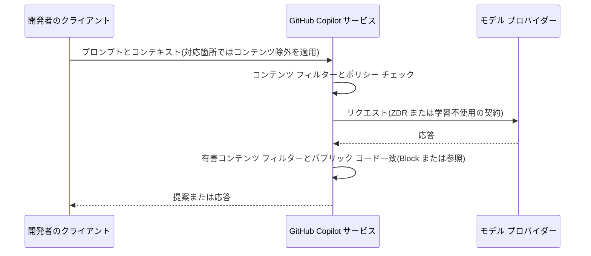
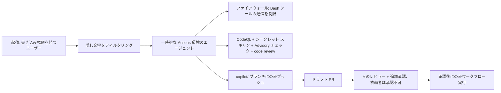

import { TLDR, DocsLinks, LastVerified, CompareTable, FlashCards } from '@components';
import { Aside, Badge } from '@astrojs/starlight/components';

<LastVerified date="2026-10" />

<TLDR>
- **Business / Enterprise:** *「GitHub は、文書による指示がない限り、Inputs または Outputs を生成 AI モデルの学習に使用しない」*(Generative AI Services Terms 第 3 条、および DPA)。Inputs の所有権もお客様に残ります。
- **Free / Pro / Pro+ / Max:** **2026 年 4 月 24 日以降**、ユーザーが**オプトアウトしない限り**、GitHub は操作データをモデルの学習に使う*可能性があります*。開発者を Business / Enterprise のシートに載せるべき最大の理由です。
- **モデル プロバイダー:** OpenAI、Anthropic(**ただし Claude Fable 5/5.1 は既定では対象外**)、Google、AWS、xAI と、ゼロ データ保持または学習不使用の契約があります。どのリクエストも GitHub のコンテンツ フィルターを通ります。
- **IP:** パブリック コード フィルターは一致を **Block** するか、**参照情報**を表示します。第三者請求に対する防御は、*お客様の契約に規定がある場合*に Outputs にも適用され、Microsoft の「Required Mitigations」が条件になります。**プレビューは対象外です。**
- **コーディング エージェント:**
  - 起動できるのは書き込み権限を持つユーザーだけです。
  - プッシュ先は `copilot/` ブランチだけです。
  - PR には人の承認が必須で、Actions ワークフローも承認されるまで実行されません。
  - ファイアウォールでインターネット アクセスを制限しています。
  - Issue やコメントの隠し文字は除去されます。
  - CodeQL、シークレット スキャン、依存関係チェックを組み込みで実行します。
</TLDR>

<Aside type="caution" title="ブースでのルール">
契約に関する質問(補償、DPA、保持期間)には、**下の文書とアカウント チームを案内**してください。法的条件を記憶で言い換えないでください。このページの回答にはすべて出典リンクがあります。
</Aside>

## ブースでよくある質問

### データと学習

GitHub は私たちのコードで AI モデルを学習しますか?

- **Copilot Business / Enterprise(ボリューム ライセンス):** 学習しません。GitHub Generative AI Services Terms 第 3 条に<em>「GitHub は、お客様から文書による指示を受けない限り、Inputs または Outputs を生成 AI モデルの学習に使用しない」</em>とあります。ドキュメントでも、データは <strong>Data Protection Agreement(DPA)</strong>で保護され、お客様の許可なくそのような利用はできないと説明されています。
- **Copilot Free / Pro / Pro+ / Max:** **学習に使われる可能性があります。** **2026 年 4 月 24 日**以降、GitHub は入力、出力、コード スニペット、関連コンテキストをモデルの学習と改善に使う*場合があります*。ユーザーは **Copilot settings →「Allow GitHub to use my data for AI model training」→ Disabled** でオプトアウトできます。Business / Enterprise のユーザーにはこの設定は表示されません。
- **Microsoft 経由で購入した場合**は、Microsoft の Product Terms for GitHub Offerings が適用されます。

Copilot が生成したコードの所有者は?

Generative AI Services Terms 第 2 条に<em>「GitHub は Inputs も Outputs も所有しない。お客様が Inputs に対して既に持つ所有権はお客様に残る」</em>とあります。

個々の Output が保護対象になるかどうかは法律の問題なので、お客様の弁護士に確認してもらいましょう。ブースでは答えないでください。

プロンプトやコードは保持されますか? 期間は?

サーフェスによって異なります。文書化されている内容は次のとおりです。

| サーフェス | 保存されるもの |
|---|---|
| Copilot CLI と Copilot app | セッションの完全な記録をローカルの `~/.copilot/session-state/` に保存します。**既定でユーザーの GitHub アカウントに同期**されます。Business / Enterprise で同期するには *Store local sessions in the Cloud* ポリシーが必要で、ない場合はローカルのみです。同期データは本人だけが見られ、**管理者は読めません**。 |
| Copilot cloud agent | **一時的な**環境で動き、終了時に破棄されます。**セッション ログは GitHub.com に残り**、リポジトリにアクセスできる人なら誰でも見られます。 |
| IDE のチャット セッション | 保存方法は IDE ごとに異なります。 |
| モデル プロバイダー | OpenAI、Anthropic(GA 機能)、xAI とはゼロ データ保持。Gemini は暗号化された永続キャッシュを**最大 24 時間**保持し、学習には一切使われません。 |

Generative AI Services Terms 第 6 条は、一部のサービスが*サービス提供のために Inputs と Outputs を保持する*こと、そして詳細は各製品のドキュメントにあることを定めています。

**サーフェスごとの正確な保持期間**は [Copilot Trust Center FAQ](https://copilot.github.trust.page/faq) にあります。記憶の数字を伝えず、その場で確認してください。

どの AI 企業がプロンプトを見ますか?

GitHub のモデル ホスティングのページによると次のとおりです。

| モデル | ホスト | コミットメント |
|---|---|---|
| OpenAI GPT ファミリー | OpenAI と GitHub の Azure インフラ | ビジネス データで学習しない、**ZDR** 契約 |
| Anthropic Claude | AWS Bedrock、Anthropic、Google Cloud | 学習しない。**GA の Anthropic 機能は ZDR。ただし Claude Fable 5/5.1 は除く** |
| Google Gemini | Google Cloud | 学習しない。永続キャッシュは 24 時間以内 |
| xAI Grok | xAI | ゼロ データ保持の API ポリシー |

すべてのリクエストと応答は、引き続き **GitHub のコンテンツ フィルター**を通ります。有害コンテンツの検出と、有効な場合はパブリック コードの一致チェックが含まれます。

Claude Fable 5 / 5.1 の注意点は?

Claude Fable 5 / 5.1 を使うと、**Anthropic は安全性分類器の運用のため、プロンプトと出力を含むデータを既定で保持します**。これらのモデルは、既定では GitHub と Anthropic の ZDR 契約の**対象外**です。

- **例外措置:** 条件を満たす Enterprise は、期間限定の例外として **2026 年末まで** ZDR を申請できます。その後は Anthropic の *Enterprise Frontier Safeguards* が必要になります。
- **有効化:** 承認後も、管理者がモデルごとに有効化する必要があります。
- **利用制限:** ZDR で Fable モデルを使うお客様は、社内業務にのみ使うことに同意します。

データの取り扱いが厳しいお客様は、例外措置を受けていない限り、モデル ポリシーでこれらのモデルを無効のままにしておきましょう。

### IP とライセンス

パブリック コード フィルターは実際に何をしますか?

インライン提案では、提案とその周辺の**約 150 文字**のコードを、**GitHub 上のパブリック リポジトリ**のインデックスと照合します。プライベート リポジトリや GitHub 外のコードはインデックスに含まれません。

ポリシーの設定は 2 つです。
- **Block:** 一致またはほぼ一致する提案を表示しません。
- **Allow:** 提案を**コード参照**(ファイル URL と検出されたライセンス)付きで表示します。Chat の応答には一致情報へのリンクが付きます。

一致は提案の **1% 未満**です。Copilot Business の既定は **Allowed** なので、Block にしたい場合は AI controls → Copilot → Privacy で変更してください。

GitHub は IP 侵害の請求から守ってくれますか(補償)?

Generative AI Services Terms 第 4 条:*「お客様の契約が第三者請求に対する防御を定めている場合、その規定は Generative AI Services の利用(Outputs を含む)にも適用される」*。

利用には **Required Mitigations**(`aka.ms/AIfilters` の Microsoft Customer Copyright Commitment の必須軽減策)も適用されます。注意点:
- **プレリリース(プレビュー)機能は Pre-Release License Terms** に従います。
- 個人プランのユーザーには、これらの条件ではなく通常の利用規約が適用されます。

<Badge text="要確認" variant="caution" /> 「補償を受けるにはパブリック コード フィルターを **Block** にする必要があるか」はよく聞かれます。正確な条件はお客様の契約で、アカウント チームと確認してください。

### コンプライアンスとデータ所在地

Copilot は GDPR に準拠していますか? データを EU や日本に留められますか?

- **DPA:** Copilot Business / Enterprise は、GA 機能と `gh.io/dpa-previews` に記載のプレビューについて、**GitHub Data Protection Agreement**(`gh.io/dpa`)の対象です。
- **データ所在地:** <strong>GitHub Enterprise Cloud with data residency(GHE.com)</strong>のリージョンは、**EU**(EFTA の Azure リージョン: ノルウェー、スイスを含む)、**オーストラリア**、**米国**、**日本**です。Copilot Business / Enterprise はここでも使えますが、設定の違いや使えない機能があります。プレビュー機能は GA まで使えない場合があります。
- **モデル推論の場所:** 確認したデータ所在地のドキュメントには、GHE.com で*モデル推論*がどこで実行されるかは書かれていません。未確認として扱い、アカウント チームに確認してください。

SOC 2 / ISO のレポートやセキュリティ FAQ はどこで入手できますか?

- **GitHub Enterprise Trust Center**(`ghec.github.trust.page`)の FAQ と「Resources」の認証資料。
- **Copilot Trust Center** の FAQ(`copilot.github.trust.page`)。
- GitHub の「承認のためのリソース」ページに、セキュリティ審査向けの資料がまとまっています。

### エージェントのセキュリティ

コーディング エージェントは main に直接プッシュしたり、自分の PR をマージしたりできますか?

**できません。** cloud agent は次のように制限されています。
- **プッシュできるのは 1 ブランチだけ:** 新しい `copilot/…` ブランチ、または @メンションされた PR のブランチ。
- <strong>単純なプッシュしかできません。</strong>任意の `git push` は実行できません。
- <strong>ルールセットに従います。</strong>ブランチ保護と必須チェックが適用されます。

ドラフト PR は**人がレビューしてマージする**必要があります。Copilot は Ready for review にすることも、承認やマージもできません。

**PR を依頼した本人はその PR を承認できず**、PR が人に帰属しない場合は**追加の承認**が必要です。

書き込み権限を持つ人が *Approve and run workflows* をクリックするまで、**Actions ワークフローは実行されません**。

悪意ある Issue コメントなどによるプロンプト インジェクションは?

GitHub が文書化している対策:
- **書き込み権限を持つユーザーだけ**がエージェントを起動できます。それ以外のユーザーのコメントがエージェントに渡ることは**ありません**。
- **隠し文字はフィルタリング**されます。たとえば Issue や PR コメント内の HTML コメントはエージェントに渡りません。
- **ファイアウォール**がインターネット アクセスを制限し、情報持ち出しのリスクを下げます。
- **オートメーション**では使えるツールを正確に選べ、書き込み権限のないユーザーのイベントは**既定で無視**されます。

正直に伝えるべき限界:
- ファイアウォールが対象にするのはエージェントの **Bash ツール**が起動したプロセスだけです。**MCP サーバー**や `copilot-setup-steps.yml` は対象外です。
- GitHub も<em>「高度な攻撃はファイアウォールを回避しうる」</em>と述べています。
- サードパーティの**スキルは GitHub の検証を受けておらず**、プロンプト インジェクションを含む可能性があります。`gh skill preview` で確認してください。
- cloud agent では **MCP ツールが承認なしで実行**されます。

エージェントは自分のコードの脆弱性をチェックしますか?

はい。既定で、しかも **GHAS ライセンスなしで**次のチェックを実行します。
- **CodeQL**
- **シークレット スキャン**
- 新しい依存関係に対する **GitHub Advisory Database** のチェック(マルウェアと High / Critical の CVE)
- セカンド オピニオンとしての **Copilot code review**

見つかった問題は完了前に修正を試み、結果はセッション ログに表示されます。管理者は個々のチェックを無効にできます。全体的なプログラムは [GHAS](/github-cheatsheet/ja/ghas/) を参照してください。

エージェントが書いたコードを見分けられますか?

はい。
- エージェントのコミットは **Copilot が作成者**、依頼した開発者が**共同作成者**になります。
- コミットは<strong>署名済み(Verified)</strong>です。
- 各コミット メッセージには**セッション ログへのリンク**が入ります。
- エージェントの活動は**監査ログ**(`actor:Copilot`)にも記録されます。

## リクエストの流れ

## コーディング エージェントのセキュリティ モデル

<CompareTable
	title="リスク → 組み込みの対策 → お客様が追加すべきこと"
	columns={[
		{ key: 'builtin', label: '組み込み(文書化済み)' },
		{ key: 'you', label: 'お客様が追加' },
	]}
	rows={[
		{ feature: '脆弱なコード / シークレット漏えい', values: { builtin: 'CodeQL、シークレット スキャン、Advisory DB チェック、code review', you: '必須チェック、リポジトリでの GHAS、人のレビュー' } },
		{ feature: '不正なプッシュ', values: { builtin: '単一の `copilot/` ブランチ、ルールセット適用、自己マージ不可', you: '必須承認付きのルールセット' } },
		{ feature: '情報の持ち出し', values: { builtin: 'Bash ツールの通信へのファイアウォール', you: '許可リストを厳しく保ち、MCP サーバーを精査(ファイアウォール対象外)' } },
		{ feature: 'プロンプト インジェクション', values: { builtin: '書き込み権限者のみ起動可、隠し文字のフィルタリング', you: 'ツール許可リスト、`preToolUse` フック、`shell` の一括事前承認をしない' } },
		{ feature: 'スキル / MCP 経由のサプライ チェーン', values: { builtin: 'Enterprise の MCP 許可リスト(マネージド設定)', you: '`gh skill preview`、バージョン固定、`.github/skills` を PR でレビュー' } },
		{ feature: '監視の欠如', values: { builtin: '署名付きコミット、セッション ログ、監査イベント', you: '監査ログを SIEM へストリーム、ローカル エージェントは OTel' } },
	]}
/>

## トーキング ポイント

- 「Business / Enterprise では、コードは学習に使われません。設定ではなく契約条件に書かれています。」
- 「個人プランは 2026 年 4 月から違います。開発者が個人の Pro アカウントで業務コードを扱っているなら、それはガバナンス上の穴です。」
- 「エージェントは自分の成果物をマージできません。すべての PR がルールセットと人のレビューを通ります。」
- 「ファイアウォールやフィルターはリスクを下げますが、ゼロにはしません。フック、ルールセット、最小権限のツールを重ねましょう。」

<FlashCards
	title="セキュリティ クイズ"
	cards={[
		{ q: 'GitHub は Copilot Business のデータで学習する?', a: 'しない。ただしお客様の文書による指示がある場合を除く(Gen AI Services Terms 第 3 条、DPA)。' },
		{ q: 'Free / Pro / Pro+ / Max のデータが学習に使われうるのはいつから(オプトアウト可)?', a: '2026 年 4 月 24 日。' },
		{ q: '既定で ZDR の対象外の Claude モデルは?', a: 'Claude Fable 5 と 5.1。' },
		{ q: 'パブリック コード チェックが照合する範囲は?', a: '提案と周辺約 150 文字のコードを、GitHub のパブリック リポジトリと照合。' },
		{ q: 'プレビューは Gen AI Services Terms の対象?', a: '対象外。Pre-Release License Terms に従う。' },
		{ q: 'cloud agent のファイアウォールが対象にしないものは?', a: 'MCP サーバーのプロセスと `copilot-setup-steps.yml` のステップ。' },
		{ q: 'cloud agent を起動できるのは?', a: 'リポジトリへの書き込み権限を持つユーザーだけ。' },
		{ q: 'GHE.com のデータ所在地リージョンは?', a: 'EU(ノルウェー、スイスを含む)、オーストラリア、米国、日本。' },
	]}
/>

<DocsLinks
	links={[
		{ label: 'GitHub Generative AI Services Terms', href: 'https://github.com/customer-terms/github-generative-ai-services-terms' },
		{ label: '個人の Copilot ポリシー管理(モデル学習のオプトアウト)', href: 'https://docs.github.com/ja/copilot/how-tos/manage-your-account/manage-policies' },
		{ label: 'GitHub Copilot のモデルのホスティング', href: 'https://docs.github.com/ja/copilot/reference/ai-models/model-hosting' },
		{ label: 'Copilot のセッション データについて', href: 'https://docs.github.com/ja/copilot/concepts/security-governance-and-network-settings/session-data' },
		{ label: 'コード参照(パブリック コードとの一致)', href: 'https://docs.github.com/ja/copilot/concepts/completions/code-referencing' },
		{ label: 'Copilot cloud agent のリスクと軽減策', href: 'https://docs.github.com/ja/copilot/concepts/security-governance-and-network-settings/risks-and-mitigations' },
		{ label: 'cloud agent のファイアウォールのカスタマイズ', href: 'https://docs.github.com/ja/copilot/how-tos/copilot-on-github/customize-copilot/customize-the-firewall' },
		{ label: '承認のためのリソース(Trust Center、DPA)', href: 'https://docs.github.com/ja/copilot/tutorials/roll-out-at-scale/govern-at-scale/resources-for-approval' },
		{ label: 'GHE.com のデータ所在地', href: 'https://docs.github.com/ja/enterprise-cloud@latest/admin/data-residency/about-github-enterprise-cloud-with-data-residency' },
		{ label: 'Copilot Trust Center FAQ', href: 'https://copilot.github.trust.page/faq' },
	]}
/>
