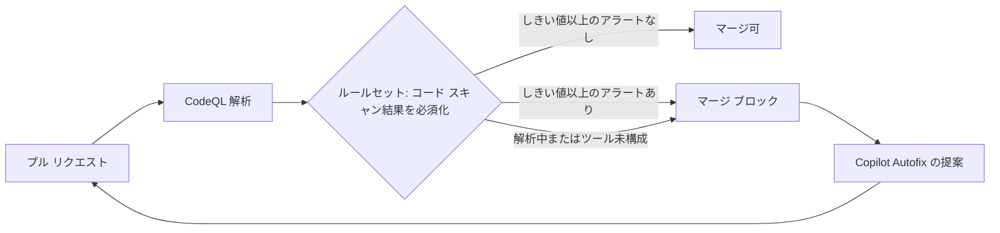

import { TLDR, DocsLinks, LastVerified, DecisionTree, YamlBuilder, CompareTable } from '@components';
import { Aside, Badge, Tabs, TabItem } from '@astrojs/starlight/components';
import codeqlBase from '../../../../snippets/ghas-codeql-base.yml?raw';

export const codeqlOptions = [
  { id: 'schedule', label: '毎週の定期スキャン', section: 'on', default: true, snippet: `schedule:
  - cron: '30 1 * * 1'`, explanation: '誰もプッシュしなくても、新しくリリースされた CodeQL クエリによるアラートを検出できます。' },
  { id: 'mergegroup', label: 'マージ キューで実行', section: 'on', snippet: 'merge_group:', explanation: 'ブランチでマージ キューとコード スキャンのマージ保護を使う場合に必要です。' },
  { id: 'concurrency', label: '古い PR 実行をキャンセル', section: 'top', snippet: `concurrency:
  group: codeql-\${{ github.ref }}
  cancel-in-progress: \${{ github.event_name == 'pull_request' }}` },
  { id: 'timeout', label: 'ジョブのタイムアウト', section: 'job', snippet: 'timeout-minutes: 120' },
  { id: 'extended', label: 'security-extended クエリ スイート', section: 'init', snippet: 'queries: security-extended', explanation: '精度がやや低いクエリも追加されるため、アラートが増えます。' },
  { id: 'config', label: 'CodeQL 構成ファイルを使用', section: 'init', snippet: 'config-file: ./.github/codeql/codeql-config.yml', explanation: 'paths-ignore、query-filters、追加パックなどに使います。CodeQL 応用ページを参照してください。' },
  { id: 'cache', label: '依存関係キャッシュ', section: 'init', snippet: 'dependency-caching: true', explanation: '高度なセットアップでは既定で無効です。依存関係の解決が速くなります。' },
  { id: 'cpp', label: 'C/C++ を手動ビルドで追加', section: 'matrix', snippet: `- language: c-cpp
  build-mode: manual` },
  { id: 'build', label: '手動ビルド ステップ', section: 'build', snippet: `- if: matrix.build-mode == 'manual'
  name: Build C/C++
  run: |
    make bootstrap
    make release`, explanation: 'build-mode: manual のマトリックス エントリでのみ実行されます。' },
];

<LastVerified date="2026-10" />

<TLDR>
- **既定のセットアップ**はトグル 1 つで有効になります。言語、クエリ スイート、トリガーは GitHub が選び、YAML は不要です。**高度なセットアップ**では `codeql.yml` ワークフローをコミットし、すべてを自分で制御します。まず既定から始め、必要なリポジトリだけ高度なセットアップに移行します。
- CodeQL は **C/C++、C#、Go、Java/Kotlin、JavaScript/TypeScript、Python、Ruby、Rust、Swift、GitHub Actions ワークフロー**に対応しています。PHP と Scala には対応していません。これらにはサードパーティ SARIF か **PR 向け AI Scan** を使います。
- **build-mode `none`** を使うと、C/C++、C#、Java、Rust をビルドなしで解析できます。既定のセットアップでは自動的に使われます。
- **Copilot Autofix** は、Copilot ライセンスなしで PR やアラートに修正案を提示します。**agentic autofix** ではアラートを Copilot に割り当てると、Copilot がドラフト PR を作成します。
- 検出結果でマージをブロックするには、**ルールセットの「Require code scanning results」**（コード スキャンのマージ保護）を使います。
</TLDR>

## ブースでよくある質問

<details>
<summary>既定のセットアップと高度なセットアップ、どちらを使うべき？</summary>

まずは全体で**既定のセットアップ**を使います。1 クリックで有効になり、Organization 全体にも展開でき、メンテナンスも不要です。次のどれかが必要なリポジトリだけ**高度なセットアップ**に切り替えます：手動ビルド、カスタム クエリ パック、構成ファイル（`paths-ignore`、クエリ フィルター）、カスタム トリガー、1 リポジトリでの複数解析（モノレポ）。下の決定木で判断できます。

</details>

<details>
<summary>Java / C# / C++ はビルドが必要ですか？</summary>

必ずしも必要ではありません。**build-mode `none`** は **C/C++、C#、Java、Rust** のソースから直接 CodeQL データベースを作成し、既定のセットアップでは自動的に使われます。トレードオフは 2 つあります。生成コードは解析されず、精度は「最高」ではなく「良好」です。**Kotlin はビルドが必要**なので、Java と Kotlin が混在するリポジトリは `autobuild` にフォールバックします。高リスクのアプリには、高度なセットアップで `manual` ビルドを使います。

</details>

<details>
<summary>PHP / Scala など CodeQL 非対応の言語を使っています。どうすれば？</summary>

選択肢は 2 つあります。

- SARIF を出力できるツール（Semgrep、Checkmarx、Snyk Code など）の結果を、コード スキャンのアラートとしてアップロードします。
- **PR 向け AI Scan** を有効にします。CodeQL が対応していない言語やフレームワークの脆弱性を見つける AI エンジンです。検出結果は**参考情報**です。PR 上に表示されますが、「Code scanning」チェックを失敗させず、ルールセットで強制もできません。利用量は Code Security AI Credits で課金されます。

</details>

<details>
<summary>重大度が高い脆弱性を含む PR をブロックできますか？</summary>

できます。**ブランチ ルールセット**で **「Require code scanning results」** を作成し、ツール（例：CodeQL）を選んで、セキュリティ アラートの重大度しきい値（例：「High 以上」）を設定します。解析の実行中や、対象リポジトリでツールが構成されていない場合も PR はブロックされます。カスタム プロパティで対象を絞れば、Organization 全体に適用できます。

</details>

<details>
<summary>サードパーティ ツールのアラートでも Copilot Autofix は使えますか？</summary>

**Copilot Autofix** が修正案を生成するのは **CodeQL** のアラートです。**agentic autofix**（アラートを Copilot に割り当てる方式）は、CodeQL を再実行して修正を検証しようとします。ただし GitHub は、サードパーティ ツールのアラート、カスタム クエリ、`security-extended` スイートについては修正を*確認できない*と明記しています。サードパーティ向けはベストエフォートと考え、**約束する前に最新の対応状況を確認**してください。

</details>

<details>
<summary>大きなリポジトリでスキャンが遅い。どう高速化できますか？</summary>

- 対応する言語では `build-mode: none` を使います。
- 高度なセットアップで `dependency-caching` を有効にします。
- **より大きなランナー**を使います。高度なセットアップでは `runs-on` を変更します。既定のセットアップでは Organization の大きなランナー <Badge text="Preview" variant="caution" /> や、`code-scanning` ラベル付きのセルフホスト ランナーを使えます。
- PR の増分解析（diff-informed と overlay）は、既定のセットアップと `codeql-action` では自動で行われます。
- 構成ファイルで生成コードやベンダー コードを除外します。ただし、ビルドするコンパイル言語には `paths-ignore` は効きません。
- モノレポは、`category` を分けた複数の解析に分割します。

</details>

<details>
<summary>CodeQL は GitHub Actions のワークフローもスキャンしますか？</summary>

はい。**GitHub Actions** は CodeQL の対応言語（`actions`）です。信頼できない入力からのスクリプト インジェクションや、`pull_request_target` の誤用などのワークフローの問題を検出します。既定のセットアップで有効にするか、高度なセットアップのマトリックスに `actions` を追加します。

</details>

## 既定のセットアップと高度なセットアップ

<CompareTable
  title="CodeQL：既定のセットアップと高度なセットアップ"
  columns={[
    { key: 'def', label: '既定のセットアップ' },
    { key: 'adv', label: '高度なセットアップ' },
  ]}
  rows={[
    { feature: 'リポジトリ内のワークフロー ファイル', category: 'セットアップ', values: { def: false, adv: '.github/workflows/codeql.yml' } },
    { feature: 'Organization 規模での有効化（セキュリティ構成）', category: 'セットアップ', values: { def: true, adv: 'リポジトリごと（または再利用可能ワークフロー / 必須ワークフロー）' } },
    { feature: '言語の自動検出', category: 'セットアップ', values: { def: true, adv: 'マトリックスに列挙' } },
    { feature: 'ビルド モード', category: 'ビルド', values: { def: 'none（不可なら autobuild）', adv: 'none / autobuild / manual' } },
    { feature: 'クエリ スイート', category: 'クエリ', values: { def: 'default または security-extended', adv: '任意のスイートやカスタム パック' } },
    { feature: 'CodeQL モデル パック', category: 'クエリ', values: { def: 'あり（Organization レベル）', adv: true } },
    { feature: '構成ファイル（paths-ignore、query-filters）', category: 'クエリ', values: { def: false, adv: true } },
    { feature: 'カスタム トリガー / スケジュール', category: 'トリガー', values: { def: 'プッシュ、PR、毎週', adv: true } },
    { feature: '1 リポジトリで複数解析（カテゴリ）', category: 'トリガー', values: { def: false, adv: true } },
    { feature: '大きなランナー / セルフホスト ランナー', category: 'ランナー', values: { def: '大きなランナー（プレビュー）、セルフホストは "code-scanning" ラベル', adv: true } },
    { feature: 'Copilot Autofix', category: '修正', values: { def: true, adv: true } },
  ]}
/>

<DecisionTree
  title="既定のセットアップか、高度なセットアップか？"
  tree={{
    start: 'lang',
    nodes: {
      lang: {
        question: '使用言語は CodeQL の対応言語ですか？（C/C++、C#、Go、Java/Kotlin、JS/TS、Python、Ruby、Rust、Swift、Actions）',
        options: [
          { label: 'はい', next: 'custom' },
          { label: 'いいえ / 一部のみ', next: 'other' },
        ],
      },
      custom: {
        question: '**カスタム クエリ パック**、**構成ファイル**（`paths-ignore`、`query-filters`）、カスタム トリガーが必要ですか？',
        options: [
          { label: 'はい', next: 'advanced' },
          { label: 'いいえ', next: 'build' },
        ],
      },
      build: {
        question: '**コンパイル言語の高リスク**アプリで、生成コードや特殊なビルドのせいで `build-mode: none` の精度が不足しますか？',
        options: [
          { label: 'はい', next: 'manual' },
          { label: 'いいえ', next: 'mono' },
        ],
      },
      mono: {
        question: 'アプリごとに解析を分けたい**モノレポ**ですか？それとも**他の CI**（Jenkins、ADO）で解析する必要がありますか？',
        options: [
          { label: 'モノレポ', next: 'advanced' },
          { label: '他の CI', next: 'cli' },
          { label: 'どちらでもない', next: 'default' },
        ],
      },
      default: {
        answer: '**既定のセットアップを使います。** セキュリティ構成で Organization 全体に有効化し、管理は GitHub に任せます。必要に応じて `security-extended` スイートを推奨設定にします。',
        links: [{ label: '既定のセットアップの構成', href: 'https://docs.github.com/ja/code-security/code-scanning/enabling-code-scanning/configuring-default-setup-for-code-scanning' }],
      },
      advanced: {
        answer: '**高度なセットアップを使います。** `codeql.yml` をコミットし、`codeql-config.yml` を参照します。モノレポでは解析ごとに別の `category` を指定します。',
        links: [{ label: '高度なセットアップの構成', href: 'https://docs.github.com/ja/code-security/code-scanning/creating-an-advanced-setup-for-code-scanning/configuring-advanced-setup-for-code-scanning' }],
      },
      manual: {
        answer: '**高度なセットアップで `build-mode: manual` を使い**、実際のビルド コマンドを指定します。最も高い精度が得られます。',
        links: [{ label: 'コンパイル言語の CodeQL', href: 'https://docs.github.com/ja/code-security/how-tos/find-and-fix-code-vulnerabilities/manage-your-configuration/codeql-for-compiled-languages' }],
      },
      cli: {
        answer: 'CI で **CodeQL CLI** を実行し、`codeql github upload-results` で SARIF をアップロードします。プライベート リポジトリでは、この場合も Code Security ライセンスが必要です。',
        links: [{ label: 'CodeQL CLI', href: 'https://docs.github.com/ja/code-security/concepts/code-scanning/codeql/codeql-cli' }],
      },
      other: {
        answer: '対応言語には CodeQL を使い、それ以外は**サードパーティ SARIF** をアップロードします。非対応言語を参考情報としてカバーするなら **PR 向け AI Scan** も検討してください。',
        links: [
          { label: 'SARIF ファイルのアップロード', href: 'https://docs.github.com/ja/code-security/how-tos/find-and-fix-code-vulnerabilities/integrate-with-existing-tools/upload-sarif-file' },
          { label: 'PR 向け AI Scan', href: 'https://docs.github.com/ja/code-security/concepts/code-scanning/ai-powered-security-detections' },
        ],
      },
    },
  }}
/>

## 対応言語

| CodeQL 言語 ID | 対象 | 既定のビルド モード |
|---|---|---|
| `actions` | GitHub Actions ワークフロー | なし（インタープリター型） |
| `c-cpp` | C、C++ | `none` |
| `csharp` | C# | `none` |
| `go` | Go | `autobuild` |
| `java-kotlin` | Java、Kotlin | `none`（Java のみ）、Kotlin があれば `autobuild` |
| `javascript-typescript` | JS、TS | なし（インタープリター型） |
| `python` | Python | なし |
| `ruby` | Ruby | なし |
| `rust` | Rust | `none` |
| `swift` | Swift（macOS ランナーが必要） | `autobuild` |

## コンパイル言語のビルド モード

| | `none` | `autobuild` | `manual` |
|---|---|---|---|
| 既定のセットアップで使用 | はい（C/C++、C#、Java、Rust） | `none` 非対応の言語 | いいえ |
| 設定なしで動作 | はい | 多くの場合 | いいえ |
| 網羅性 | 生成コードは解析されない | 状況による | 自分で制御 |
| 精度 | 良好 | 良好 | **最高** |

<Aside type="tip">
よくある展開パターン：まず全体で既定のセットアップ（`none`）を使ってバックログを素早く減らし、その後、最重要アプリを高度なセットアップの `manual` ビルドに移行します。
</Aside>

## クエリ スイート

- **`default`**：誤検知の少ない高精度なクエリです。既定のセットアップはこれを実行します。
- **`security-extended`**：`default` に、精度や重大度がやや低いクエリを加えたものです。UI では **「Extended」** と表示され、既定のセットアップでも選べます。Organization オーナーとセキュリティ マネージャーは、既定のセットアップで使うスイートを Organization 全体に*推奨*設定できます。
- **`security-and-quality`**：`security-extended` に保守性のクエリを加えたものです。高度なセットアップでのみ使えます。コード品質の指摘には GitHub Code Quality も検討してください。

## 高度なセットアップのワークフローを作る

<YamlBuilder title="CodeQL 高度なセットアップ" filename=".github/workflows/codeql.yml" base={codeqlBase} options={codeqlOptions} />

## Copilot Autofix と agentic autofix

| | Copilot Autofix | agentic autofix |
|---|---|---|
| 内容 | 1 つのアラートに対する修正案を 1 つ提示し、自分で適用する | Copilot が 1 つ以上のアラートを調査し、**ドラフト PR** を作成する |
| 有効化 | CodeQL が動く場所では既定で有効。管理者が無効化でき、設定は下位に継承される | Organization オーナーかセキュリティ マネージャーが有効化し、Enterprise が許可している必要がある |
| Copilot ライセンス | 不要 | 不要 |
| コスト | AI クレジットは消費しない | **Code Security AI Credits と Actions の実行時間** |
| EMU のユーザー名前空間 | 利用可 | 利用不可 |
| セキュリティ キャンペーンからの利用 | キャンペーン内のコード アラートで自動実行される | キャンペーンのアラートを最大 25 件まで Copilot に割り当て可能 |

## サードパーティ SARIF のアップロード

**SARIF 2.1.0** を出力するツールであれば、その結果をコード スキャンのアラートとして表示できます。ツールごとに一意の `category` を指定してください。

```yaml
- name: Run my scanner
  run: my-scanner --format sarif --output results.sarif
- name: Upload SARIF
  uses: github/codeql-action/upload-sarif@v4
  with:
    sarif_file: results.sarif
    category: my-scanner
```

ジョブには `permissions: security-events: write` が必要です。他の CI からは REST API か CodeQL CLI（`codeql github upload-results`）でアップロードすることもできます。すべてのツールのアラートが、同じ UI、ルールセット、セキュリティの概要に集約されます。

## アラートのトリアージ

- **重大度**：セキュリティ アラートには Critical / High / Medium / Low の*セキュリティ重大度*があります。それ以外のアラートは Error / Warning / Note です。
- **却下理由**：*False positive*（誤検知）、*Used in tests*（テストで使用）、*Won't fix*（修正しない）。**委任されたアラートの却下**を使うと、却下に承認を必須にできます。
- **PR 上の表示**：変更行にチェックの注釈としてアラートが表示され、Autofix の提案も一緒に表示されます。
- **ツール ステータス ページ**：言語ごとのスキャンの健全性を表示します。「アラートが消えた」ときに最初に見る場所です。

## PR チェックとマージ保護



- 設定場所は **ルールセット → Require code scanning results → ツールと、セキュリティ / アラートの重大度しきい値** です。
- マージ キューを使う場合は、ワークフローのトリガーに `merge_group` を追加します。
- **注意点：** リポジトリで構成されていないツールを必須にしたルールセットは、すべての PR をブロックします。カスタム プロパティで対象を絞り、スキャンが有効なリポジトリだけに適用してください。

## モノレポ

- 既定のセットアップは、リポジトリ全体に対して言語ごとに 1 つの解析を行います。
- 高度なセットアップでは、構成ファイルで `paths` を変えたり作業ディレクトリを変えたりして、複数のジョブ（またはマトリックス）を実行します。解析ごとに別の `category`（例：`/language:javascript-typescript;app:web`）を付けます。カテゴリが異なる結果は互いに上書きされません。
- **注意点：** カテゴリ名を変えたり削除したりすると、古い構成のアラートが残ることがあります。アラートの「Affected configurations」かツール ステータス ページから、古い構成を削除してください。

## パフォーマンスのヒント

| 手段 | メモ |
|---|---|
| `build-mode: none` | C/C++、C#、Java、Rust のビルド時間がなくなる |
| 大きなランナー | 高度なセットアップ：`runs-on` を変更。既定のセットアップ：Organization の大きなランナー（パブリック プレビュー）か、`code-scanning` ラベル付きのセルフホスト ランナー |
| `dependency-caching: true` | 高度なセットアップでは既定で無効 |
| 生成コードやベンダー コードの除外 | `paths-ignore`（インタープリター型言語と `none` モード） |
| PR の増分解析 | 既定のセットアップと `codeql-action` では diff-informed / overlay 解析が自動。他の CI で CLI を使う場合はオプトインが必要（GitHub によれば最大 10 倍高速） |
| モノレポの分割 | アプリごとにカテゴリを分けて並列ジョブで実行 |

<DocsLinks links={[
  { label: 'CodeQL コード スキャンについて', href: 'https://docs.github.com/ja/code-security/concepts/code-scanning/codeql/codeql-code-scanning' },
  { label: 'コンパイル言語の CodeQL（ビルド モード）', href: 'https://docs.github.com/ja/code-security/how-tos/find-and-fix-code-vulnerabilities/manage-your-configuration/codeql-for-compiled-languages' },
  { label: 'CodeQL クエリ スイート', href: 'https://docs.github.com/ja/code-security/concepts/code-scanning/codeql/codeql-query-suites' },
  { label: 'コード スキャンの Autofix について', href: 'https://docs.github.com/ja/code-security/concepts/code-scanning/copilot-autofix-for-code-scanning' },
  { label: 'PR 向け AI Scan', href: 'https://docs.github.com/ja/code-security/concepts/code-scanning/ai-powered-security-detections' },
  { label: 'SARIF ファイルのアップロード', href: 'https://docs.github.com/ja/code-security/how-tos/find-and-fix-code-vulnerabilities/integrate-with-existing-tools/upload-sarif-file' },
  { label: 'ルールセットで使用できるルール', href: 'https://docs.github.com/ja/repositories/configuring-branches-and-merges-in-your-repository/managing-rulesets/available-rules-for-rulesets' },
]} />
