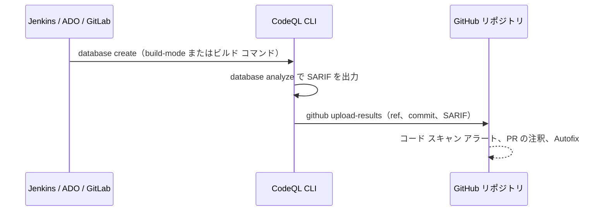

import { TLDR, DocsLinks, LastVerified, FlashCards } from '@components';
import { Aside, Badge, Tabs, TabItem } from '@astrojs/starlight/components';

<LastVerified date="2026-10" />

<TLDR>
- **CodeQL CLI** は、データベースを作成してクエリを実行し、SARIF を出力して `codeql github upload-results` でアップロードします。Jenkins、Azure Pipelines、GitLab など、どこでも使えます。プライベート リポジトリでは引き続き **Code Security** ライセンスが必要です。CLI は glibc が必要なため、Alpine など musl ベースのディストリビューションでは動きません。
- **CodeQL パック**は、クエリやライブラリをバージョン付きでまとめたものです。`codeql pack publish` で **GitHub Container registry** に公開し、`packs:` で参照します。
- **モデル パック** <Badge text="Preview" variant="caution" /> を使うと、QL を書かずに社内フレームワークやマイナーなフレームワークを CodeQL に教えられます。作成には VS Code の **CodeQL モデル エディター**を使います。
- **`codeql-config.yml`** で `paths`、`paths-ignore`、`queries`、`packs`、`query-filters` を制御します。
- **MRVA**（複数リポジトリのバリアント分析）では、VS Code から 1 つのクエリを**最大 1,000 リポジトリ**に対して実行し、同種のバグを探せます。
</TLDR>

## ブースでよくある質問

<details>
<summary>Jenkins / Azure Pipelines / GitLab CI を使っています。それでも CodeQL は使えますか？</summary>

使えます。ビルド エージェントに CodeQL バンドルをダウンロードし、`codeql database create` と `codeql database analyze` を実行して、`security_events` スコープを持つトークンで `codeql github upload-results` を使い結果を送ります。アラートは GitHub 上に表示されるので、コードは **GitHub のリポジトリ**にある必要があります。コードが Azure Repos にある場合は、Microsoft の別製品である **GitHub Advanced Security for Azure DevOps** を検討してください。

</details>

<details>
<summary>チームでカスタム クエリを書きました。全リポジトリに展開するには？</summary>

次の手順で進めます。

1. クエリをパックにします：`codeql pack init my-org/my-queries` を実行し、`.ql` ファイルを追加します。
2. `codeql test run` でテストします。
3. `codeql pack publish` で GHCR に `ghcr.io/my-org/my-queries` として公開します。
4. 高度なセットアップで参照します（ワークフローか構成ファイルの `packs:`）。

利用するリポジトリからパッケージが見えるように、可視性を設定してください。

</details>

<details>
<summary>CodeQL が社内の Web フレームワークを知らないため、テイント フローを見逃します。対策は？</summary>

**モデル パック** <Badge text="Preview" variant="caution" /> を作ります。VS Code でアプリのデータベースを対象に **CodeQL モデル エディター**を開き、フレームワークのメソッドに source、sink、summary、neutral のどれかを指定します。エディターは YAML のデータ拡張として保存します。モデル パックを公開すれば、**高度なセットアップ**と、Organization レベルの**既定のセットアップ**で使えます。モデル パックが対応する言語は C/C++、C#、Java/Kotlin、Python、Ruby、Rust です。モデル エディターの UI が対応する言語は C#、Java/Kotlin、Python、Ruby です。

</details>

<details>
<summary>テスト、ベンダー、生成コードを除外するには？</summary>

`codeql-config.yml` に `paths-ignore` を追加します。**注意点：** `autobuild` や `manual` ビルドで解析するコンパイル言語では、パス フィルターで抽出対象を絞れません。代わりにビルド対象を制御してください。パス フィルターが効くのは、インタープリター型の言語と `build-mode: none` の場合です。ファイルではなく特定のルールを抑止したいときは `query-filters` を使います。

</details>

<details>
<summary>あるリポジトリでバグのパターンを見つけました。他にもありますか？</summary>

CodeQL の VS Code 拡張機能から **MRVA** を使います。コントローラー リポジトリを選び、最大 1,000 リポジトリのリスト（自社 Organization、カスタム リスト、上位のパブリック リポジトリ）を選んでクエリを実行します。処理はコントローラー リポジトリの GitHub Actions で行われ、結果は VS Code に順次返ってきます。対象リポジトリごとに GitHub 上の CodeQL データベースが必要ですが、CodeQL コード スキャンを実行しているリポジトリには必ずあります。

</details>

<details>
<summary>これらは GitHub Enterprise Server でも使えますか？</summary>

ほぼ使えますが、注意点があります。

- GHES でのコード スキャンには、**GitHub Actions とセルフホスト ランナーの有効化**（または他の CI での CLI）が必要です。
- エアギャップ環境では、**CodeQL Action sync tool** で CodeQL アクションとバンドルを同期する必要があります。
- 新しい機能（AI 機能、一部のルール、指標）が GHES に届くのは遅れるか、届かないこともあります。お客様の GHES バージョンのリリース ノートを確認してください。執筆時点の最新は 3.22 です。

</details>

## 構成ファイルを使う高度なセットアップ

```yaml
# .github/workflows/codeql.yml
name: CodeQL
on:
  push:
    branches: [main]
  pull_request:
    branches: [main]
  schedule:
    - cron: '30 1 * * 1'
jobs:
  analyze:
    name: Analyze (${{ matrix.language }})
    runs-on: ubuntu-latest
    permissions:
      security-events: write
      packages: read        # GHCR からプライベート CodeQL パックを取得するのに必要
      actions: read
      contents: read
    strategy:
      fail-fast: false
      matrix:
        include:
          - language: java-kotlin
            build-mode: manual
          - language: javascript-typescript
            build-mode: none
    steps:
      - uses: actions/checkout@v6
      - uses: github/codeql-action/init@v4
        with:
          languages: ${{ matrix.language }}
          build-mode: ${{ matrix.build-mode }}
          config-file: ./.github/codeql/codeql-config.yml
          dependency-caching: true
      - if: matrix.build-mode == 'manual'
        run: ./mvnw -B -DskipTests package
      - uses: github/codeql-action/analyze@v4
        with:
          category: "/language:${{ matrix.language }}"
```

```yaml
# .github/codeql/codeql-config.yml
name: "Org CodeQL config"
queries:
  - uses: security-extended
packs:
  java-kotlin:
    - my-org/java-security-queries@~1.2.0   # カスタム クエリ パック（GHCR）
    - my-org/java-inhouse-models             # モデル パック
  javascript-typescript:
    - my-org/js-security-queries
paths:
  - src
paths-ignore:
  - '**/test/**'
  - '**/vendor/**'
  - '**/*.generated.ts'
query-filters:
  - exclude:
      id: js/missing-rate-limiting
  - exclude:
      tags contain: maintainability
```

<Aside type="tip">
`init` ステップに `config: |` で構成をインラインで書くことも、別のリポジトリから読み込むこと（`config-file: org/repo/path/codeql-config.yml@main`）もできます。後者を使えば、1 つの中央の構成を多数のリポジトリで共有できます。
</Aside>

## CodeQL パック

<Tabs>
<TabItem label="クエリ パック">

```yaml
# qlpack.yml
name: my-org/java-security-queries
version: 1.2.0
dependencies:
  codeql/java-all: "*"
```

```bash
codeql pack install          # 依存関係を解決
codeql test run tests/       # クエリの単体テスト
codeql pack publish          # ghcr.io/my-org/java-security-queries に公開
```

</TabItem>
<TabItem label="モデル パック（プレビュー）">

```yaml
# qlpack.yml: library: true、依存関係なし、extensionTargets が 1 つ以上
name: my-org/java-inhouse-models
version: 0.1.0
library: true
extensionTargets:
  codeql/java-all: "*"
dataExtensions:
  - models/**/*.yml
```

`models/` 以下のファイルはモデル エディターが生成します。各ファイルはデータ拡張で、フレームワークのメソッドの source、sink、summary を宣言します。

</TabItem>
</Tabs>

- パックは **GHCR 上のコンテナー パッケージ**として保存され、そのレジストリの権限と可視性に従います。プライベート パックを取得するワークフローには `packages: read` が必要です。
- スキャンの再現性のため、パックのバージョンは semver の範囲（`@~1.2.0`）で固定します。
- 組み込みのスイートは GitHub のパックの中にあります。例：`codeql/java-queries:codeql-suites/java-security-extended.qls`。

## 他の CI システムでの CodeQL CLI



```bash
# 任意の CI エージェントでの例（Linux、glibc）
codeql database create codeql-db \
  --language=java-kotlin --build-mode=none --source-root=.

codeql database analyze codeql-db \
  codeql/java-queries:codeql-suites/java-security-extended.qls \
  --format=sarif-latest --output=results.sarif \
  --sarif-category=java

GITHUB_TOKEN="$CODEQL_UPLOAD_TOKEN" codeql github upload-results \
  --repository=my-org/my-repo \
  --ref=refs/heads/main \
  --commit="$GIT_COMMIT" \
  --sarif=results.sarif
```

- PR を解析する場合は `--ref=refs/pull/<n>/head`（または `merge`）でアップロードすると、結果が PR に表示されます。
- CLI を自分で実行するときは、PR スキャンを速くするために**増分解析**（diff-informed と overlay）を有効にします。GitHub によれば最大 10 倍高速になります。`codeql-action` と既定のセットアップでは自動です。
- 複数の言語をまとめてスキャンするには `--db-cluster --language=java-kotlin,javascript-typescript` を使います。

## バリアント分析（MRVA）

| 項目 | 詳細 |
|---|---|
| 実行場所 | CodeQL の VS Code 拡張機能 |
| 規模 | 1 回の実行で最大 1,000 リポジトリ |
| 計算資源 | 自分で選んだ**コントローラー リポジトリ**の GitHub Actions |
| 対象 | GitHub 上に CodeQL データベースがあるリポジトリ（CodeQL コード スキャンを使う全リポジトリ、および上位数千のパブリック リポジトリ） |
| 主な用途 | セキュリティ研究者がバグを見つけ、クエリを書いて、Organization 全体で同種のバグを探す |

## GHES での Code Security

- ライセンスの仕組みは同じです。アクティブ コミッター単位で、Secret Protection と Code Security は別製品です。
- **要件：** Actions の有効化と、十分な CPU / メモリを持つランナーが必要です（「Hardware resources for CodeQL」を参照）。既定のセットアップも、`code-scanning` ラベル付きのセルフホスト ランナーを使えば GHES で動きます。
- **オフライン環境：** CodeQL Action sync tool で GitHub.com から新しい CodeQL バンドルを取り込むか、**GitHub Connect** を有効にしてアクションを自動でダウンロードします。
- **機能の遅れ：** AI Scan、agentic autofix、プレビュー中のルールを約束する前に、各 GHES リリースのリリース ノートで GitHub.com との差を確認してください。

<FlashCards
  title="CodeQL 応用クイズ"
  cards={[
    { q: 'CodeQL パックの公開先は？', a: '**GitHub Container registry**（GHCR）。`codeql pack publish` で公開します。' },
    { q: 'プライベート パックの取得にワークフローが必要とする権限は？', a: '`packages: read`' },
    { q: 'モデル パックの条件は？', a: '`library: true`、依存関係なし、`extensionTargets`、`dataExtensions` の YAML ファイル。' },
    { q: 'MRVA 1 回で対象にできるリポジトリ数の上限は？', a: '**1,000**' },
    { q: 'autobuild でビルドする Java に `paths-ignore` は効く？', a: 'いいえ。ビルドするコンパイル言語では、パス フィルターで抽出対象を絞れません。' },
    { q: 'CodeQL CLI は Alpine で動く？', a: 'いいえ。glibc が必要なので、glibc を使わない Linux ディストリビューションは非対応です。' },
  ]}
/>

<DocsLinks links={[
  { label: 'CodeQL CLI', href: 'https://docs.github.com/ja/code-security/concepts/code-scanning/codeql/codeql-cli' },
  { label: 'CodeQL パックの作成と利用', href: 'https://docs.github.com/ja/code-security/tutorials/customize-code-scanning/create-and-work-with-codeql-packs' },
  { label: 'CodeQL モデル エディターの使用', href: 'https://docs.github.com/ja/code-security/how-tos/find-and-fix-code-vulnerabilities/scan-from-vs-code/use-the-model-editor' },
  { label: '複数リポジトリのバリアント分析', href: 'https://docs.github.com/ja/code-security/concepts/code-scanning/multi-repository-variant-analysis' },
  { label: 'CodeQL CLI での増分解析', href: 'https://docs.github.com/ja/code-security/how-tos/find-and-fix-code-vulnerabilities/scan-from-the-command-line/incremental-analysis' },
  { label: 'コンパイル言語の CodeQL', href: 'https://docs.github.com/ja/code-security/how-tos/find-and-fix-code-vulnerabilities/manage-your-configuration/codeql-for-compiled-languages' },
  { label: 'SARIF ファイルのアップロード', href: 'https://docs.github.com/ja/code-security/how-tos/find-and-fix-code-vulnerabilities/integrate-with-existing-tools/upload-sarif-file' },
]} />
