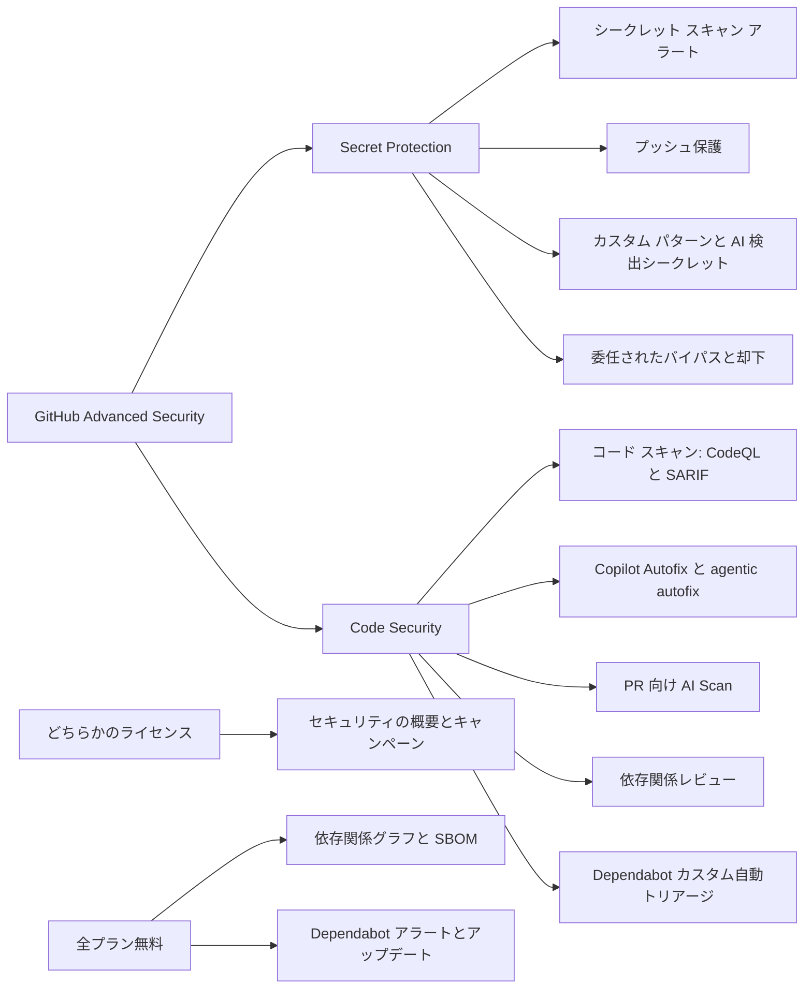

import { TLDR, DocsLinks, LastVerified, CompareTable } from '@components';
import { Aside, Badge, LinkCard, CardGrid } from '@astrojs/starlight/components';

<LastVerified date="2026-10" />

<TLDR>
- **2025 年 4 月**以降、GHAS は **2 つの独立した製品**として販売されています。**GitHub Secret Protection** は、シークレット スキャン、プッシュ保護、AI 検出シークレット、カスタム パターン、委任されたバイパスを含みます。**GitHub Code Security** は、CodeQL コード スキャン、Copilot Autofix、AI Scan、依存関係レビュー、Dependabot のカスタム自動トリアージ ルール、セキュリティ キャンペーンを含みます。
- どちらも **GitHub Team** と **GitHub Enterprise**（Cloud / Server）で購入でき、GitHub Enterprise はもう必須ではありません。課金は**ユニークなアクティブ コミッター**（過去 90 日以内にプッシュした人）単位です。GitHub App として動くボットはカウントされません。
- **パブリック リポジトリでは無料**で使えるもの：コード スキャン、CodeQL CLI、Copilot Autofix、シークレット スキャン、プッシュ保護。**全プランで無料**のもの：依存関係グラフ、Dependabot アラート、セキュリティ アップデート、バージョン アップデート、SBOM エクスポート。
- エージェントやスキャナーとして動く AI 機能（**PR 向け AI Scan** と **agentic autofix**）は、**Code Security AI Credits** として別途課金されます。従来の **Copilot Autofix は Copilot ライセンス不要**で、AI クレジットも消費しません。
- どこから始めるか迷ったら、**無料のシークレット リスク評価**（とコード セキュリティ リスク評価）を実行し、まず **Secret Protection とプッシュ保護**を有効にします。
</TLDR>

<Aside type="caution" title="価格について">
コミッターあたりの価格を記憶で答えないでください。最新の価格ページを案内します：[github.com/enterprise/advanced-security](https://github.com/enterprise/advanced-security#pricing)
</Aside>

## ブースでよくある質問

今でも「GHAS」をバンドルで買う必要がありますか？

いいえ。2025 年 4 月以降、**Secret Protection** と **Code Security** を個別に購入でき、両方購入することもできます。リポジトリ単位で有効化できるので、必要な場所でだけライセンスを消費します。既存の GHAS 契約には両方が含まれます。

購入に GitHub Enterprise は必要ですか？

いいえ。**GitHub Team** でも、GitHub Enterprise Cloud / Server でも購入できます。GitHub Free と Pro のアカウントで使えるのは、パブリック リポジトリ向けの機能だけです。

課金の仕組みは？誰がコミッターとしてカウントされますか？

製品が有効なリポジトリに過去 **90 日**以内にコミットをプッシュした**ユニークなアクティブ コミッター**ごとに課金されます。複数のリポジトリにコミットしていても 1 人として数えます。GitHub App のボットは対象外です。GitHub Enterprise Importer で移行した場合は、移行*後*にプッシュされたコミットだけが対象です。AI Scan と agentic autofix は **Code Security AI Credits** として別に従量課金され、Copilot に含まれる AI クレジットの枠があればそこから先に消費されます。

Copilot Autofix に Copilot ライセンスは必要ですか？

不要です。**Copilot Autofix** は Code Security の一部で、CodeQL が動いている場所では既定で有効になっており、AI クレジットも消費しません。アラートを Copilot に割り当てるとドラフト PR を作成する **agentic autofix** も Copilot ライセンスは不要です。ただし、Code Security AI Credits と Actions の実行時間を消費し、Enterprise Managed Users（EMU）のユーザー名前空間では使えません。

購入前に無料で試せるものは？

Team / Enterprise の Organization では、無料の**リスク評価**を実行できます。

- **シークレット リスク評価**は Organization 全体をスキャンし、漏えいしているシークレットと、そのうちプッシュ保護で防げた件数を示します。
- **コード セキュリティ リスク評価**は、アクティブなリポジトリ上位 20 個までをスキャンし、Copilot Autofix で修正できる件数を示します。

Dependabot のアラートとアップデート、依存関係グラフ、SBOM エクスポートは全プランで無料です。

「GitHub Advanced Security for Azure DevOps」と同じものですか？

いいえ。GHAS for Azure DevOps は Microsoft の別製品で、Azure DevOps 側で構成と課金を行います。このページで扱う GitHub の製品は、GitHub.com、GHE.com、GHES で動作します。

## 全体像

## どこで何が使えるか

<CompareTable
  title="Secret Protection と Code Security：提供範囲"
  columns={[
    { key: 'product', label: '製品 / SKU' },
    { key: 'pub', label: 'パブリック リポジトリ（無料）' },
    { key: 'priv', label: 'プライベート / 内部リポジトリ' },
  ]}
  rows={[
    { feature: 'シークレット スキャン（プロバイダー パターン）', category: 'Secret Protection', values: { product: 'Secret Protection', pub: true, priv: 'Secret Protection が必要' } },
    { feature: 'プッシュ保護（リポジトリ）', category: 'Secret Protection', values: { product: 'Secret Protection', pub: true, priv: 'Secret Protection が必要' } },
    { feature: 'AI 検出（汎用）シークレット', category: 'Secret Protection', values: { product: 'Secret Protection', pub: false, priv: 'Secret Protection が必要' } },
    { feature: 'カスタム パターン', category: 'Secret Protection', values: { product: 'Secret Protection', pub: false, priv: 'Secret Protection が必要' } },
    { feature: 'プッシュ保護の委任されたバイパス', category: 'Secret Protection', values: { product: 'Secret Protection', pub: false, priv: 'Secret Protection が必要' } },
    { feature: 'ユーザー向けプッシュ保護（アカウント単位）', category: 'Secret Protection', values: { product: '無料・既定で有効', pub: true, priv: 'パブリック リポジトリのみ対象' } },
    { feature: 'コード スキャン（CodeQL / サードパーティ SARIF）', category: 'Code Security', values: { product: 'Code Security', pub: true, priv: 'Code Security が必要' } },
    { feature: 'CodeQL CLI', category: 'Code Security', values: { product: 'Code Security', pub: true, priv: 'Code Security が必要' } },
    { feature: 'Copilot Autofix', category: 'Code Security', values: { product: 'Code Security', pub: true, priv: 'Code Security が必要' } },
    { feature: 'PR 向け AI Scan', category: 'Code Security', values: { product: 'Code Security + AI Credits', pub: 'Organization 所有のパブリック', priv: 'Code Security が必要' } },
    { feature: '依存関係レビュー', category: 'Code Security', values: { product: 'Code Security', pub: true, priv: 'Code Security が必要' } },
    { feature: 'Dependabot カスタム自動トリアージ ルール', category: 'Code Security', values: { product: 'Code Security', pub: true, priv: 'Code Security が必要' } },
    { feature: 'セキュリティ キャンペーン', category: 'どちらか', values: { product: 'Secret Protection または Code Security', pub: false, priv: 'どちらかが必要' } },
    { feature: 'セキュリティの概要（全ダッシュボード）', category: 'どちらか', values: { product: 'Secret Protection または Code Security', pub: false, priv: 'どちらかが必要' } },
    { feature: '依存関係グラフと SBOM エクスポート', category: '全プラン', values: { product: '無料', pub: true, priv: true } },
    { feature: 'Dependabot アラート / セキュリティ・バージョン アップデート', category: '全プラン', values: { product: '無料', pub: true, priv: true } },
    { feature: 'シークレット / コード セキュリティのリスク評価', category: '全プラン', values: { product: '無料（Team / Enterprise の Organization）', pub: true, priv: true } },
  ]}
/>

| | GitHub Free / Pro | GitHub Team | GitHub Enterprise Cloud | GitHub Enterprise Server |
|---|---|---|---|---|
| Secret Protection / Code Security の購入 | ❌（パブリックのみ） | ✅ | ✅ | ✅（機能は GHES のバージョンに依存） |

<Aside type="note">
「About GitHub Advanced Security」の一覧表では、ライセンスのないパブリック リポジトリで依存関係レビューは利用不可と記載されています。一方、依存関係レビュー機能のページではパブリック リポジトリが対象に含まれています。お客様に約束する前にドキュメントを確認してください。
</Aside>

## このセクションのページ

<CardGrid>
  <LinkCard title="コード スキャン" description="既定と高度なセットアップ、ビルド モード、Autofix、SARIF、マージ保護。" href="/github-cheatsheet/ja/ghas/code-scanning/" />
  <LinkCard title="シークレット スキャンとプッシュ保護" description="アラート、バイパスの流れ、カスタム パターン、AI 検出、有効性チェック。" href="/github-cheatsheet/ja/ghas/secret-scanning/" />
  <LinkCard title="サプライチェーン（Dependabot）" description="dependabot.yml、自動トリアージ、依存関係レビュー、SBOM。" href="/github-cheatsheet/ja/ghas/supply-chain/" />
  <LinkCard title="大規模展開" description="セキュリティ構成、セキュリティの概要、キャンペーン、指標。" href="/github-cheatsheet/ja/ghas/rollout-at-scale/" />
  <LinkCard title="CodeQL 応用" description="CLI、カスタム パック、構成ファイル、モデル パック、MRVA、他の CI。" href="/github-cheatsheet/ja/ghas/codeql-advanced/" />
</CardGrid>

## トーキング ポイント

- **「シフトレフト、ただしまず予防を」。** プッシュ保護はシークレットが漏れる*前に*止めます。漏れた後のトリアージより、はるかに低コストです。
- **「見つけるだけでなく直す」。** Copilot Autofix とセキュリティ キャンペーンが目指すのは、修正までの平均時間の短縮です。アラートを積み上げることではありません。
- **「開発者のワークフローの中で」。** 結果は別のポータルではなく、PR の中、つまり開発者の普段の作業の流れに表示されます。

<DocsLinks links={[
  { label: 'GitHub Advanced Security について', href: 'https://docs.github.com/ja/get-started/learning-about-github/about-github-advanced-security' },
  { label: 'GitHub Advanced Security のライセンス課金', href: 'https://docs.github.com/ja/billing/concepts/product-billing/github-advanced-security' },
  { label: 'GitHub のセキュリティ機能', href: 'https://docs.github.com/ja/code-security/getting-started/github-security-features' },
  { label: 'コード スキャンの Autofix について', href: 'https://docs.github.com/ja/code-security/concepts/code-scanning/copilot-autofix-for-code-scanning' },
  { label: 'シークレット リスク評価', href: 'https://docs.github.com/ja/code-security/concepts/secret-security/secret-security-with-github' },
]} />
