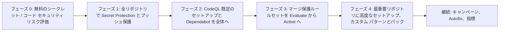

import { TLDR, DocsLinks, LastVerified, DecisionTree } from '@components';
import { Aside, Badge, Steps } from '@astrojs/starlight/components';

<LastVerified date="2026-10" />

<TLDR>
- 機能の有効化には**セキュリティ構成**を使います。設定をまとめて名前を付け、多数のリポジトリに Organization または Enterprise レベルで適用する仕組みです。**GitHub 推奨**構成から始め、**強制**してリポジトリ管理者が機能をオフにできないようにします。
- 展開の順序：
  1. 無料の**リスク評価**を実行する。
  2. 全リポジトリで **Secret Protection とプッシュ保護**を有効にする。
  3. **CodeQL の既定のセットアップ**を有効にする。
  4. 最重要リポジトリを**高度なセットアップ**に移行する。
- `business-criticality` や `data-classification` などの**カスタム プロパティ**で、構成、ルールセット、キャンペーンの対象を絞ります。
- 既存のバックログは**セキュリティ キャンペーン**で減らします。キャンペーンでは Copilot Autofix が自動実行され、コード アラートを最大 25 件まで Copilot に割り当てられます。
- アラートの件数だけでなく、**予防**（プッシュ保護によるブロック、マージ前に修正された PR のアラート）と **MTTR** を測ります。
</TLDR>

## ブースでよくある質問

リポジトリが 5,000 個あります。リポジトリごとにチケットを切らずに有効化するには？

「本番アプリ」や「サンドボックス」のように、1 つ以上の**セキュリティ構成**を作成します。そのうえで：

- 全リポジトリ、またはカスタム プロパティや可視性などで絞り込んだリポジトリに適用します。
- 1 つを**新規リポジトリの既定**に設定します。
- **強制**して、リポジトリ管理者が上書きできないようにします。

推奨 CodeQL クエリ スイートや AI 検出シークレットなどのグローバル設定は、その上に重ねて設定します。Enterprise オーナーは Enterprise レベルで構成を作成し、複数の Organization に適用できます。

全部有効にしたら、開発者がアラートに埋もれませんか？

だからこそ順序が大事です。

- プッシュ保護が対象にするのは**新しい**シークレットだけなので、バックログは増えません。
- CodeQL の `default` スイートの結果は高精度です。
- PR 上のコード スキャン アラートは、**変更された行**だけが対象です。

過去のバックログは、セキュリティ チームが厳選した**キャンペーン**で別に対応します。初日から全開発者に投げないでください。

効果はどこで確認できますか？

Organization / Enterprise の**セキュリティの概要**を開きます。

- **Overview** タブには、検出・修正・予防の傾向が表示されます。
- **Risk** と **Coverage** のビューでは、どのリポジトリでどの機能が足りないかが分かります。
- **Code scanning on pull requests** レポートには、マージ前に捕捉したアラート、Autofix の採用率、Autofix の有無別の MTTR が表示されます。
- 機能ごとのアラート ビューもあります。

すべて CSV にエクスポートできます。

キャンペーンと Copilot はどう連携しますか？

組み込みのテンプレートか、「重要リポジトリの SQL インジェクションすべて」のようなフィルターで、関連するアラートのまとまりを選びます。次に期限と窓口担当者を決めます。開発者には普段のワークフローの中で通知が届きます。キャンペーン内のコード アラートでは **Copilot Autofix** が自動で実行されます。**agentic autofix** が有効なら、コード スキャン アラートを最大 25 件まで Copilot に割り当てられ、Copilot がドラフト PR を作成します。シークレット スキャン アラートのキャンペーンは <Badge text="Preview" variant="caution" /> です。

安全でないコードのマージを Organization 全体で止めるには？

カスタム プロパティで対象を絞った **Organization ルールセット**で、次のルールを組み合わせます。

- **Require code scanning results**：重大度がしきい値を超えるアラートがあればマージをブロックします。
- **Require secret scanning alerts are resolved** <Badge text="Preview" variant="caution" />。
- **Require status checks**：依存関係レビューのワークフローなどを必須にします。

強制する前に、**Evaluate** モード（GitHub Enterprise）で、何がブロック*される予定か*を確認してください。

経営層に ROI をどう示せば？

次の 4 つを示します。

- **防いだシークレット**：バイパスされなかったプッシュ保護のブロック件数。
- **防いだ脆弱性**：マージ前に修正された PR のアラート。
- **MTTR の推移**：Autofix ありとなしの比較。
- **バックログの消化**：キャンペーンによる減少。

展開の前後でシークレット リスク評価の結果を比べます。

## 段階的な展開

<Steps>

1. **評価：** 無料のリスク評価を実行し、所有者、重要度、インターネット公開の有無などを**カスタム プロパティ**で棚卸しします。
2. **パイロット：** 協力的なチームを 2〜3 つ選び、カスタム パターンと、委任されたバイパスのレビュー担当者を調整します。
3. **予防：** **強制**したセキュリティ構成で、Organization 全体にプッシュ保護を有効化します。バイパス率は見える化しておきます。
4. **検出：** 既定のセットアップと依存関係レビューを有効化し、マージ保護のルールセットを Evaluate モードで追加します。
5. **修正：** 最もリスクの高いアラート（critical / high、インターネット公開、active なシークレット）にキャンペーンを実施し、Autofix を活用します。
6. **深化：** 高リスクのリポジトリを高度なセットアップ（手動ビルド、`security-extended`、カスタム パック）に移行します。

</Steps>

## セキュリティ構成チートシート

| 概念 | ポイント |
|---|---|
| **GitHub 推奨**構成 | 推奨機能を有効にする既製の構成。最も早く始められる |
| カスタム構成 | 機能を個別に選ぶ：シークレット スキャン、プッシュ保護、AI 検出シークレット、有効性チェック、CodeQL 既定のセットアップ、Dependabot、依存関係レビューなど |
| 強制 | 強制した構成は、リポジトリ管理者が変更できない |
| 新規リポジトリの既定 | 可視性ごと（パブリック、プライベートと内部）に設定できる |
| 構成ステータス | 各リポジトリに attached、enforced、failed、removed などが表示される。「有効にならない」ときはまずここを確認 |
| グローバル設定 | Organization 全体の動作（推奨クエリ スイート、AI 検出シークレット、バイパスや却下ができる人など） |
| Enterprise レベルの構成 | Enterprise オーナーが作成し、複数の Organization に適用する |
| 本番コンテキスト | Microsoft Defender for Cloud、JFrog Artifactory、CI/CD のデプロイ データと連携し、実際にデプロイされているコードのアラートを優先できる |

<Aside type="caution" title="ライセンスの注意点">
Secret Protection や Code Security を含む構成をプライベート リポジトリに適用すると、そのリポジトリのアクティブ コミッター分の**ライセンスを消費**します。「すべてに適用」を押す前に、ライセンス ページで残数を確認してください。
</Aside>

## 開発者中心の修正文化

- **作業の流れの中で直す。** PR の注釈と Autofix の提案は、PDF のレポートより効果的です。
- **小さく、厳選して依頼する。** 期限付きで関連アラート 20 件のキャンペーンは、4,000 件のリストより効果的です。
- **バイパスを不可能にせず、見える化する。** 素早く対応するレビュー担当者と委任されたバイパスを組み合わせれば、信頼を保てます。
- 各チームの**セキュリティ チャンピオン**が、キャンペーンの窓口担当者を務めます。
- アラート件数ではなく、**予防の指標**を評価します。

## 成果の測り方

| 指標 | 確認場所 | 望ましい方向 |
|---|---|---|
| カバレッジ（各機能が有効なリポジトリの割合） | セキュリティの概要 → Coverage | ↑ |
| プッシュ保護によるブロック件数 / バイパス率 | セキュリティの概要 → シークレット スキャン / プッシュ保護の指標 | ブロック ↑、バイパス ↓ |
| PR で捕捉した脆弱性 | セキュリティの概要 → Code scanning on pull requests | ↑ |
| Autofix の採用率 | 同上のレポート | ↑ |
| MTTR（Autofix あり / なし） | 同上のレポート / CSV エクスポート | ↓ |
| 既定ブランチのオープンな critical / high アラート | セキュリティの概要 → Overview / Risk | ↓ |
| キャンペーンの完了率 | キャンペーンの追跡画面 | ↑ |

## どこから始めるか

<DecisionTree
  title="お客様の質問：どこから始めればいい？"
  tree={{
    start: 'q1',
    nodes: {
      q1: {
        question: 'Secret Protection か Code Security のライセンスをすでにお持ちですか？',
        options: [
          { label: 'いいえ、検討中', next: 'assess' },
          { label: 'はい', next: 'q2' },
        ],
      },
      assess: {
        answer: '**無料のシークレット リスク評価**（と、最大 20 リポジトリが対象のコード セキュリティ リスク評価）を実行します。「防げた漏えい（preventable leaks）」の件数をビジネス ケースに使います。Secret Protection は多くの場合、最も早く成果が出ます。',
        links: [{ label: 'シークレット リスク評価', href: 'https://docs.github.com/ja/code-security/concepts/secret-security/secret-security-with-github' }],
      },
      q2: {
        question: '全リポジトリでプッシュ保護を強制していますか？',
        options: [
          { label: 'いいえ', next: 'pp' },
          { label: 'はい', next: 'q3' },
        ],
      },
      pp: {
        answer: 'まずそこからです。シークレット スキャンとプッシュ保護を含む**セキュリティ構成**を作成し、**強制**して、新規リポジトリの既定にします。コンプライアンス上、承認が必要なら**委任されたバイパス**を追加します。',
        links: [{ label: 'セキュリティ機能の大規模な有効化', href: 'https://docs.github.com/ja/code-security/concepts/security-at-scale/organization-security' }],
      },
      q3: {
        question: 'CodeQL の既定のセットアップを広く有効にしていますか？',
        options: [
          { label: 'いいえ', next: 'cq' },
          { label: 'はい', next: 'q4' },
        ],
      },
      cq: {
        answer: '構成に **CodeQL の既定のセットアップ**と依存関係レビューを追加し、重要なアプリから順に、カスタム プロパティを使って展開します。',
      },
      q4: {
        question: '既存のバックログは大きいですか？',
        options: [
          { label: 'はい', next: 'camp' },
          { label: 'いいえ / 管理できている', next: 'gate' },
        ],
      },
      camp: {
        answer: '対象を絞った**セキュリティ キャンペーン**（例：インターネット公開リポジトリの critical / high）を実施し、**Copilot Autofix** と agentic autofix を活用します。MTTR はセキュリティの概要で追跡します。',
        links: [{ label: 'セキュリティ キャンペーンについて', href: 'https://docs.github.com/ja/code-security/concepts/security-at-scale/about-security-campaigns' }],
      },
      gate: {
        answer: '**マージ保護ルールセット**（コード スキャン結果、シークレット アラートの解決）を追加します。まず Evaluate モードで確認してから強制します。最重要リポジトリは**高度なセットアップ**に移行します。',
      },
    },
  }}
/>

<DocsLinks links={[
  { label: 'セキュリティ機能の大規模な有効化', href: 'https://docs.github.com/ja/code-security/concepts/security-at-scale/organization-security' },
  { label: 'セキュリティの概要', href: 'https://docs.github.com/ja/code-security/concepts/security-at-scale/security-overview' },
  { label: 'セキュリティ キャンペーンについて', href: 'https://docs.github.com/ja/code-security/concepts/security-at-scale/about-security-campaigns' },
  { label: 'PR でのコード スキャン（指標）', href: 'https://docs.github.com/ja/code-security/concepts/code-scanning/code-scanning-on-pull-requests' },
  { label: 'カスタム プロパティ', href: 'https://docs.github.com/ja/organizations/managing-organization-settings/managing-custom-properties-for-repositories-in-your-organization' },
  { label: 'ルールセットについて', href: 'https://docs.github.com/ja/repositories/configuring-branches-and-merges-in-your-repository/managing-rulesets/about-rulesets' },
]} />
