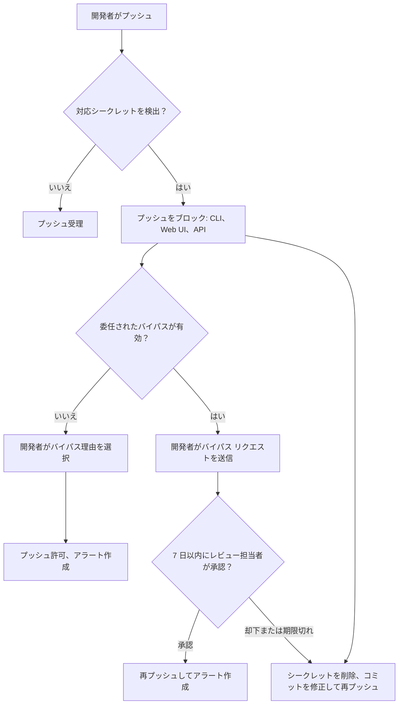

import { TLDR, DocsLinks, LastVerified, FlashCards, CompareTable } from '@components';
import { Aside, Badge, Steps } from '@astrojs/starlight/components';

<LastVerified date="2026-10" />

<TLDR>
- **シークレット スキャン**は、すでにリポジトリにあるシークレットを見つけます。対象は Git の全履歴、Issue、PR、Discussions、Wiki です。**プッシュ保護**は、新しいシークレットが入り込む*前に*ブロックします。まず予防を提案してください。
- 検出されるシークレットは 3 種類です。**プロバイダー パターン**は GitHub のパートナー プログラム由来で、有効性チェックが可能です。**カスタム パターン**は独自の正規表現で、Copilot に生成させることもできます。**汎用**シークレットは、非プロバイダー パターン（秘密鍵など）か AI（パスワードなど）で検出され、別のリストに表示されます。
- **委任されたバイパス**は「クリックでバイパス」を「承認の依頼」に変えます。アラートのクローズについては、**委任されたアラートの却下**が同じ役割を果たします。
- パブリック リポジトリでは、スキャンとプッシュ保護が無料です。**ユーザー向けプッシュ保護**は全アカウントで既定で有効で、パブリック リポジトリへのプッシュを対象にします。Organization 全体の**シークレット リスク評価**も無料です。
- シークレットが漏れたら、**まずローテーション**します。Git 履歴のクリーンアップはその後です。
</TLDR>

## ブースでよくある質問

シークレット スキャンのアラートとプッシュ保護の違いは？

- **アラート**は事後検出です。有効化した時点で Git の全履歴をスキャンし、その後のすべてのプッシュもスキャンします。Issue / PR のタイトル・本文・コメント、Discussions、Wiki、シークレット Gist も対象です。
- **プッシュ保護**は予防です。対応するシークレットが含まれていれば、`git push`、Web UI でのコミットやアップロード、対応する REST API 呼び出しをブロックします。

プッシュ保護をバイパスするとアラートが作成されます。そのアラートは `bypassed: true` でフィルターすると表示されます。

開発者は「バイパス」をクリックするだけで通せますか？

既定では通せます。開発者は理由を選びます：*テストで使用*、*誤検知*、*後で修正*。そのプッシュは成功し、アラートが作成されます。**委任されたバイパス**を有効にすると、指定したロール・チーム・ユーザーだけがバイパスできます。それ以外の人は**バイパス リクエストを送信**する必要があり、リクエストはレビューされないまま **7 日で期限切れ**になります。ボットなどに完全な除外を付与することもできます。

社内独自のトークン形式も検出できますか？

できます。リポジトリ、Organization、Enterprise の各レベルで**カスタム パターン**を定義します。正規表現は自分で書くこともでき、シークレットの説明を自然言語で書けば（例の文字列は任意）**Copilot が正規表現を生成**することもできます。必ず最初に **Save and dry run** を実行してください。アラートを作成せずに、最大 1,000 件のサンプル一致が表示されます。パターンを公開した後、**そのパターンでプッシュ保護を有効化**できます。

どのパターンにも一致しない、普通のパスワードは？

**AI 検出シークレット**（汎用シークレット検出）を使います。AI モデルがパスワードのような非構造的な資格情報を見つけます。誤検知率が高めなので、結果は別の **Generic** アラート リストに入ります。利用には有効化が必要で、Secret Protection も必要です。なお、ルールセットの「Require secret scanning alerts are resolved」ルールは AI 検出シークレットを**対象外**としています。

漏れたシークレットのうち、まだ危険なものはどう見分けますか？

**有効性チェック**を有効にします。GitHub はパートナー パターンのシークレットを定期的にプロバイダーに照会し、*active*、*inactive*、*unknown* のラベルを付けます。active なものから優先してトリアージできます。**拡張メタデータ チェック**を使うと、一部のトークン種別で所有者やスコープの情報も表示されます <Badge text="Preview" variant="caution" />。

無料で使えるものは？

いくつかあります。

- **パブリック リポジトリ**でのシークレット スキャンとプッシュ保護。
- **ユーザー向けプッシュ保護**。既定で有効なアカウント設定で、*あらゆる*パブリック リポジトリへの自分のプッシュをブロックします。アラートが作成されるのは、リポジトリ側でもプッシュ保護が有効な場合だけです。
- **シークレット リスク評価**。Team / Enterprise の Organization 向けの、その時点での一括スキャンです。
- **パートナー アラート**。パブリック コンテンツでの漏えいは、プロバイダーに直接通知されます。

すでにシークレットを含む PR のマージを止められますか？

できます。ルールセットの **「Require secret scanning alerts are resolved」** ルールを使います <Badge text="Preview" variant="caution" />。head コミットのスキャンがまだ終わっていないとき、または PR 内のコミットが、選択したシークレット種別のオープンなアラートを発生させたときに、マージをブロックします。プロバイダー、カスタム、汎用パターンに対応していますが、AI 検出シークレットには対応していません。

## プッシュ保護の流れ

<Aside type="tip" title="トーキング ポイント">
「一番安くローテーションできるシークレットは、ノート PC から外に出なかったシークレットです。」プッシュ保護は履歴に書き込まれる前に止めるので、後片付けが要りません。
</Aside>

## 何が検出されるか

<CompareTable
  title="シークレット検出の種類"
  columns={[
    { key: 'how', label: '仕組み' },
    { key: 'list', label: 'アラート リスト' },
    { key: 'pp', label: 'プッシュ保護' },
    { key: 'valid', label: '有効性チェック' },
  ]}
  rows={[
    { feature: 'プロバイダー（パートナー）パターン', values: { how: 'シークレット スキャン パートナー提供のパターン', list: 'Default', pp: true, valid: 'あり（対応プロバイダー）' } },
    { feature: 'カスタム パターン', values: { how: '独自の正規表現（Copilot 生成も可）', list: 'Default', pp: 'パターンごとにオプトイン', valid: false } },
    { feature: '非プロバイダー（汎用）パターン', values: { how: '秘密鍵や接続文字列などの決定的パターン', list: 'Generic', pp: 'パターンごとに要確認', valid: false } },
    { feature: 'AI 検出シークレット', values: { how: '非構造的シークレット（パスワード）向けの AI モデル', list: 'Generic', pp: '約束する前に要確認', valid: false } },
  ]}
/>

- **Generic リストの制限：** リポジトリあたり 5,000 件まで（オープンとクローズの合計）。これらのアラートは、セキュリティの概要のサマリー ビューには表示されません。汎用パターンは最初の 5 か所、AI 検出シークレットは最初の 1 か所だけが表示されます。
- **ペアの資格情報**（AWS のキー ID とシークレットなど）は、両方が同じファイルで見つかった場合にのみアラートになります。

## 委任による制御

| 制御 | 内容 | 対象 |
|---|---|---|
| **委任されたバイパス**（プッシュ保護） | バイパス リストに載ったロール・チーム・ユーザーはバイパスできる。それ以外の人はリクエストを送り、7 日で期限切れになる。除外の付与も可能 | プッシュ保護 |
| **委任されたアラートの却下** | 承認されたレビュー担当者だけがアラートを直接却下できる。それ以外の人は却下リクエストを送る | コード スキャン、シークレット スキャン（GitHub.com と GHES 3.17 以降）、Dependabot（GHES 3.21 以降） |

## 漏えい時の対応手順

<Steps>

1. **プロバイダー側で、すぐに資格情報をローテーションまたは失効させます。** すでにコピーされたと考えてください。有効性チェックで *inactive* になったことを確認します。
2. **悪用の有無を確認します。** 露出していた期間について、プロバイダーのアクセス ログを確認します。
3. **コードを置き換えます。** シークレット ストア（Actions シークレット、OIDC、Vault）への参照に変えます。
4. **必要なら履歴をクリーンアップします。** `git filter-repo` や BFG を使いますが、必要なのはコンプライアンス上の理由がある場合やパブリック リポジトリの場合だけです。履歴を書き換えても、漏えいはなかったことになりません。
5. **アラートを *Revoked*（失効済み）でクローズします。** 他の却下理由には *False positive*、*Used in tests*、*Won't fix* があります。

</Steps>

<Aside type="caution">
よくある間違いは、強制プッシュでシークレットを消してそこで終わりにすることです。フォーク、クローン、キャッシュ、CI のログに残っている可能性があります。**解決策はローテーションです。**
</Aside>

## 自動化：API と Webhook

- **REST API：** リポジトリ、Organization、Enterprise の各レベルで、シークレット スキャンのアラートとその検出場所を一覧・取得・更新できます。プッシュ保護は、コンテンツを作成する一部の REST エンドポイントにも適用されます。
- **Webhook：** `secret_scanning_alert`（作成、解決、再オープンなど）と `secret_scanning_alert_location`。チケットの起票や、自動ローテーションのトリガーに使えます。
- シークレット アラート向けの**セキュリティ キャンペーン**は <Badge text="Preview" variant="caution" /> です。漏えいをまとめ、担当者を決め、対応の進み具合を追跡します。

<FlashCards
  title="シークレット スキャン クイズ"
  cards={[
    { q: 'プッシュ保護がバイパスされた。アラートはどこに表示される？', a: 'リポジトリのシークレット スキャン アラート一覧です。`bypassed: true` でフィルターします。' },
    { q: '委任されたバイパスのリクエストはいつまで有効？', a: '**7 日間**で、その後は期限切れになります。' },
    { q: '誤検知率が高く、専用リストに入る検出種別は？', a: '**Generic**：非プロバイダー パターンと AI 検出シークレットです。' },
    { q: 'シークレットが漏れたら最初にやることは？', a: 'プロバイダー側での**ローテーションか失効**です。履歴のクリーンアップは後回しで、任意です。' },
    { q: 'ユーザー向けプッシュ保護はアラートを作成する？', a: 'プッシュ先のリポジトリでもプッシュ保護が有効な場合だけ作成されます。' },
    { q: '新しいカスタム パターンを安全に試すには？', a: '**Save and dry run**。アラートを作らずに、最大 1,000 件の一致を表示します。' },
    { q: '有効性チェックはカスタム パターンでも使える？', a: 'いいえ。対象は対応する**プロバイダー** パターンだけです。' },
  ]}
/>

<DocsLinks links={[
  { label: 'シークレット スキャンについて', href: 'https://docs.github.com/ja/code-security/concepts/secret-security/secret-scanning' },
  { label: 'シークレット スキャン アラートについて', href: 'https://docs.github.com/ja/code-security/concepts/secret-security/about-alerts' },
  { label: 'プッシュ保護', href: 'https://docs.github.com/ja/code-security/concepts/secret-security/push-protection' },
  { label: 'カスタム パターンの定義', href: 'https://docs.github.com/ja/code-security/how-tos/secure-your-secrets/customize-leak-detection/define-custom-patterns' },
  { label: '有効性チェック', href: 'https://docs.github.com/ja/code-security/concepts/secret-security/validity-checks' },
  { label: '委任されたバイパス', href: 'https://docs.github.com/ja/code-security/concepts/secret-security/delegated-bypass' },
  { label: '委任されたアラートの却下', href: 'https://docs.github.com/ja/code-security/concepts/security-at-scale/delegated-alert-dismissal' },
  { label: 'シークレット リスク評価', href: 'https://docs.github.com/ja/code-security/concepts/secret-security/secret-security-with-github' },
]} />
