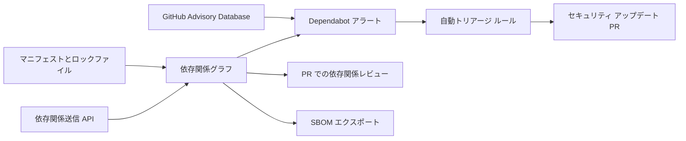

import { TLDR, DocsLinks, LastVerified, CompareTable } from '@components';
import { Aside, Badge, Tabs, TabItem } from '@astrojs/starlight/components';

<LastVerified date="2026-10" />

<TLDR>
- 次のものは**全プランで無料**で、プライベート リポジトリでも使えます：依存関係グラフ、Dependabot アラート、Dependabot セキュリティ アップデート、Dependabot バージョン アップデート、SBOM エクスポート。
- **Code Security** はプライベート / 内部リポジトリ向けに次を追加します：**依存関係レビュー**（PR で危険な依存関係をブロック）、**カスタム自動トリアージ ルール**、Enterprise の**ライセンス コンプライアンス** ルールセット。
- PR のノイズを減らすには、`groups`、`cooldown`、`open-pull-requests-limit`（既定は 5）を使います。cooldown は、既定では新しいバージョンが公開から 3 日経つまでバージョン アップデートを提案しない設定です。
- マニフェストだけでは分からないビルド時の依存関係（Maven、Gradle など）を含めるには、**依存関係送信 API** を使います。
</TLDR>

## ブースでよくある質問

<details>
<summary>Dependabot は GHAS の一部？有料ですか？</summary>

大部分は無料です。アラート、セキュリティ アップデート、バージョン アップデートは全リポジトリで無料です。Code Security は、プライベート / 内部リポジトリ向けに**カスタム自動トリアージ ルール**、**依存関係レビュー**、**ライセンス コンプライアンス**を追加します。

</details>

<details>
<summary>Dependabot の PR が多すぎます。どう抑えれば？</summary>

- `groups` で関連する更新を **1 つの PR にまとめ**ます。パターン、依存関係の種類、更新の種類で絞り込めます。
- **cooldown** を設定し、公開直後のリリースが落ち着くまで待ちます。リリースの乗っ取り攻撃への対策にもなります。
- `open-pull-requests-limit` を下げ、`schedule` を毎週や毎月にします。
- **自動トリアージ ルール**で、開発専用の依存関係など影響の小さいアラートを自動的に却下します。

</details>

<details>
<summary>社内の Artifactory / Nexus / npm レジストリに Dependabot はアクセスできますか？</summary>

できます。`dependabot.yml` のトップレベルの `registries` に定義し、エコシステムごとに参照して、資格情報は **Dependabot シークレット**に保存します。Organization レベルの Dependabot シークレットは複数のリポジトリで共有できます。レジストリがプライベート ネットワーク内にある場合は、ネットワークに到達できるセルフホスト ランナーや大きなランナーで Dependabot を動かすことを検討してください。

</details>

<details>
<summary>脆弱性のあるパッケージや GPL ライセンスのパッケージを追加する PR をブロックできますか？</summary>

できます。**依存関係レビュー アクション**は、重大度がしきい値を超えると PR を失敗させ、`allow-licenses` か `deny-licenses`（どちらか一方のみ）を適用します。ルールセットでこのアクションを必須チェックにします。Code Security を持つ GitHub Enterprise Cloud では、ルールセットのルール「Require license compliance results before merging」でライセンス ポリシーを**一元管理**することもできます。

</details>

<details>
<summary>推移的な依存関係も把握できますか？</summary>

ロックファイルに記載されていれば把握できます。ロックファイルのない Maven / Gradle のツリーのように、ビルド時に解決される依存関係には**依存関係送信 API** が必要です。コミュニティの送信アクションか、対応エコシステム向けの自動依存関係送信機能を使うと、アラートと依存関係レビューがツリー全体を参照できるようになります。

</details>

<details>
<summary>SBOM は取得できますか？</summary>

全プランで取得できます。**Insights → Dependency graph → Export SBOM** で SPDX JSON を取得するか、REST API を使います。さらに **アーティファクト構成証明**（`actions/attest`）で SBOM に署名すれば、利用者が来歴を検証できます。

</details>

<details>
<summary>脆弱性だけでなく、悪意のあるパッケージは？</summary>

**Dependabot マルウェア アラート**が、既知の悪意あるパッケージ バージョンを検出します（GitHub.com と GHES 3.22 以降）。組み込みの自動トリアージ プリセット「Dismiss package malware alerts」は既定で無効です。他の対策がない限り、無効のままにしてください。

</details>

## 機能の役割

<CompareTable
  title="サプライチェーン機能"
  columns={[
    { key: 'what', label: '内容' },
    { key: 'trigger', label: 'トリガー' },
    { key: 'cost', label: 'プライベート リポジトリ' },
  ]}
  rows={[
    { feature: '依存関係グラフ', values: { what: 'マニフェストとロックファイル（および送信された依存関係）の一覧', trigger: 'プッシュ', cost: '無料' } },
    { feature: 'Dependabot アラート', values: { what: '依存関係を GitHub Advisory Database と照合', trigger: '新しいアドバイザリまたは新しい依存関係', cost: '無料' } },
    { feature: 'Dependabot セキュリティ アップデート', values: { what: '修正済みの最小バージョンへ上げる PR', trigger: 'アラート（既定ブランチのみ）', cost: '無料' } },
    { feature: 'Dependabot バージョン アップデート', values: { what: '依存関係を最新に保つ PR', trigger: 'dependabot.yml のスケジュール', cost: '無料' } },
    { feature: '自動トリアージ プリセット', values: { what: '組み込みの却下ルール', trigger: 'アラート作成時', cost: '無料' } },
    { feature: 'カスタム自動トリアージ ルール', values: { what: '重大度・パッケージ・CWE・スコープで却下 / スヌーズ / 再オープン。PR を作成するアラートも制御', trigger: 'アラート作成時', cost: 'Code Security' } },
    { feature: '依存関係レビュー', values: { what: 'PR 上の依存関係の差分と、強制用のアクション', trigger: 'プル リクエスト', cost: 'Code Security' } },
    { feature: 'ライセンス コンプライアンス（ルールセット）', values: { what: 'ライセンス ポリシーを一元管理し、PR をブロック', trigger: 'プル リクエスト', cost: 'Code Security（GHEC）' } },
    { feature: 'SBOM エクスポート', values: { what: '依存関係グラフを SPDX でエクスポート', trigger: 'オンデマンド / API', cost: '無料' } },
  ]}
/>



## dependabot.yml の例

```yaml
# .github/dependabot.yml
version: 2
registries:
  npm-internal:
    type: npm-registry
    url: https://npm.example.com
    token: ${{ secrets.NPM_INTERNAL_TOKEN }}   # Dependabot シークレット
updates:
  - package-ecosystem: npm
    directory: "/"
    registries:
      - npm-internal
    schedule:
      interval: weekly
      day: monday
    open-pull-requests-limit: 10
    cooldown:
      default-days: 5
      semver-major-days: 30
      semver-minor-days: 7
      semver-patch-days: 3
      exclude:
        - "@my-org/*"          # 自社パッケージは待たない
    groups:
      dev-dependencies:
        dependency-type: development
        update-types: [minor, patch]
      aws-sdk:
        patterns: ["@aws-sdk/*"]
      security:
        applies-to: security-updates
        patterns: ["*"]
  - package-ecosystem: github-actions
    directory: "/"
    schedule:
      interval: weekly
    groups:
      actions:
        patterns: ["*"]
```

**注意点**

- `cooldown` が適用されるのは**バージョン アップデートだけ**で、セキュリティ アップデートには適用されません。`cooldown` を書かなくても、バージョン アップデートには**既定で 3 日**の cooldown がかかります。
- `groups` は既定でバージョン アップデート向けです。セキュリティ PR をまとめるには `applies-to: security-updates` を指定します。
- セキュリティ アップデートの対象は**既定ブランチだけ**です。
- `github-actions` は `dependabot.yml` に残してください。SHA で固定したアクションを最新に保つのに役立ちます。

## 依存関係レビュー アクション

```yaml
# .github/workflows/dependency-review.yml
name: Dependency review
on: [pull_request]
permissions:
  contents: read
  pull-requests: write   # comment-summary-in-pr を使う場合のみ
jobs:
  dependency-review:
    runs-on: ubuntu-latest
    steps:
      - uses: actions/checkout@v6
      - uses: actions/dependency-review-action@v4
        with:
          fail-on-severity: high          # critical | high | moderate | low
          fail-on-scopes: runtime         # development | runtime | unknown
          deny-licenses: GPL-3.0, AGPL-3.0   # allow-licenses とは併用不可
          allow-ghsas: GHSA-xxxx-xxxx-xxxx   # 受容済みリスク
          comment-summary-in-pr: on-failure
```

<Aside type="tip">
この設定は 1 つの共有ファイル（`config-file: org/repo/dependency-review-config.yml@main`）にまとめ、ルールセットでワークフローを必須にできます。全リポジトリに同じポリシーを適用できます。
</Aside>

## 自動トリアージ ルール

- **GitHub プリセット：** 「Dismiss low impact issues for development-scoped dependencies」はパブリック リポジトリで既定で有効です。「Dismiss package malware alerts」は既定で無効です。
- **カスタム ルール**（プライベート リポジトリでは Code Security が必要）：重大度、パッケージ、エコシステム、CWE、スコープなどで絞り込み、**自動却下**、**スヌーズ**、**再オープン**、**セキュリティ アップデート PR を作成するアラートの選択**を行います。Organization レベルで定義できます。
- ルールは通知の送信*前に*実行されるので、自動却下されたアラートが開発者に通知されることはありません。

## 依存関係グラフ、送信 API、SBOM

- **依存関係グラフ：** 対応するマニフェストとロックファイルから自動で作成されます。
- **依存関係送信 API：** ビルド時に解決された依存関係を CI から送信します。送信されたデータはアラートと依存関係レビューに反映されます。
- **SBOM：** UI か `GET /repos/{owner}/{repo}/dependency-graph/sbom` で SPDX をエクスポートするか、CI で SBOM アクションを使って生成します。
- **来歴：** アーティファクト構成証明（`actions/attest`、SLSA ビルド来歴、SBOM 構成証明）については、[GitHub Actions セクション](/github-cheatsheet/ja/actions/)を参照してください。

<DocsLinks links={[
  { label: 'Dependabot セキュリティ アップデート', href: 'https://docs.github.com/ja/code-security/concepts/supply-chain-security/dependabot-security-updates' },
  { label: 'Dependabot のプル リクエスト（バージョン アップデート）', href: 'https://docs.github.com/ja/code-security/concepts/supply-chain-security/dependabot-pull-requests' },
  { label: 'Dependabot オプション リファレンス（groups、cooldown、registries）', href: 'https://docs.github.com/ja/code-security/reference/supply-chain-security/dependabot-options-reference' },
  { label: 'Dependabot 自動トリアージ ルール', href: 'https://docs.github.com/ja/code-security/concepts/supply-chain-security/dependabot-auto-triage-rules' },
  { label: '依存関係レビュー', href: 'https://docs.github.com/ja/code-security/concepts/supply-chain-security/dependency-review' },
  { label: '依存関係レビュー アクションの構成', href: 'https://docs.github.com/ja/code-security/how-tos/secure-your-supply-chain/manage-your-dependency-security/configure-dependency-review-action' },
  { label: '依存関係を SBOM としてエクスポート', href: 'https://docs.github.com/ja/code-security/how-tos/secure-your-supply-chain/establish-provenance-and-integrity/export-dependencies-as-sbom' },
]} />
