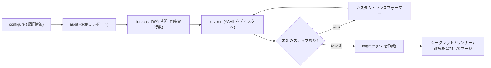

import { TLDR, DocsLinks, LastVerified, FlashCards } from '@components';
import { Aside, Badge, Tabs, TabItem, Steps } from '@astrojs/starlight/components';

<LastVerified date="2026-10" />

<TLDR>
- **GitHub Actions Importer**（旧コード名 "Valet"）は Docker コンテナで、`gh actions-importer` CLI 拡張機能から操作します。
- **対応している移行元:** Azure DevOps、Bamboo、Bitbucket Pipelines、CircleCI、GitLab（クラウド/セルフホスト）、Jenkins、Travis CI。
- **4 つのコマンド:** `audit`（棚卸し）→ `forecast`（ランナー時間と同時実行数の予測）→ `dry-run`（YAML をローカルに出力）→ `migrate`（PR を作成）。
- GitHub の目標は**ワークフローあたり約 80% の自動変換**です。シークレット、未知のプラグイン、セルフホストランナーなどの残りは手作業になる前提で計画し、大規模な場合は**カスタムトランスフォーマー**でギャップを埋めます。
</TLDR>

## ブースでよくある質問

<details>
<summary>シークレットや認証情報も移行されますか？</summary>

いいえ。変換後のワークフローは `secrets.*` を**参照**しますが、シークレット自体（Organization・リポジトリ・環境レベル）は自分で作成する必要があります。長期間有効なクラウドキーを **OIDC** フェデレーションに置き換える好機です。

</details>

<details>
<summary>Jenkins のパイプラインはどのくらい自動変換されますか？</summary>

`audit` を実行するとレポートが出力されます。パイプラインは**成功**・**部分的に成功**・**非対応**・**失敗**に、ビルドステップは**既知**・**未知**・**非対応**に分類されます。このレポートが実際の答えになります。ドキュメント上の目標はワークフローあたり約 80% ですが、実際の結果はプラグインの使い方に大きく左右されます。

</details>

<details>
<summary>必要な Actions の実行時間を見積もれますか？</summary>

はい。`forecast` は過去のジョブデータから使用量と同時実行数を推定します。**Jenkins** の場合は、先に Jenkins サーバーに `paginated-builds` プラグインをインストールする必要があります。既存の GitHub Actions の履歴に対しては `forecast github` も使えます。

</details>

<details>
<summary>Jenkins の共有ライブラリに独自ステップが何百もあります。どうすればよいですか？</summary>

**カスタムトランスフォーマー**を作成します。これは未知のステップやプラグインを任意の Actions ステップに対応付ける小さな Ruby DSL で、`--custom-transformers` を付けて `dry-run` や `migrate` を再実行します。長期的には、共有ライブラリを**再利用可能なワークフロー**や**複合アクション**にリファクタリングしましょう。

</details>

<details>
<summary>各チームがセルフサービスで移行できますか？</summary>

はい。**IssueOps** テンプレート（[`actions/importer-issue-ops`](https://github.com/actions/importer-issue-ops)）を使います。開発者がテンプレートから Issue を作成すると、Actions ワークフローが Importer を実行して PR を作成します。トレーニングには [`actions/importer-labs`](https://github.com/actions/importer-labs) を使ってください。

</details>

<details>
<summary>Actions Importer は今もメンテナンスされていますか？</summary>

docs.github.com のドキュメントは最新の状態です（パスは `/actions/tutorials/migrate-to-github-actions/automated-migrations` に移動しています）。拡張機能は `github/gh-actions-importer` からインストールします。`gh actions-importer update` を定期的に実行してください。約束する前に、github.com で現在の状況を確認してください。

</details>

<details>
<summary>当面は Azure Pipelines を使い続けたいのですが、問題ありませんか？</summary>

問題ありません。Azure Pipelines は GitHub リポジトリをビルドでき、`ado2gh --all` スクリプトでリポジトリ移行時にパイプラインを付け替えられます。CI はチームごとに後から移行すればよいです。

</details>

## CI 移行の流れ



<Steps>

1. インストールして認証情報を設定します。Docker と GitHub CLI が必要で、コンテナは CI サーバー上で動かす必要はありません。

   ```bash
   gh extension install github/gh-actions-importer
   gh actions-importer update
   gh actions-importer configure      # 対話形式。.env.local に書き込まれる
   ```

2. 全体を棚卸しします。

   ```bash
   gh actions-importer audit jenkins --output-dir audit/
   ```

3. 使用量を予測します。

   ```bash
   gh actions-importer forecast jenkins --output-dir forecast/
   ```

4. 1 つのパイプラインでドライランを行い、YAML を確認します。

   ```bash
   gh actions-importer dry-run jenkins --source-url https://jenkins.example.com/job/app --output-dir out/
   ```

5. 移行します。対象リポジトリに PR が作成されます。

   ```bash
   gh actions-importer migrate jenkins --source-url https://jenkins.example.com/job/app \
     --target-url https://github.com/acme/app --output-dir out/
   ```

</Steps>

<Aside type="note">
フラグは移行元によって異なります（例: Azure DevOps は `--pipeline-id`、GitLab は `--namespace` と `--project`）。ブースでは `gh actions-importer <verb> <source> -h` を実行して正確なフラグを見せましょう。
</Aside>

## 概念マッピング（手動変換とレビュー用）

| 概念 | Jenkins | Azure Pipelines | GitLab CI | GitHub Actions |
|---|---|---|---|---|
| パイプラインファイル | `Jenkinsfile` | `azure-pipelines.yml` | `.gitlab-ci.yml` | `.github/workflows/*.yml` |
| トリガー | `triggers {}` / SCM ポーリング | `trigger:` / `pr:` / `schedules:` | `rules:` / `only` / `except` | `on:`（push、pull_request、schedule、workflow_dispatch など） |
| ステージ | `stage('Build')` | `stages:` | `stages:` | **ジョブ**（`needs:` で順序付け） |
| ジョブ | （agent ブロック） | `jobs:` | ジョブ | `jobs.<id>` |
| ステップ | `steps {}` / `sh` | `steps:` / タスク | `script:` | `steps:`（`run:` または `uses:`） |
| エージェント / ランナー | `agent { label 'x' }` | `pool:` | ランナーの `tags:` | `runs-on:`（ラベル、グループ、大きいランナー） |
| コンテナ | `agent { docker }` | `container:` | `image:` | `jobs.<id>.container` / `services:` |
| 並列実行 | `parallel {}` / matrix | `strategy: matrix` | `parallel: matrix` | `strategy.matrix` / 独立したジョブ |
| 条件 | `when {}` | `condition:` | `rules: if` | `if:` |
| 後処理 | `post { always/failure }` | `condition: always()` | `after_script` / `when: on_failure` | `if: always()` / `failure()` |
| 変数 | `environment {}` | `variables:` / 変数グループ | CI/CD 変数 | `env:` + `vars.*`（Organization / リポジトリ / 環境） |
| シークレット | `credentials()` | シークレット変数 / サービス接続 | マスクされた変数 | `secrets.*` + クラウドには **OIDC** |
| 再利用 | 共有ライブラリ | テンプレート | `include:` / `extends:` | 再利用可能なワークフロー、複合アクション、YAML アンカー |
| プラグイン / タスク | プラグイン | Marketplace のタスク | — | Marketplace の**アクション** |
| 承認 | `input` ステップ | 環境 + チェック | `when: manual`、保護された環境 | **環境** + 必須レビュー担当者 |
| 成果物 / キャッシュ | `archiveArtifacts` / stash | `PublishPipelineArtifact` / Cache | `artifacts:` / `cache:` | `actions/upload-artifact` / `actions/cache` |

### 変換前後の例: 小さな Jenkinsfile

<Tabs>
<TabItem label="Jenkinsfile">

```groovy
pipeline {
  agent { label 'linux' }
  environment { NODE_ENV = 'test' }
  stages {
    stage('Build') { steps { sh 'npm ci && npm run build' } }
    stage('Test')  { steps { sh 'npm test' } }
    stage('Deploy') {
      when { branch 'main' }
      steps {
        input message: 'Deploy to prod?'
        withCredentials([string(credentialsId: 'DEPLOY_TOKEN', variable: 'TOKEN')]) {
          sh './deploy.sh'
        }
      }
    }
  }
  post { failure { echo 'Build failed' } }
}
```

</TabItem>
<TabItem label="GitHub Actions">

```yaml
name: ci
on:
  push:
    branches: [main]
  pull_request:
permissions:
  contents: read
env:
  NODE_ENV: test
jobs:
  build:
    runs-on: [self-hosted, linux]
    steps:
      - uses: actions/checkout@v5
      - run: npm ci && npm run build
  test:
    needs: build
    runs-on: [self-hosted, linux]
    steps:
      - uses: actions/checkout@v5
      - run: npm ci && npm test
  deploy:
    needs: test
    if: github.ref == 'refs/heads/main'
    runs-on: [self-hosted, linux]
    environment: production   # `input` の代わりに必須レビュー担当者
    steps:
      - uses: actions/checkout@v5
      - run: ./deploy.sh
        env:
          TOKEN: ${{ secrets.DEPLOY_TOKEN }}
      - if: failure()
        run: echo "Build failed"
```

</TabItem>
</Tabs>

## 注意点とトークポイント

- **ジョブは毎回新しいランナーで実行されます。** Jenkins ではステージ間でワークスペースを共有することが多いですが、Actions では再チェックアウトして再ビルドするか、ジョブ間で成果物を受け渡します。
- **対話型の `input` ステップ**は、**環境の保護ルール**（必須レビュー担当者や待機タイマー）に置き換えます。
- **認証情報:** 静的なクラウドキーをコピーせず、AWS、Azure、GCP には **OIDC** と短期トークンを使います。
- **共有ライブラリ**は、中央リポジトリの再利用可能なワークフロー（`workflow_call`）に置き換え、必須ワークフローやルールセットで統制します。
- **Bitbucket Pipelines と Bamboo** もサポートされていますが、コマンドごとの対応範囲は移行元によって異なります。`gh actions-importer <verb> -h` で確認してください。
- 変換後のワークフローでは、**サードパーティのアクションを完全なコミット SHA で固定**し、許可リストポリシーを有効にしてください。

<FlashCards
	title="Actions Importer クイズ"
	cards={[
		{ q: '変換したワークフローの PR を作成するコマンドは？', a: '`gh actions-importer migrate <source>`' },
		{ q: 'Jenkins で `forecast` に必要なものは？', a: 'Jenkins サーバーにインストールした **`paginated-builds`** プラグイン。' },
		{ q: '目標とする変換率は？', a: 'ワークフローあたり約 **80%**。本番前に必ず出力をレビューします。' },
		{ q: '未知のプラグインを大規模に扱うには？', a: '`--custom-transformers` で渡す**カスタムトランスフォーマー**（Ruby DSL）。' },
		{ q: 'Jenkins の `stage` は何に対応する？', a: '通常は `needs:` で順序付けした**ジョブ**。' },
	]}
/>

<DocsLinks
	links={[
		{ label: 'Actions Importer による自動移行', href: 'https://docs.github.com/ja/actions/tutorials/migrate-to-github-actions/automated-migrations' },
		{ label: 'GitHub Actions Importer の使用', href: 'https://docs.github.com/ja/actions/tutorials/migrate-to-github-actions/automated-migrations/use-github-actions-importer' },
		{ label: 'Jenkins からの移行', href: 'https://docs.github.com/ja/actions/tutorials/migrate-to-github-actions/automated-migrations/jenkins-migration' },
		{ label: 'Azure DevOps からの移行', href: 'https://docs.github.com/ja/actions/tutorials/migrate-to-github-actions/automated-migrations/azure-devops-migration' },
		{ label: 'GitLab からの移行', href: 'https://docs.github.com/ja/actions/tutorials/migrate-to-github-actions/automated-migrations/gitlab-migration' },
		{ label: 'カスタムトランスフォーマー', href: 'https://docs.github.com/ja/actions/reference/github-actions-importer/custom-transformers' },
	]}
/>
