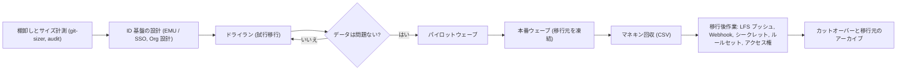

import { TLDR, DocsLinks, LastVerified, DecisionTree } from '@components';
import { Aside, Badge, LinkCard, CardGrid } from '@astrojs/starlight/components';

<LastVerified date="2026-10" />

<TLDR>
- **リポジトリ + PR + 履歴 → GitHub Enterprise Cloud** には **GitHub Enterprise Importer (GEI)** を使います。対応元は GHES 3.4.1+、GitHub.com、GHE.com（エンタープライズ間）、Azure DevOps Cloud、Bitbucket Server/Data Center 5.14+、GitLab です。
- **CI/CD パイプライン → GitHub Actions** には **GitHub Actions Importer**（旧コード名 "Valet"）を使います。対応元は Jenkins、Azure DevOps、GitLab、CircleCI、Travis CI、Bamboo、Bitbucket Pipelines です。
- **GHES への移行**（GHES→GHES、GitHub.com→GHES）には `ghe-migrator` を使います。**その他の Git ホストからコードだけを移す**場合は GitHub Importer か `git push --mirror` を使います。
- **GHES → GHE.com を最小ダウンタイムで移行したい**場合は、**Enterprise Live Migrations (ELM)** を検討してください。サポート対象の GHES 3.17+ パッチリリースで利用できます。
- 移行は一度きりのコマンドではなく**プログラム**として進めます。棚卸し → ドライラン → パイロット → ウェーブ移行 → マネキン回収 → カットオーバーの順です。
</TLDR>

## ブースでよくある質問

Bitbucket Cloud を使っています。GEI で PR も移行できますか？

現在のドキュメントで GEI の移行元として記載されているのは **Bitbucket Server / Data Center 5.14+** だけで、Bitbucket Cloud は**含まれていません**。コードと履歴は GitHub Importer か `git push --mirror` で、パイプラインは Actions Importer（Bitbucket Pipelines）で移行する計画にしてください。対応状況は変わる可能性があるため、案内前に必ず確認してください。

Azure DevOps Server（オンプレミス）から直接 GitHub に移行できますか？

GEI は **ADO Cloud のみ**をサポートしているため、GEI では直接移行できません。いったん ADO Server → ADO Cloud に移行してから GEI を使うか、`git push --mirror` でコードだけを移行してください。

GitLab からの公式な移行パスはありますか？

あります。GEI は `gh gl2gh` CLI 拡張機能を通じて、**GitLab.com とメンテナンス中のセルフホスト版 GitLab** をサポートしています。リポジトリ、Wiki、Issue、MR→PR、マイルストーン、リリースなどが移行されます。CI/CD パイプライン（`.gitlab-ci.yml`）は移行**されない**ため、Actions Importer を使ってください。

誰が何を書いたかという情報は失われますか？

Git のコミットは元の作成者情報を保持します。それ以外のアクティビティ（PR、コメント、Issue）はプレースホルダーの**マネキン**に帰属します。移行後に、マネキンを実際の Organization メンバーに**回収**（reclaim）します。CSV で一括回収も可能です。詳しくは [GEI によるリポジトリ移行](/github-cheatsheet/ja/migration/repos-gei/)を参照してください。

ダウンタイムはどのくらいですか？

GEI は各リポジトリのスナップショットを移行するため、エクスポート後に移行元へプッシュされた変更は引き継がれません。ウェーブごとに移行元を変更凍結（読み取り専用）にし、ドライランの所要時間をもとに各ウェーブの規模を決めてください。GHES → GHE.com の場合は、ダウンタイムを短縮し大規模モノレポに強い **Enterprise Live Migrations** があります。

移行したリポジトリで、過去のコミッターも GHAS ライセンスを消費しますか？

いいえ。GEI で移行したリポジトリでは、GHAS のライセンス消費は**移行後**にプッシュされたコミットのみがカウントされます。

## どの移行ツールを使うか

<DecisionTree
	title="どの移行ツールを使う？"
	tree={{
		start: 'what',
		nodes: {
			what: {
				question: '何を移行しますか？',
				options: [
					{ label: 'リポジトリ（コード・PR・Issue）', next: 'src' },
					{ label: 'CI/CD パイプライン', next: 'ci' },
					{ label: '両方', next: 'both' },
				],
			},
			src: {
				question: '移行元はどこですか？',
				options: [
					{ label: 'GitHub Enterprise Server', next: 'ghesdest' },
					{ label: 'GitHub.com / GHE.com', next: 'ghcomdest' },
					{ label: 'Azure DevOps', next: 'ado' },
					{ label: 'Bitbucket Server / Data Center', next: 'bbs' },
					{ label: 'GitLab', next: 'gitlab' },
					{ label: 'Bitbucket Cloud やその他の Git ホスト', next: 'other' },
					{ label: 'SVN / TFVC / Mercurial', next: 'nongit' },
				],
			},
			ghesdest: {
				question: '移行先はどこですか？',
				options: [
					{ label: 'GitHub Enterprise Cloud（GitHub.com）', next: 'gei' },
					{ label: 'GHE.com（データレジデンシー）', next: 'elm' },
					{ label: '別の GHES インスタンス', next: 'ghemig' },
				],
			},
			ghcomdest: {
				question: '移行先はどこですか？',
				options: [
					{ label: 'GitHub Enterprise Cloud 上の別の Organization / Enterprise', next: 'gei' },
					{ label: 'GHES インスタンス', next: 'ghemig' },
				],
			},
			ado: {
				question: 'Azure DevOps の **Cloud** と **Server** のどちらですか？',
				options: [
					{ label: 'Cloud', next: 'ado2gh' },
					{ label: 'Server（オンプレミス）', next: 'adoserver' },
				],
			},
			gei: {
				answer: '**GEI**（`gh gei`）を使います。GitHub.com からはリポジトリ単位または Organization 単位、GHES からはリポジトリ単位で移行できます。まずドライランを行い、移行後にマネキンを回収します。',
				links: [{ label: 'GEI について', href: 'https://docs.github.com/ja/migrations/using-github-enterprise-importer/understanding-github-enterprise-importer/about-github-enterprise-importer' }],
			},
			elm: {
				answer: '低ダウンタイムや大規模モノレポが必要なら **Enterprise Live Migrations**（サポート対象の GHES 3.17+ パッチリリース）を検討してください。それ以外は **GEI**（`gh gei`）を使います。',
				links: [{ label: 'Enterprise Live Migrations について', href: 'https://docs.github.com/ja/migrations/elm/about-live-migrations' }],
			},
			ghemig: {
				answer: '**`ghe-migrator`**（GHES のサイト管理者権限が必要）を使います。まずステージングインスタンスで試行移行してください。ハイパーバイザー間でインスタンスを移す用途には使わず、backup-utils かレプリカを使ってください。',
				links: [{ label: 'ghe-migrator について', href: 'https://docs.github.com/ja/enterprise-server@latest/migrations/using-ghe-migrator/about-ghe-migrator' }],
			},
			ado2gh: {
				answer: '**GEI**（`gh ado2gh`）を使います。リポジトリ、PR、PR の履歴、PR 上の作業項目リンク、ブランチポリシーが移行されます。Azure Boards と Azure Pipelines は GitHub リポジトリと連携したまま使い続けられます。',
				links: [{ label: 'ADO → GitHub', href: 'https://docs.github.com/ja/migrations/ado/understand-migrations-from-azure-devops-to-github' }],
			},
			adoserver: {
				answer: 'GEI は ADO Server を**サポートしていません**。**先に ADO Cloud へ移行**してから `gh ado2gh` を使うか、`git push --mirror` で**コードのみ**を移行してください。',
			},
			bbs: {
				answer: '**GEI**（`gh bbs2gh`）を使います（Bitbucket Server/DC **5.14+**）。コードと PR は移行されますが、ブランチ権限、リポジトリ設定、CI パイプラインは移行されません。',
				links: [{ label: 'Bitbucket Server → GHEC', href: 'https://docs.github.com/ja/migrations/using-github-enterprise-importer/migrating-from-bitbucket-server-to-github-enterprise-cloud/about-migrations-from-bitbucket-server-to-github-enterprise-cloud' }],
			},
			gitlab: {
				answer: '**GEI**（`gh gl2gh` 拡張機能）を使います（GitLab.com またはメンテナンス中のセルフホスト版）。パイプラインは移行されないため、Actions Importer を使ってください。',
				links: [{ label: 'GitLab からの移行', href: 'https://docs.github.com/ja/migrations/using-github-enterprise-importer/migrate-from-gitlab/understand-migrations' }],
			},
			other: {
				answer: '**コードと履歴のみ**であれば、**GitHub Importer**（GitHub.com の UI。移行元はインターネットから到達可能である必要あり）か、`git clone --mirror` + `git push --mirror` を使います。Issue や PR の移行には API を使った独自スクリプトが必要です。Git LFS オブジェクトは別途プッシュしてください。',
				links: [{ label: 'GitHub Importer について', href: 'https://docs.github.com/ja/migrations/importing-source-code/using-github-importer/about-github-importer' }],
			},
			nongit: {
				answer: 'まず Git に変換し（例: `git svn`、`git-tfs`）、その後プッシュします。GitHub Importer は Git のソースにしか対応していません。',
				links: [{ label: 'コマンドラインによるソースのインポート', href: 'https://docs.github.com/ja/migrations/importing-source-code/using-the-command-line-to-import-source-code/about-source-code-imports-using-the-command-line' }],
			},
			ci: {
				answer: '**GitHub Actions Importer**（`gh actions-importer audit → forecast → dry-run → migrate`）を使います。最後の仕上げは手作業になる前提で計画してください。詳しくは [Actions Importer](/github-cheatsheet/ja/migration/ci-actions-importer/) を参照してください。',
				links: [{ label: '自動移行', href: 'https://docs.github.com/ja/actions/tutorials/migrate-to-github-actions/automated-migrations' }],
			},
			both: {
				answer: '2 つのトラックで進めます。リポジトリは **GEI**（ウェーブごと）、パイプラインは **Actions Importer** です。先にリポジトリを移行し、移行後のリポジトリに対して Actions Importer で PR を作成します。',
			},
		},
	}}
/>

## 移行プログラムの全体像

| フェーズ | やること | 注意点 |
|---|---|---|
| 棚卸し | リポジトリを一覧化し、`git-sizer` でサイズを測ります。LFS の利用、大きなファイル、使われていないリポジトリを洗い出します。パイプラインには `gh actions-importer audit` を実行します。 | 使われていないリポジトリは移行せずアーカイブします。 |
| ID 基盤 | 移行先 Enterprise を作成する**前に** **EMU か個人アカウントか**を決めます。[管理](/github-cheatsheet/ja/administration/)を参照してください。 | 後から EMU に切り替えると再移行が必要です。 |
| ドライラン | 検証用 Organization に試行移行し、移行ログ（リポジトリ内に Issue として作成される）を確認します。 | ログには致命的でない個別項目の失敗が記録されます。 |
| ウェーブ | チームや依存関係ごとにリポジトリをまとめます。各ウェーブ中は移行元を変更凍結します。 | リポジトリへのユーザー/チームのアクセス権は移行**されません**（GitHub.com の *Organization* 移行でのチームアクセスを除く）。 |
| マネキン | マネキン CSV を生成し、Organization メンバーに対応付けて回収します。 | 別の Organization にリポジトリを移管する**前に**回収してください。 |
| 移行後作業 | LFS オブジェクトのプッシュ、Webhook の再有効化、シークレット・変数・環境、ルールセット、カスタムプロパティの再作成を行います。 | コード検索の再インデックスには時間がかかります。 |

<Aside type="tip" title="トークポイント">
ソースの種類ごとに 1 つずつ、協力的なチームで早めにパイロットを行いましょう。実データに近いドライランを行えば、LFS、サイズ超過のファイル、255 バイトを超える ref 名、ID の不足といった想定外の問題の多くを早期に発見できます。
</Aside>

## このセクションのページ

<CardGrid>
	<LinkCard title="GEI によるリポジトリ移行" description="移行元ごとの移行対象、gh gei / ado2gh / bbs2gh / gl2gh、マネキン、制限、EMU。" href="/github-cheatsheet/ja/migration/repos-gei/" />
	<LinkCard title="Actions Importer による CI/CD 移行" description="audit / forecast / dry-run / migrate と概念マッピング（Jenkins、ADO、GitLab など）。" href="/github-cheatsheet/ja/migration/ci-actions-importer/" />
</CardGrid>

<DocsLinks
	links={[
		{ label: '移行のドキュメント', href: 'https://docs.github.com/ja/migrations' },
		{ label: 'GitHub Enterprise Importer について', href: 'https://docs.github.com/ja/migrations/using-github-enterprise-importer/understanding-github-enterprise-importer/about-github-enterprise-importer' },
		{ label: 'Enterprise Live Migrations について', href: 'https://docs.github.com/ja/migrations/elm/about-live-migrations' },
		{ label: 'ghe-migrator について', href: 'https://docs.github.com/ja/enterprise-server@latest/migrations/using-ghe-migrator/about-ghe-migrator' },
		{ label: 'GitHub Importer について', href: 'https://docs.github.com/ja/migrations/importing-source-code/using-github-importer/about-github-importer' },
		{ label: 'GitHub Actions Importer', href: 'https://docs.github.com/ja/actions/tutorials/migrate-to-github-actions/automated-migrations' },
	]}
/>
