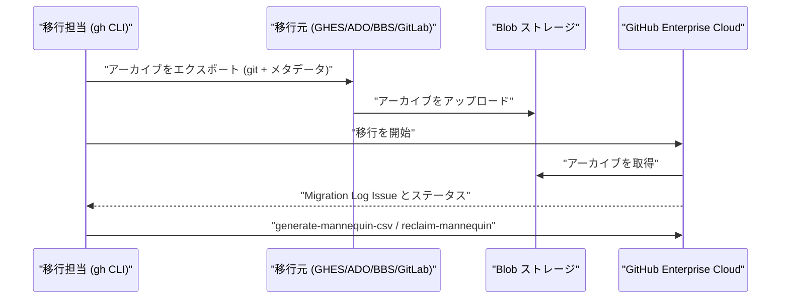

import { TLDR, DocsLinks, LastVerified, CompareTable, FlashCards } from '@components';
import { Aside, Badge, Tabs, TabItem, Steps } from '@astrojs/starlight/components';

<LastVerified date="2026-10" />

<TLDR>
- **GEI** は **GitHub Enterprise Cloud**（GitHub.com または GHE.com）**への**移行ツールです。移行元ごとに `gh` CLI 拡張機能があり、`gei`（GitHub 系）、`ado2gh`、`bbs2gh`、`gl2gh` を使い分けます。
- 基本の流れは、`generate-script` → **試行移行** → 本番移行 → **「Migration Log」Issue** の確認 → **マネキン回収** → 移行後作業です。
- **どの移行元でも移行されないもの**は、Git LFS オブジェクト（後からプッシュ）、シークレット、ユーザー/チームのリポジトリアクセス権、GitHub 以外の移行元の CI です。
- **制限:** 1 コミット/1 プッシュあたり 2 GiB、移行中のファイルサイズ上限 400 MiB（移行後は 100 MiB）、ref 名 255 バイト、リポジトリのソース上限 **40 GiB** <Badge text="プレビュー" variant="caution" />。
- **GitHub.com が移行元**の場合は **Organization 単位**で移行できます（チームとチームのアクセス権を含む）。それ以外の移行元はリポジトリ単位です。
</TLDR>

## ブースでよくある質問

<details>
<summary>Azure DevOps からは具体的に何が移行されますか？</summary>

Git のソースと履歴、**プルリクエスト**（ユーザー履歴、添付ファイル、**作業項目リンク**を含む）、そして**ブランチポリシー**です。ユーザー単位のポリシーとリポジトリ横断のポリシーは除外されます。作業項目自体は **Azure Boards** に、パイプラインは **Azure Pipelines** に残り、どちらも GitHub リポジトリと連携して使い続けられます。`gh ado2gh generate-script --all` を使うと、パイプラインの付け替え、チームの作成、Boards 連携の設定といった手順がスクリプトに追加されます。

</details>

<details>
<summary>60 GB のリポジトリがあります。移行できますか？</summary>

GEI の上限は**ソース 40 GiB**（パブリックプレビュー）です。対象は Git ソースのみなので、`git-sizer`（総 blob サイズ）で確認してください。選択肢は次のとおりです。
- 大きなバイナリを **Git LFS** に移す（LFS オブジェクトは移行後に別途プッシュ）。
- 履歴を書き換えて大きな blob を削除する。
- GHES → GHE.com であれば、大規模モノレポにより適した **Enterprise Live Migrations** を検討する。

GHES が移行元の場合、アーカイブの上限はバージョンによって異なります。3.8 未満は 2 GiB、3.8–3.11 は 10 GiB、3.12 は 20 GiB、3.13+ は 40 GiB（プレビュー）です。

</details>

<details>
<summary>マネキンとは何ですか？ ユーザー側で承認が必要ですか？</summary>

移行後、**Git コミット以外**のすべてのアクティビティは**マネキン**と呼ばれるプレースホルダーアカウントに帰属します。これを既存の **Organization メンバー**に回収します（個別、または CSV で一括）。デフォルトではメンバーに**招待メール**が届き、承認が必要です。**EMU** の場合は `--skip-invitation` を付けると即時に回収できます。リポジトリを別の Organization に移管した後は回収できないため、移管の**前に**回収してください。

</details>

<details>
<summary>GitHub Actions のシークレット、環境、ランナーは移行されますか（GHES → GHEC）？</summary>

いいえ。ワークフロー（YAML ファイル）は移行されますが、**シークレット、変数、環境、セルフホスト/大きいランナー、成果物、実行履歴**は移行されません。ルールセット、カスタムプロパティ、Projects、Packages、Dependabot/コードスキャンのアラート、Discussions、スターも移行されません。できればコード（Terraform やスクリプト）で再作成する計画にしてください。

</details>

<details>
<summary>コミット作成者のメールアドレスが原因で移行が失敗しました。なぜですか？</summary>

**移行先 Organization のルールセットが移行を失敗させることがあります。** たとえば作成者のメールを `@yourco.com` に限定するメタデータルールは、過去のコミットで違反になります。移行対象を一時的に除外するか、移行担当者をバイパスリストに追加し、カットオーバー後にルールを再有効化してください。

</details>

<details>
<summary>移行は誰が実行できますか？ Organization オーナーである必要がありますか？</summary>

いいえ。GEI には専用の**移行者（migrator）ロール**があり、移行先 Organization のユーザーやチームに付与できます。Organization オーナーがすべての移行を実行する必要はありません。必要な個人用アクセストークン (PAT) のスコープは移行元によって異なるため、各移行元のドキュメントの「アクセスの管理」を確認してください。

</details>

<details>
<summary>移行後、過去のコミッターは GHAS ライセンスを消費しますか？</summary>

いいえ。GEI で移行したリポジトリでは、GHAS は**移行後**にプッシュされたコミットのみをカウントします。

</details>

## 移行元ごとの移行対象

<CompareTable
	title="GEI: 移行されるデータ（概要 — 詳細は移行元ごとのドキュメントを確認）"
	columns={[
		{ key: 'ghes', label: 'GHES 3.4.1+' },
		{ key: 'ghcom', label: 'GitHub.com' },
		{ key: 'ado', label: 'Azure DevOps Cloud' },
		{ key: 'bbs', label: 'Bitbucket Server/DC' },
		{ key: 'gitlab', label: 'GitLab' },
	]}
	rows={[
		{ feature: 'Git ソース + コミット履歴', category: 'コード', values: { ghes: true, ghcom: true, ado: true, bbs: true, gitlab: true } },
		{ feature: 'Git LFS オブジェクト', category: 'コード', values: { ghes: '後からプッシュ', ghcom: '後からプッシュ', ado: '後からプッシュ', bbs: '後からプッシュ', gitlab: '後からプッシュ' } },
		{ feature: 'プルリクエスト（レビュー・コメント含む）', category: 'コラボレーション', values: { ghes: true, ghcom: true, ado: true, bbs: true, gitlab: 'MR → PR' } },
		{ feature: 'Issue', category: 'コラボレーション', values: { ghes: true, ghcom: true, ado: 'Azure Boards に残る', bbs: false, gitlab: true } },
		{ feature: 'マイルストーン', category: 'コラボレーション', values: { ghes: true, ghcom: true, ado: false, bbs: false, gitlab: true } },
		{ feature: 'Wiki', category: 'コラボレーション', values: { ghes: true, ghcom: 'あり（添付ファイルを除く）', ado: false, bbs: false, gitlab: true } },
		{ feature: 'コミットコメント', category: 'コラボレーション', values: { ghes: true, ghcom: true, ado: false, bbs: false, gitlab: true } },
		{ feature: 'リリース', category: 'コラボレーション', values: { ghes: false, ghcom: 'リポジトリあたり 10 GiB まで', ado: false, bbs: false, gitlab: 'アセット含む' } },
		{ feature: 'ブランチ保護 / ポリシー', category: '設定', values: { ghes: '一部', ghcom: '一部', ado: 'ブランチポリシー（ユーザー単位・リポジトリ横断を除く）', bbs: false, gitlab: false } },
		{ feature: 'Webhook', category: '設定', values: { ghes: '移行後に再有効化', ghcom: '有効なもののみ。移行後に再有効化', ado: false, bbs: false, gitlab: false } },
		{ feature: 'ルールセットとカスタムプロパティ', category: '設定', values: { ghes: false, ghcom: false, ado: false, bbs: false, gitlab: false } },
		{ feature: 'GitHub Actions ワークフローファイル', category: 'CI/CD', values: { ghes: true, ghcom: true, ado: '該当なし', bbs: '該当なし', gitlab: '該当なし' } },
		{ feature: 'CI パイプライン / シークレット / 変数', category: 'CI/CD', values: { ghes: false, ghcom: false, ado: 'Azure Pipelines を継続、または Actions Importer', bbs: false, gitlab: false } },
		{ feature: 'Organization 単位の移行（チーム・チームアクセス）', category: 'スコープ', values: { ghes: false, ghcom: true, ado: false, bbs: false, gitlab: false } },
		{ feature: 'ユーザーアクティビティの帰属', category: 'ID', values: { ghes: 'マネキン', ghcom: 'マネキン', ado: 'マネキン', bbs: 'マネキン', gitlab: 'マネキン' } },
	]}
/>

<Aside type="caution" title="その他移行されないもの（GitHub 系の移行元）">
監査ログ、コードスキャン結果、Dependabot アラート、シークレットスキャンの修正状態、Codespaces/Dependabot/Actions のシークレット、Packages、Projects、Discussions、サブ Issue、フォーク、スター/ウォッチャー、ユーザー所有リポジトリ、GitHub Apps のインストールは移行されません。ブランチ保護ルールのうち「必須 PR のバイパス許可」「最新プッシュの承認必須」「ブランチのロック」「フォースプッシュの許可」なども移行されません。
</Aside>

## CLI チートシート

どの拡張機能も GitHub CLI **2.4.0+** が必要です。移行先が **GHE.com** の場合は、すべてのコマンドに `--target-api-url https://api.SUBDOMAIN.ghe.com` を付けてください。

<Tabs>
<TabItem label="GitHub (gei)">

```bash
gh extension install github/gh-gei
export GH_PAT=...          # 移行先のトークン
export GH_SOURCE_PAT=...   # 移行元のトークン

# Organization 全体のスクリプト生成（移行元が GitHub.com の場合）またはリポジトリ単位
gh gei generate-script --github-source-org SRC --github-target-org DEST --output migrate.ps1
gh gei migrate-repo --github-source-org SRC --source-repo app --github-target-org DEST --target-repo app
# 任意: --target-repo-visibility internal | --skip-releases | --download-migration-logs

# GHES が移行元の場合: --ghes-api-url https://ghes.example.com/api/v3 を追加（+ blob ストレージ、または GHES 3.16+ のローカルストレージ）
gh gei abort-migration --migration-id MIGRATION-ID
```

</TabItem>
<TabItem label="Azure DevOps (ado2gh)">

```bash
gh extension install github/gh-ado2gh
export ADO_PAT=... GH_PAT=...

gh ado2gh generate-script --ado-org SRC --github-org DEST --output migrate.ps1 --all
# --all を付けると、Azure Pipelines の付け替え、チーム作成、Azure Boards 連携の設定が追加される
```

</TabItem>
<TabItem label="Bitbucket Server (bbs2gh)">

```bash
gh extension install github/gh-bbs2gh

gh bbs2gh migrate-repo --bbs-server-url https://bbs.example.com \
  --bbs-project PROJ --bbs-repo app \
  --github-org DEST --github-repo app \
  --ssh-user USER --ssh-private-key ~/.ssh/id_rsa \
  --use-github-storage        # または --aws-bucket-name / Azure ストレージ
```

</TabItem>
<TabItem label="GitLab (gl2gh)">

```bash
gh extension install github/gh-gl2gh

gh gl2gh migrate-repo --gitlab-server-url https://gitlab.example.com \
  --gitlab-group GROUP --gitlab-project app \
  --github-org DEST --github-repo app \
  --use-github-storage

gh gl2gh generate-script --gitlab-server-url https://gitlab.example.com \
  --github-org DEST --output migrate.ps1 --use-github-storage
```

</TabItem>
</Tabs>

<Aside type="tip">
ブースでは `gh <ext> --help` や `gh <ext> migrate-repo --help` をその場で実行して見せましょう。フラグは拡張機能ごとに異なります（例: `gei` は `--github-target-org`、他は `--github-org`）。
</Aside>

## ドライラン → 本番 → マネキン回収



<Steps>

1. 検証用 Organization に何度でも**試行移行**します。各移行先リポジトリの **「Migration Log」Issue**（または `--download-migration-logs`）を確認してください。
2. **ブロッカーを解消**します。大きなファイルや blob、255 バイトを超える ref、競合する Organization のルールセット、存在しないユーザーなどです。
3. ウェーブごとに、移行元を変更凍結したうえで**本番移行**します。
4. **マネキンを一括回収**します。

   ```bash
   gh gei generate-mannequin-csv --github-target-org DEST --output mannequins.csv
   # CSV を編集し、各マネキンを既存の Organization メンバーに対応付ける
   gh gei reclaim-mannequin --github-target-org DEST --csv mannequins.csv
   # EMU のみ: --skip-invitation で招待メールなしで回収
   ```

   （`ado2gh`、`bbs2gh`、`gl2gh` にも、`--github-org` を使う同等のコマンドがあります。）
5. **移行後作業**を行います。ユーザー/チームのアクセス権の付与、LFS オブジェクトのプッシュ、Webhook の再有効化、シークレット・環境・ルールセットの再作成、可視性の設定（デフォルトはすべて **private**）、コード検索の再インデックス待ちです。

</Steps>

## EMU と GHE.com の考慮点

- **最初に EMU かどうかを決めます。** 既存の Enterprise を EMU に切り替えるには、*新しい* Enterprise アカウントへの移行が必要です。GHE.com（データレジデンシー）は**常に EMU** です。
- マネキンを回収するには、ユーザーが SCIM で**プロビジョニング済み**で、かつ **Organization メンバー**である必要があります。
- マネージドユーザーは**パブリックリポジトリを作成できません**。`--target-repo-visibility` には `private` か `internal` を指定してください。
- `reclaim-mannequin` に `--skip-invitation` を付けると、履歴が即座に帰属されます。
- 移行先で **IP 許可リスト**を使っている場合は、GEI の送信元 IP 範囲を許可してください（移行元ごとの「アクセスの管理」を参照）。

## 注意点とトークポイント

- コミットは **Git の作成者名とメールアドレス**を保持します。アカウントとの紐付けはマネキンではなく、ユーザーの検証済みメールアドレスによって決まります。
- Organization 移行では CODEOWNERS や `@org/team` の参照は**書き換えられない**ため、移行後に CODEOWNERS を見直してください。
- **マネキンに帰属したコンテンツは**ユーザー修飾子（例: `author:`）で**検索できない場合があります**。早めに回収する理由の 1 つです。
- **GHES 3.16+** では、外部の blob ストレージの代わりにインスタンスのローカルストレージにアーカイブを置けます。

<FlashCards
	title="GEI クイズ"
	cards={[
		{ q: 'GEI のリポジトリあたりの Git ソース上限は？', a: '**40 GiB**（パブリックプレビュー）。`git-sizer` で確認します。' },
		{ q: 'GEI が対応している ADO のエディションは？', a: '**Azure DevOps Cloud** のみ（ADO Server は非対応）。' },
		{ q: 'マネキンに帰属するデータは？', a: '**Git コミット以外**のすべてのユーザーアクティビティ。' },
		{ q: 'Organization 単位の移行に対応している移行元は？', a: '**GitHub.com**（Organization → 別の Enterprise）。' },
		{ q: 'LFS オブジェクトは移行される？', a: 'いいえ。移行後に移行先へプッシュします。' },
	]}
/>

<DocsLinks
	links={[
		{ label: 'GitHub Enterprise Importer について', href: 'https://docs.github.com/ja/migrations/using-github-enterprise-importer/understanding-github-enterprise-importer/about-github-enterprise-importer' },
		{ label: 'GitHub 製品間の移行', href: 'https://docs.github.com/ja/migrations/using-github-enterprise-importer/migrating-between-github-products/about-migrations-between-github-products' },
		{ label: 'Azure DevOps → GitHub', href: 'https://docs.github.com/ja/migrations/ado/understand-migrations-from-azure-devops-to-github' },
		{ label: 'Bitbucket Server → GHEC', href: 'https://docs.github.com/ja/migrations/using-github-enterprise-importer/migrating-from-bitbucket-server-to-github-enterprise-cloud/about-migrations-from-bitbucket-server-to-github-enterprise-cloud' },
		{ label: 'GitLab → GitHub', href: 'https://docs.github.com/ja/migrations/using-github-enterprise-importer/migrate-from-gitlab/understand-migrations' },
		{ label: 'マネキンの回収', href: 'https://docs.github.com/ja/migrations/using-github-enterprise-importer/completing-your-migration-with-github-enterprise-importer/reclaiming-mannequins-for-github-enterprise-importer' },
		{ label: 'Enterprise Live Migrations', href: 'https://docs.github.com/ja/migrations/elm/about-live-migrations' },
	]}
/>
