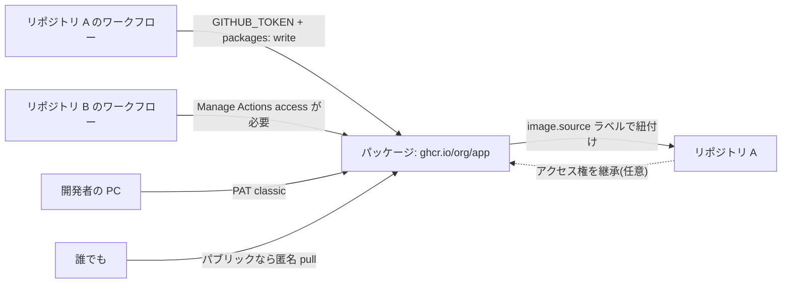

import { TLDR, DocsLinks, LastVerified, CompareTable, FlashCards, DecisionTree } from '@components';
import { Aside, Badge, Tabs, TabItem, LinkCard, CardGrid, Code } from '@astrojs/starlight/components';
import publishGhcr from '@snippets/packages-publish-ghcr.yml?raw';
import publishNpm from '@snippets/packages-publish-npm.yml?raw';

<LastVerified date="2026-10" />

<TLDR>
- GitHub Packages は、**コンテナ(`ghcr.io`)、npm、Maven、Gradle、NuGet、RubyGems** をコードの隣でホストします。認証と権限には GitHub の ID と権限モデルを使います。
- 権限モデルは 2 種類あります。
  - **細かい権限(granular)**: Container、npm、NuGet、RubyGems。パッケージはユーザーまたは Org に属し、独自のアクセス設定を持ちます。
  - **リポジトリスコープ**: Maven、Gradle。パッケージは常にリポジトリの権限と可視性を継承します。
- 公開は、Actions 内なら **`GITHUB_TOKEN`**(`permissions: packages: write`)を使います。Actions の外では **PAT(classic)** が必要です。fine-grained PAT は Packages では**使えません**。
- **課金:** パブリックパッケージは無料です。プライベートパッケージはストレージ(Actions の成果物と共有)とデータ転送で課金されます。**Container registry のストレージと帯域幅は現在無料**です。
- **可視性:** 新しいパッケージは**既定でプライベート**です。一度パブリックにすると**プライベートに戻せません**。
</TLDR>

## ブースでよくある質問

fine-grained PAT は GitHub Packages で使えますか?

**使えません。** GitHub 自身が既知のギャップとして挙げています。npm と Container registry のドキュメントにも、*「GitHub Packages は personal access token (classic) による認証のみをサポートしています」*と書かれています。

- **Actions の中:** `GITHUB_TOKEN` を使います。
- **それ以外:** `read:packages` / `write:packages` に絞った classic PAT を使うか、レジストリが対応していれば GitHub App を使います。

イメージは push できたのに、リポジトリに紐付いていないのはなぜ?

CLI から push したイメージは、名前がリポジトリと同じでも、既定では**どのリポジトリにも紐付きません**。

- **対処法:** Dockerfile に `LABEL org.opencontainers.image.source=https://github.com/OWNER/REPO` を追加します。`docker/metadata-action` を使えば自動で付きます。パッケージ設定からリポジトリに接続することもできます。
- **注意点:** リポジトリの権限が**自動で継承される**のは、最初の公開*より前*に紐付けた場合だけです。

リポジトリ A で公開したパッケージを、リポジトリ B のワークフローから pull できないのはなぜ?

`GITHUB_TOKEN` が自動でアクセスできるのは、そのパッケージを公開したリポジトリ(または紐付けたリポジトリ)だけです。

- **granular レジストリの場合:** パッケージ設定の **Manage Actions access** で **Add repository** を選び、リポジトリ B に Read ロールを付与します。
- **Maven / Gradle(リポジトリスコープ)の場合:** 別の**プライベート**リポジトリからインストールするには、classic PAT が必要です。

パブリックパッケージの pull に認証は必要ですか?

- **Container registry:** **不要**です。パブリックイメージは**匿名で pull** できます。
- **npm、Maven、Gradle、NuGet、RubyGems:** パブリックでも PAT か `GITHUB_TOKEN` での認証が**必要**です。

パッケージのバージョンは削除できますか? 元に戻せますか?

- **プライベートパッケージ:** 削除できます。
- **パブリックパッケージ:** **どのバージョンもダウンロード数が 5,000 以下**なら削除できます。超えている場合はサポートに連絡してください。
- **復元:** 削除から **30 日以内**で、名前空間がまだ使われていなければ、パッケージやバージョンを復元できます。
- **Actions からの自動化:** granular レジストリでは、`GITHUB_TOKEN` を使って REST で削除・復元できます。パッケージの **admin** 権限が必要です <Badge text="Preview" variant="caution" />。

Packages の費用は? CI からのトラフィックはカウントされますか?

**含まれるストレージと月間転送量:**

| プラン | ストレージ | 月間転送量 |
|---|---|---|
| Free | 500 MB | 1 GB |
| Pro / Team | 2 GB | 10 GB |
| Enterprise Cloud | 50 GB | 100 GB |

- **ストレージ枠:** **Actions の成果物と共有**です。
- **CI からのダウンロード:** `GITHUB_TOKEN` を使えば、ホストランナーでもセルフホストランナーでも**無料**です。**PAT を使うセルフホストランナー**からのダウンロードは課金されます。
- **Container registry:** ストレージと帯域幅は現在無料です。変更する場合は少なくとも 1 か月前に通知されます。

Packages、Actions の成果物、リリースの違いは?

解決する課題が違います。

- **Packages:** バージョン管理された、インストール可能な依存関係やイメージ。
- **成果物(artifacts):** ジョブ間で受け渡す、あるいはデバッグ用にダウンロードする、短命なビルド出力。
- **リリース:** Git タグに紐付く、人が使うダウンロード。**immutable releases** と組み合わせると改ざんを防げます。

詳しくは下の比較を参照してください。

## レジストリと権限モデル

| レジストリ | エンドポイント | 権限モデル |
|---|---|---|
| Container | `ghcr.io/OWNER/IMAGE` | **granular** |
| npm | `https://npm.pkg.github.com`(スコープ付き `@OWNER/pkg`) | **granular** |
| NuGet | `https://nuget.pkg.github.com/OWNER/index.json` | **granular** |
| RubyGems | `https://rubygems.pkg.github.com/OWNER` | **granular** |
| Apache Maven | `https://maven.pkg.github.com/OWNER/REPO` | **リポジトリスコープ** |
| Gradle | `https://maven.pkg.github.com/OWNER/REPO` | **リポジトリスコープ** |

<CompareTable
	title="granular とリポジトリスコープの比較"
	columns={[
		{ key: 'gran', label: 'granular(Container、npm、NuGet、RubyGems)' },
		{ key: 'repo', label: 'リポジトリスコープ(Maven、Gradle)' },
	]}
	rows={[
		{ feature: '所有者', category: 'モデル', values: { gran: 'ユーザーまたは Org', repo: 'リポジトリ' } },
		{ feature: 'リポジトリに紐付けずに存在できる', category: 'モデル', values: { gran: true, repo: false } },
		{ feature: '独自のアクセスリスト(ユーザー / チーム / リポジトリ)', category: 'アクセス', values: { gran: true, repo: false } },
		{ feature: '可視性', category: 'アクセス', values: { gran: 'パッケージごとに設定(既定はプライベート)', repo: 'リポジトリと同じ' } },
		{ feature: 'リポジトリの権限を継承', category: 'アクセス', values: { gran: '初回公開前に紐付けた場合(解除可)', repo: '常に' } },
		{ feature: 'パブリックパッケージの匿名 pull', category: 'アクセス', values: { gran: 'Container registry のみ', repo: false } },
		{ feature: 'GITHUB_TOKEN で公開', category: 'Actions', values: { gran: true, repo: true } },
		{ feature: '他リポジトリの Actions からのアクセス', category: 'Actions', values: { gran: '**Manage Actions access**', repo: '他のプライベートリポジトリは classic PAT' } },
		{ feature: 'Actions から REST で削除 / 復元', category: 'Actions', values: { gran: '可(Preview、admin ロール)', repo: '—' } },
		{ feature: 'GraphQL の Packages API', category: 'API', values: { gran: false, repo: true } },
		{ feature: 'リポジトリ移管時に一緒に移動', category: 'ライフサイクル', values: { gran: 'しない(アカウント所有)', repo: true } },
	]}
/>

## Actions からの公開

<Tabs>
	<TabItem label="Container(ghcr.io)+ 来歴">
		<Code code={publishGhcr} lang="yaml" title=".github/workflows/publish-image.yml" />
	</TabItem>
	<TabItem label="npm">
		<Code code={publishNpm} lang="yaml" title=".github/workflows/publish-npm.yml" />
	</TabItem>
</Tabs>

<Aside type="tip">
`actions/attest` で `push-to-registry: true` を指定すると、署名付きのビルド来歴(provenance)アテステーションがイメージと一緒に保存されます。
利用者は `gh attestation verify oci://ghcr.io/OWNER/IMAGE:TAG --owner OWNER` で検証できます。
サプライチェーンセキュリティについては [GitHub Actions](/github-cheatsheet/ja/actions/) を参照してください。
</Aside>

## 可視性と継承

- **既定の可視性:** 新しいパッケージは**プライベート**です。一度パブリックにすると**プライベートに戻せません**。
- **紐付けた granular パッケージ:** リポジトリの**アクセス権は継承しますが、可視性は継承しません**。個別にアクセス権を設定したい場合は、パッケージ設定で継承を解除します。
- **リポジトリスコープのパッケージ(Maven、Gradle):** 常にリポジトリの権限**と**可視性を共有します。
- **Org オーナーができること:**
  - メンバーが作成できるパッケージの可視性(パブリック / プライベート / internal)を制限する。
  - Org 全体で権限の自動継承を無効にする。
- **internal パッケージ:** Enterprise アカウントで利用できます。Org スコープのプライベート / internal パッケージに付与できるのは、Org のメンバーとチームだけです。

<DecisionTree
	title="このビルド出力はどこに置くべき?"
	tree={{
		start: 'q1',
		nodes: {
			q1: {
				question: '他のプロジェクトが依存関係として**インストール**したり、イメージとして pull したりしますか?',
				options: [
					{ label: 'はい', next: 'pkg' },
					{ label: 'いいえ', next: 'q2' },
				],
			},
			q2: {
				question: 'タグ付けしたバージョンを**人がダウンロード**するもの(バイナリ、インストーラー)ですか?',
				options: [
					{ label: 'はい', next: 'rel' },
					{ label: 'いいえ、ジョブ間の受け渡しやデバッグ用', next: 'art' },
				],
			},
			pkg: {
				answer: '**GitHub Packages**。バージョン管理され、`docker pull`、`npm install`、`mvn` などのネイティブツールでインストールできます。',
				links: [{ label: 'GitHub Packages の概要', href: 'https://docs.github.com/ja/packages/learn-github-packages/introduction-to-github-packages' }],
			},
			rel: {
				answer: '**リリース**。Git タグに紐付くアセットです。**immutable releases** を有効にすると、公開後にタグやアセットを変更できなくなります。',
				links: [{ label: 'リリースについて', href: 'https://docs.github.com/ja/repositories/releasing-projects-on-github/about-releases' }],
			},
			art: {
				answer: '**Actions の成果物**(`actions/upload-artifact`)。保持期間を設定できる短命な出力で、ストレージは Packages の枠と共有です。',
				links: [{ label: 'ワークフローの成果物によるデータの保存と共有', href: 'https://docs.github.com/ja/actions/tutorials/store-and-share-data' }],
			},
		},
	}}
/>

| | Packages | Actions の成果物 | リリース |
|---|---|---|---|
| 目的 | インストール可能な依存関係とイメージ | ジョブ間のビルド出力、デバッグ | 人が使うバージョン付きダウンロード |
| 利用者 | パッケージマネージャー、`docker` | ワークフロー、人(zip ダウンロード) | 人、スクリプト |
| 存続期間 | 削除するまで | 保持期間まで | 削除するまで |
| バージョン管理 | パッケージのバージョン / タグ | 実行ごと | Git タグ |
| 課金 | Packages のストレージ + 転送 | Actions のストレージ(共有枠) | 個別の従量課金なし |

## GitHub Enterprise Server の注意点

- **有効化:** 管理者が GitHub Packages を有効にし、**外部 BLOB ストレージ**(**AWS S3、Azure Blob Storage、MinIO**)を接続します。
- **エコシステムの設定:** Container、Docker、npm、Maven、Gradle、NuGet、RubyGems を、それぞれ**有効 / 無効 / 読み取り専用**に設定できます。
- **TLS 証明書:** サブドメイン分離が有効な場合は、`containers.HOSTNAME` など各パッケージホストを含む証明書が必要です。
- **CPU リソース:** Container registry を使うには、**少なくとも 10% 多い CPU** が必要です。
- **機能差:** 新機能はクラウドが先行することがあるので、ご利用の GHES バージョンのドキュメントで確認してください。

## トークポイントと落とし穴

- **npm のスコープ:** パッケージ名は `@OWNER/name` にし、`.npmrc` でスコープを `npm.pkg.github.com` に対応付ける必要があります。
- **Docker Hub / Artifactory からの移行:** GHCR には、イメージがコードの隣にある、パブリックイメージを匿名で pull できる、現在 Container のストレージが無料、アーティファクトアテステーションと統合されている、といった利点があります。
- **プロキシやキャッシュではありません:** GitHub Packages は**自社の**パッケージをホストする場所で、上流のミラーや仮想リポジトリではありません。プロキシ機能が必要なら Artifactory や Nexus を併用してください。
- **サプライチェーン:** **アーティファクトアテステーション**や、利用側での **Dependabot** と組み合わせます。詳しくは [GHAS](/github-cheatsheet/ja/ghas/) を参照してください。

<FlashCards
	title="Packages クイズ"
	cards={[
		{ q: 'リポジトリスコープの権限しか使えないレジストリは?', a: '**Maven** と **Gradle**' },
		{ q: 'fine-grained PAT は Packages で使える?', a: '**使えない。** `GITHUB_TOKEN` か classic PAT を使う。' },
		{ q: 'パブリックパッケージを匿名で pull できるレジストリは?', a: '**Container registry**(`ghcr.io`)' },
		{ q: '削除後に復元できる期間は?', a: '**30 日**' },
		{ q: 'パブリックにしたパッケージをプライベートに戻せる?', a: '**戻せない。**' },
	]}
/>

<CardGrid>
	<LinkCard title="GitHub Actions" description="ワークフロー、OIDC、アテステーション。" href="/github-cheatsheet/ja/actions/" />
	<LinkCard title="請求とライセンス" description="ストレージと転送の枠。" href="/github-cheatsheet/ja/billing/" />
</CardGrid>

<DocsLinks
	links={[
		{ label: 'GitHub Packages の概要', href: 'https://docs.github.com/ja/packages/learn-github-packages/introduction-to-github-packages' },
		{ label: 'GitHub Packages の権限について', href: 'https://docs.github.com/ja/packages/learn-github-packages/about-permissions-for-github-packages' },
		{ label: 'Container registry の利用', href: 'https://docs.github.com/ja/packages/working-with-a-github-packages-registry/working-with-the-container-registry' },
		{ label: 'Actions でのパッケージの公開とインストール', href: 'https://docs.github.com/ja/packages/managing-github-packages-using-github-actions-workflows/publishing-and-installing-a-package-with-github-actions' },
		{ label: 'リポジトリとパッケージの接続', href: 'https://docs.github.com/ja/packages/learn-github-packages/connecting-a-repository-to-a-package' },
		{ label: 'パッケージのアクセス制御と可視性の設定', href: 'https://docs.github.com/ja/packages/learn-github-packages/configuring-a-packages-access-control-and-visibility' },
		{ label: 'パッケージの削除と復元', href: 'https://docs.github.com/ja/packages/learn-github-packages/deleting-and-restoring-a-package' },
		{ label: 'GitHub Packages の課金', href: 'https://docs.github.com/ja/billing/concepts/product-billing/github-packages' },
		{ label: 'GHES: GitHub Packages の利用開始', href: 'https://docs.github.com/ja/enterprise-server@latest/admin/configuring-packages/getting-started-with-github-packages-for-your-enterprise' },
	]}
/>
