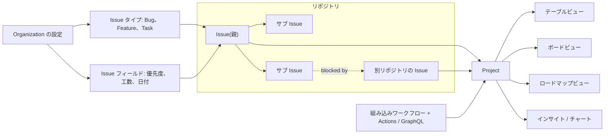

import { TLDR, DocsLinks, LastVerified, CompareTable, FlashCards } from '@components';
import { Aside, Tabs, TabItem, LinkCard, CardGrid, Code } from '@astrojs/starlight/components';
import addToProject from '@snippets/projects-add-to-project.yml?raw';

export const issueForm = `name: Bug report
description: Report a defect
type: Bug                 # Org レベルの Issue タイプを設定
labels: ["triage"]
projects: ["my-org/42"]   # Org の project に自動追加
body:
  - type: dropdown
    id: area
    attributes:
      label: Area
      options: [API, Web, Mobile]
    validations:
      required: true
  - type: textarea
    id: repro
    attributes:
      label: Steps to reproduce
      render: shell
    validations:
      required: true`;

export const graphql = `# 1) project とフィールドの ID を取得
gh project view 42 --owner my-org --format json
gh project field-list 42 --owner my-org --format json

# 2) Issue を追加し、単一選択フィールドを設定(内部では GraphQL)
gh project item-add 42 --owner my-org --url https://github.com/my-org/api/issues/123
gh project item-edit --project-id PVT_xxx --id PVTI_xxx \\
  --field-id PVTSSF_xxx --single-select-option-id 98236657`;

<LastVerified date="2026-10" />

<TLDR>
- **Issues** は作業の単位です。次のものを持てます。
  - **サブ Issue**: 親 1 つにつき最大 100、8 階層まで
  - **Issue タイプ**: Org 全体で最大 25
  - **Issue フィールド**: Org レベルの型付きフィールド。最大 25(優先度、日付など)
  - **依存関係**: blocked by / blocking
- **Projects** は、リポジトリをまたいで使えるスプレッドシート型の計画レイヤーです。**テーブル / ボード / ロードマップ**のビュー、カスタムフィールド、**イテレーション**、組み込みワークフロー、チャート、GraphQL API を備えます。
- **Issue 検索**は `AND` / `OR` と括弧(5 階層まで)、`type:` や `field.` の修飾子に対応しています。
- **自動化**はまず組み込みワークフローを使い、足りなければ Actions + GraphQL を使います。`GITHUB_TOKEN` は Projects に**アクセスできない**ので、GitHub App トークンか PAT を使います。
- **上限:** 1 つの project につき**最大 50,000 アイテム**、フィールドは**合計 50 個**まで。
</TLDR>

## ブースでよくある質問

ラベル、Issue タイプ、Issue フィールドの違いは?

- **ラベル**: リポジトリごとの自由なタグです。
- **Issue タイプ**: **Org 単位で 1 回**定義し、1 つの Issue に 1 つだけ付けます。既定は Task / Bug / Feature で、最大 25 個です。`type:"Bug"` で検索できます。
- **Issue フィールド**: Issue 自体に保存される、**Org レベルの型付きメタデータ**です。すべての project で表示されます。
  - 型は単一選択、テキスト、数値、日付の 4 種類で、Org あたり最大 25 個です。
  - 既定のフィールドは**優先度(Priority)、工数(Effort)、開始日、目標日**です。
  - Issue タイプごとにピン留めできます。

目安としては、作業の種類はタイプ、構造化された属性はフィールド、それ以外はラベルを使います。

Issue フィールドと project のカスタムフィールド、どちらを使うべき?

- **Issue フィールド**は、優先度や目標日のように、**どの project でも** Issue と一緒に持ち歩くべきデータに使います。一度定義すれば Org 全体で一貫します。
- **project のカスタムフィールド**は、チームの「スプリント目標」のように、**1 つの project でしか**意味を持たないデータに使います。

注意点:

- 1 つの project のフィールドは、Issue フィールド・カスタムフィールド・システムフィールドを**合わせて 50 個**までです。
- パブリック / internal の project に表示されるのは、**Public** に設定した Issue フィールドだけです。

サブ Issue はどこまでネストできますか? 進捗は集計されますか?

- **上限:** 親 1 つにつき **100 個**、**8 階層**までネストできます。
- **進捗:** 親 Issue にサブ Issue の完了状況が表示されます。Projects でも、親 Issue とサブ Issue の進捗をフィールドとして表示できます。
- **CLI での操作例:**
  - `gh issue create --parent 123`
  - `gh issue edit 456 --add-sub-issue 789`

多数のリポジトリから 1 つの project に Issue を自動追加できますか?

できます。組み込みワークフローの**自動追加(auto-add)**に、`is:issue label:bug` のようなフィルターを設定します。

- **project あたりの自動追加ワークフロー数:** Free は 1、Pro / Team は 5、Enterprise Cloud / Server は 20 です。
- **注意点:** 自動追加の対象は、有効化した**後に作成または更新された**アイテムだけです。既存のアイテムは手動か API で一括追加します。

Actions のワークフローから project を更新できないのはなぜ?

**`GITHUB_TOKEN` はリポジトリスコープなので、Projects にアクセスできません。**

- **Org の project:** **GitHub App** のインストールトークンを使います(推奨)。
- **ユーザーの project:** `project` スコープ付きの PAT を使います。

下の Actions の例を参照してください。

Jira から移行できますか?

GitHub Docs には、**ファーストパーティの Jira インポーターはありません**。一般的な進め方は次のとおりです。

1. **マッピングを決める:** Jira の課題タイプを **Issue タイプ**、エピックとストーリーを**サブ Issue**、カスタムフィールドを **Issue フィールド**または project のフィールドに対応付けます。
2. **データを取り出す:** Jira から CSV または API でエクスポートします。
3. **パイロットで検証する:** まず 1 つの project で試してから、`gh` と GraphQL のスクリプトで作成します。

Marketplace やパートナーのツールもありますが、ご自身で評価してください。移行期間中は、Atlassian の「GitHub for Jira」アプリでコミットや PR を Jira チケットに紐付けられます。

Projects でロードマップやバーンアップチャートは作れますか?

作れます。

- **ロードマップレイアウト:** 日付フィールドやイテレーションフィールドを使ってアイテムを配置します。月 / 四半期 / 年単位でズームでき、イテレーションやマイルストーンのマーカーも表示できます。
- **インサイト:** 組み込みの履歴バーンアップチャートに加え、カスタムチャートを作れます。チャートは Issue フィールドでグループ化できます。

## 全体像

## Issues の詳細

### 高度な検索の例

| 目的 | クエリ |
|---|---|
| 自分担当のバグ、または hubot 担当の機能 | `(type:"Bug" AND assignee:@me) OR (type:"Feature" AND assignee:hubot)` |
| オープンで優先度が高いもの | `is:open field.priority:high` |
| 目標日が指定日以降 | `field."target date":>=2026-11-01` |
| ストーリーポイントが 5 より大きい | `field.story-points:>5` |
| 「not planned」でクローズ | `is:issue is:closed reason:"not planned"` |
| どの project にも入っていない | `is:issue is:open no:project` |

括弧を使ったブール演算のグループ化は、リポジトリの Issues ページと Issues ダッシュボードで使え、**5 階層**までネストできます。

### テンプレートと Issue フォーム

Issue フォーム(`.github/ISSUE_TEMPLATE/*.yml`)を使うと、必須項目のある構造化された入力にできます。

- **自動設定できるもの:** **Issue タイプ**、ラベル、担当者、**project**。
- **`projects` の注意点:** Issue を作成する人に、その project への書き込み権限が必要です。
- **`config.yml`:** 同じフォルダーに置くと、空の Issue を無効にしたり、Discussions やサポートへのリンクを表示したりできます。

<Code code={issueForm} lang="yaml" title=".github/ISSUE_TEMPLATE/bug.yml" />

<Aside type="tip">
Org 全体の既定: Org の `.github` リポジトリに置いたテンプレートは、独自のテンプレートを持たないすべてのリポジトリに適用されます。
</Aside>

## Projects の詳細

| 機能 | お客様への説明 |
|---|---|
| **ビュー** | **テーブル**、**ボード**、**ロードマップ**。フィルター、並べ替え、グループ化、スライスをビューごとに保存 |
| **フィールド** | テキスト、数値、日付、単一選択、**イテレーション**。加えて Issue フィールドとシステムフィールド(担当者、ラベル、マイルストーン、親 Issue、サブ Issue の進捗など)。合計最大 50 |
| **イテレーション** | 日または週単位で任意の長さ。**休止期間**を入れられ、個別に編集可能 |
| **組み込みワークフロー** | クローズまたはマージで Status を *Done*(既定で有効)、追加時に *Todo*、**自動アーカイブ**、**自動追加** |
| **チャート / インサイト** | バーンアップに加え、任意のフィールドでグループ化したカスタムの棒・縦棒・折れ線・積み上げチャート |
| **API** | GraphQL `ProjectV2`(アイテム追加、フィールド更新)、`gh project` CLI、Webhook(`projects_v2_item`) |
| **規模** | アクティブとアーカイブ合わせて最大 **50,000 アイテム** |

### Actions と API による自動化

<Tabs>
	<TabItem label="Actions: add-to-project">
		<Code code={addToProject} lang="yaml" title=".github/workflows/add-to-project.yml" />
	</TabItem>
	<TabItem label="gh project CLI">
		<Code code={graphql} lang="bash" />
	</TabItem>
</Tabs>

## 計画機能の比較

<CompareTable
	title="各計画機能はどこに属するか?"
	columns={[
		{ key: 'labels', label: 'ラベル' },
		{ key: 'types', label: 'Issue タイプ' },
		{ key: 'ifields', label: 'Issue フィールド' },
		{ key: 'pfields', label: 'Project フィールド' },
		{ key: 'milestones', label: 'マイルストーン' },
	]}
	rows={[
		{ feature: '定義する場所', category: 'スコープ', values: { labels: 'リポジトリ', types: 'Org', ifields: 'Org', pfields: 'Project', milestones: 'リポジトリ' } },
		{ feature: 'Issue あたりの値の数', category: 'スコープ', values: { labels: '複数', types: '1 つ', ifields: 'フィールドごとに 1 つ', pfields: 'フィールドごとに 1 つ', milestones: '1 つ' } },
		{ feature: '型付きの値(数値 / 日付)', category: 'データ', values: { labels: false, types: false, ifields: true, pfields: true, milestones: '期日のみ' } },
		{ feature: 'すべての project で表示', category: 'データ', values: { labels: true, types: true, ifields: true, pfields: false, milestones: true } },
		{ feature: 'Issue 検索で使えるか', category: '検索', values: { labels: '`label:`', types: '`type:`', ifields: '`field.name:`', pfields: 'Project のフィルターのみ', milestones: '`milestone:`' } },
		{ feature: '上限', category: '上限', values: { labels: '—', types: 'Org あたり 25', ifields: 'Org あたり 25', pfields: 'Project あたり合計 50 フィールド', milestones: '—' } },
	]}
/>

## トークポイントと落とし穴

- **Projects はリポジトリに縛られません。** 1 つの project で複数のリポジトリや Org の Issue / PR を扱えます。ただし、project にアイテムを流し込むワークフローは**リポジトリごと**に置く必要があります。
- **ドラフト Issue** は project 内の軽量なプレースホルダーです。作業を始めるときに本物の Issue に変換します。
- **自動追加は既存アイテムを遡って追加しません。** 一度だけの一括追加を計画してください。
- **パブリック project** に表示される Issue フィールドは、**Public** に設定したものだけです。
- **Copilot との連携:** Issue を **Copilot クラウドエージェント**にアサインできます。タイプ、フィールド、サブ Issue で整理された Issue ほど、良いエージェントタスクになります。詳しくは [Copilot](/github-cheatsheet/ja/copilot/) を参照してください。

<FlashCards
	title="Projects & Issues クイズ"
	cards={[
		{ q: '親 1 つあたりのサブ Issue 上限と、ネストの深さは?', a: '**100 個** / **8 階層**' },
		{ q: 'Org あたりの Issue タイプと Issue フィールドの上限は?', a: 'どちらも **25**' },
		{ q: 'project あたりのフィールド上限は?', a: '**50**(Issue、カスタム、システムフィールドの合計)' },
		{ q: '`GITHUB_TOKEN` で project を更新できる?', a: '**できない。** GitHub App トークンか PAT を使う。' },
		{ q: 'Enterprise Cloud での自動追加ワークフロー数は?', a: 'project あたり **20**' },
	]}
/>

<CardGrid>
	<LinkCard title="Copilot" description="Issue を Copilot クラウドエージェントにアサイン。" href="/github-cheatsheet/ja/copilot/" />
	<LinkCard title="GitHub Actions" description="project の更新を自動化。" href="/github-cheatsheet/ja/actions/" />
</CardGrid>

<DocsLinks
	links={[
		{ label: 'Projects について', href: 'https://docs.github.com/ja/issues/planning-and-tracking-with-projects/learning-about-projects/about-projects' },
		{ label: 'サブ Issue の追加', href: 'https://docs.github.com/ja/issues/tracking-your-work-with-issues/using-issues/adding-sub-issues' },
		{ label: 'Organization での Issue タイプの管理', href: 'https://docs.github.com/ja/issues/tracking-your-work-with-issues/using-issues/managing-issue-types-in-an-organization' },
		{ label: 'Issue フィールドについて', href: 'https://docs.github.com/ja/issues/planning-and-tracking-with-projects/understanding-fields/about-issue-fields' },
		{ label: 'Issue の依存関係の作成', href: 'https://docs.github.com/ja/issues/tracking-your-work-with-issues/using-issues/creating-issue-dependencies' },
		{ label: 'Issue と PR のフィルターと検索', href: 'https://docs.github.com/ja/issues/tracking-your-work-with-issues/using-issues/filtering-and-searching-issues-and-pull-requests' },
		{ label: 'Issue フォームの構文', href: 'https://docs.github.com/ja/communities/using-templates-to-encourage-useful-issues-and-pull-requests/syntax-for-issue-forms' },
		{ label: '組み込みの自動化の使用', href: 'https://docs.github.com/ja/issues/planning-and-tracking-with-projects/automating-your-project/using-the-built-in-automations' },
		{ label: 'Actions を使った Projects の自動化', href: 'https://docs.github.com/ja/issues/planning-and-tracking-with-projects/automating-your-project/automating-projects-using-actions' },
		{ label: 'ロードマップレイアウトのカスタマイズ', href: 'https://docs.github.com/ja/issues/planning-and-tracking-with-projects/customizing-views-in-your-project/customizing-the-roadmap-layout' },
	]}
/>
