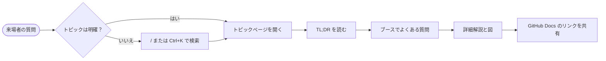

import { Aside, Badge, Tabs, TabItem } from '@astrojs/starlight/components';
import { CompareTable, DecisionTree, DocsLinks, FlashCards, LastVerified, TLDR, YamlBuilder } from '@components';

export const ciBase = `name: CI
on:
  push:
    branches: [main]
  pull_request:
# @top
jobs:
  build:
    runs-on: ubuntu-latest
    # @job
    steps:
      - uses: actions/checkout@v5
      # @steps
`;

export const ciOptions = [
	{
		id: 'permissions',
		label: '最小権限の GITHUB_TOKEN',
		section: 'top',
		default: true,
		snippet: `
permissions:
  contents: read`,
		explanation: 'トークンをデフォルトで読み取り専用に制限します（GHAS / OpenSSF のベストプラクティス）。',
	},
	{
		id: 'concurrency',
		label: '古い実行をキャンセル',
		section: 'top',
		snippet: `
concurrency:
  group: \${{ github.workflow }}-\${{ github.ref }}
  cancel-in-progress: true`,
	},
	{ id: 'timeout', label: 'ジョブのタイムアウト', section: 'job', snippet: 'timeout-minutes: 15' },
	{
		id: 'node',
		label: 'Node.js のセットアップ（キャッシュ付き）',
		description: '`actions/setup-node` を追加します。',
		snippet: `
- uses: actions/setup-node@v4
  with:
    node-version: 22
    cache: npm
- run: npm ci
- run: npm test`,
	},
];

<LastVerified date="2026-10" />

<TLDR>
- <kbd>/</kbd> または <kbd>Ctrl</kbd>+<kbd>K</kbd> で全ページを**検索**できます（英語・日本語）。
- 各トピックページは **TL;DR** → **ブースでよくある質問** → 詳細解説 の順に構成されています。
- 右上の言語切り替えから [English](/github-cheatsheet/start-here/how-to-use/) に切り替えられます。
</TLDR>

## サイトの構成

優先トピック — [GitHub Actions](/github-cheatsheet/ja/actions/)、[GitHub Copilot](/github-cheatsheet/ja/copilot/)、
[GitHub Advanced Security](/github-cheatsheet/ja/ghas/) — はサイドバーで展開表示されます。その他のトピック
（移行、導入と展開、管理、請求とライセンス、Codespaces、Projects & Issues、Packages）は折りたたまれています。

各トピックページは同じレイアウトです。

1. **最終確認** バッジ — 内容を最後に確認した時期。
2. **TL;DR** — 10 秒で伝えられる答え。
3. **ブースでよくある質問** — 会話しながら開ける折りたたみ式 Q&A。
4. **詳細解説** — 図、比較表、デシジョンツリー、ワークフロービルダー。
5. **GitHub ドキュメント** — 来場者に共有できる公式リンク。

## ブースでよくある質問

このサイトは GitHub の公式ドキュメントですか？

いいえ。[GitHub Docs](https://docs.github.com/ja) を要約・リンクするブース用の補助資料です。お客様が実際に
行動する内容については、必ず GitHub Docs のリンクを共有してください。

検索はオフラインでも使えますか？

検索はブラウザ内（Pagefind）で動作しますが、検索インデックスの一部や結果データは必要に応じて取得します。
未取得のデータを使う検索にはインターネット接続が必要なため、一度アクセスしただけでオフライン検索が保証されるわけではありません。

## コンポーネントのデモ

<Aside type="tip">これらのデモは執筆者向けのコピー＆ペースト用サンプルでもあります。README の「Authoring guide」を参照してください。</Aside>

### デシジョンツリー

<DecisionTree
	title="どのランナーを使うべき？"
	tree={{
		start: 'q1',
		nodes: {
			q1: {
				question: 'ジョブは**プライベートネットワーク**内のリソースにアクセスする必要がありますか？',
				options: [
					{ label: 'はい', next: 'q2' },
					{ label: 'いいえ', next: 'q3' },
				],
			},
			q2: {
				question: '自分で VM / Kubernetes を管理できますか？',
				options: [
					{ label: 'はい', next: 'selfhosted' },
					{ label: 'いいえ', next: 'vnet' },
				],
			},
			q3: {
				question: 'より多くの CPU/RAM、GPU、または固定 IP が必要ですか？',
				options: [
					{ label: 'はい', next: 'larger' },
					{ label: 'いいえ', next: 'standard' },
				],
			},
			selfhosted: {
				answer: '**セルフホストランナー**を使用します（Kubernetes 上の Actions Runner Controller も検討）。',
				links: [{ label: 'セルフホストランナーについて', href: 'https://docs.github.com/ja/actions/hosting-your-own-runners' }],
			},
			vnet: { answer: '**Azure プライベートネットワーク接続の GitHub ホステッド大型ランナー**を使用します。' },
			larger: { answer: '**大型ランナー**を使用します（`runs-on: my-larger-runner`）。' },
			standard: { answer: '標準の GitHub ホステッドランナー（`ubuntu-latest`）で十分です。' },
		},
	}}
/>

### ワークフロー YAML ビルダー

<YamlBuilder title="CI ワークフローを作成" filename=".github/workflows/ci.yml" base={ciBase} options={ciOptions} />

### 比較表

<CompareTable
	title="どこで実行される？"
	columns={[
		{ key: 'hosted', label: 'GitHub ホステッド' },
		{ key: 'larger', label: '大型ランナー' },
		{ key: 'self', label: 'セルフホスト' },
	]}
	rows={[
		{ feature: 'GitHub が管理', category: '運用', values: { hosted: true, larger: true, self: false } },
		{ feature: 'GPU 利用可能', category: 'ハードウェア', values: { hosted: false, larger: true, self: true } },
		{ feature: '固定 IP', category: 'ネットワーク', values: { hosted: false, larger: true, self: '自社ネットワーク' } },
	]}
/>

### フラッシュカード

<FlashCards
	title="クイズ"
	cards={[
		{ q: '検索を開くキーは？', a: '<kbd>/</kbd> または <kbd>Ctrl</kbd>+<kbd>K</kbd>' },
		{ q: '公式な答えはどこにある？', a: '[GitHub Docs](https://docs.github.com/ja)' },
		{ q: '`permissions: contents: read` の効果は？', a: '`GITHUB_TOKEN` をリポジトリ内容の読み取り専用に制限します。' },
	]}
/>

### Starlight 組み込みコンポーネント

<Tabs>
	<TabItem label="Badge">ステータスバッジ: <Badge text="GA" variant="success" /> <Badge text="プレビュー" variant="caution" /></TabItem>
	<TabItem label="Aside">`<Aside type="note|tip|caution|danger">` でコールアウトを表示します。</TabItem>
</Tabs>

<DocsLinks
	links={[
		{ label: 'GitHub Docs ホーム', href: 'https://docs.github.com/ja' },
		{ label: 'GitHub Actions ドキュメント', href: 'https://docs.github.com/ja/actions' },
	]}
/>
