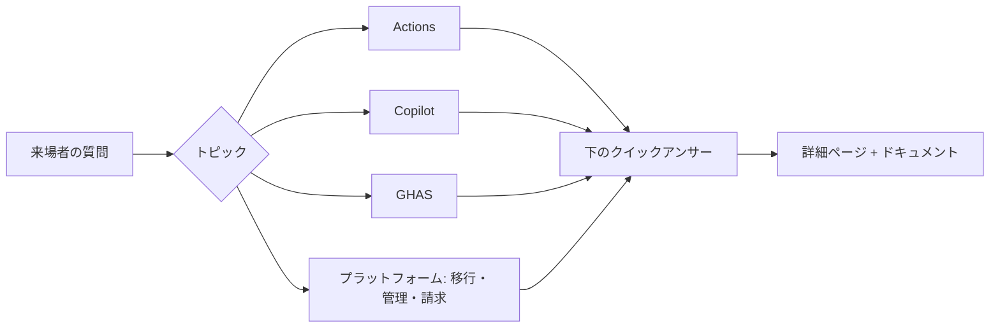

import { Tabs, TabItem, Aside, Badge } from '@astrojs/starlight/components';
import { TLDR, LastVerified } from '@components';

<LastVerified date="2026-10" />

<TLDR>

- 1〜2 行で即答し、**→** から図・YAML・ドキュメントリンク付きの詳細ページへ進めます。
- <kbd>/</kbd> または <kbd>Ctrl</kbd>+<kbd>K</kbd> でサイト全体を検索できます（英語・日本語対応）。
- <Badge text="要確認" variant="caution" /> の付いた回答は変更が多い内容です。引用前に docs.github.com で確認してください。

</TLDR>

<Tabs syncKey="qa-topic">
<TabItem label="⚙️ Actions">

必須チェックが "Expected — waiting for status" のまま止まる

`paths`/`branches` フィルターでワークフローがスキップされ、ステータスが報告されていません。`if: always()` の集約ジョブを 1 つ作り、それだけを必須チェックにしてください。必須ワークフローにはパスフィルターを使わないでください。→ [高度なワークフロー](/github-cheatsheet/ja/actions/advanced-workflows/) · [トラブルシューティング](/github-cheatsheet/ja/actions/troubleshooting/)

再利用可能ワークフローと複合アクション、どちらを使う？

**再利用可能ワークフロー**はパイプライン全体（ジョブ、ランナー、環境、シークレット）を扱い、最大 10 階層までネストできます。**複合アクション**は呼び出し元のジョブ内で動くステップの集まりです。ゴールデンパスのパイプラインには前者、共通のステップ処理には後者を使います。→ [高度なワークフロー](/github-cheatsheet/ja/actions/advanced-workflows/)

長期キーなしで AWS/Azure/GCP にデプロイするには？

OIDC を使います。`permissions: id-token: write` を設定し、クラウド側の信頼ポリシーで `sub` クレームを照合します。照合はリポジトリ**と**環境に固定するのが理想です。2026-07-15 以降に作成されたリポジトリでは、ID を含むイミュータブルな `sub` 形式が使われます。→ [セキュリティ強化](/github-cheatsheet/ja/actions/security/)

マージキューが永遠に待機する

必須ワークフローには `on: merge_group` トリガーも必要です。→ [高度なワークフロー](/github-cheatsheet/ja/actions/advanced-workflows/)

ボットの push で CI が動かない

`GITHUB_TOKEN` によるイベントは新しいワークフロー実行を起動しません（`workflow_dispatch` と `repository_dispatch` を除く）。連鎖実行が必要な場合は GitHub App トークンを使ってください。→ [トラブルシューティング](/github-cheatsheet/ja/actions/troubleshooting/)

数百リポジトリに CI 標準を強制するには？

Organization またはエンタープライズのルールセットで **「Require workflows to pass before merging」** を有効にし、カスタムプロパティで対象リポジトリを指定します。再利用可能ワークフローとワークフローテンプレートで裏付けます。→ [エンタープライズのパターン](/github-cheatsheet/ja/actions/enterprise-patterns/)

pull_request_target は安全？

PR のコードをチェックアウト・実行しない場合に限り安全です。パブリックリポジトリでは既定のポリシーでブロックされるようになり、2026-11-02 から強制されます <Badge text="要確認" variant="caution" />。信頼できない入力は `run:` 内の `${{ }}` ではなく `env:` 経由で渡してください。→ [セキュリティ強化](/github-cheatsheet/ja/actions/security/)

アクションは SHA で固定すべき？

はい。Organization の許可アクションポリシーで完全な SHA での固定を強制でき、固定した SHA は Dependabot で更新を維持できます。→ [セキュリティ強化](/github-cheatsheet/ja/actions/security/)

Kubernetes で大規模にセルフホストランナーを運用するには？

ARC（Actions Runner Controller）のランナースケールセットとエフェメラルな JIT Pod を使います。パブリックリポジトリに永続的なセルフホストランナーを接続しないでください。→ [ランナー](/github-cheatsheet/ja/actions/runners/)

キャッシュの上限は？

リポジトリあたり 10 GB が含まれます。超過課金で引き上げ可能で、7 日間使われていないエントリは削除されます。<Badge text="要確認" variant="caution" /> → [パフォーマンスとコスト](/github-cheatsheet/ja/actions/performance-cost/)

</TabItem>
<TabItem label="🤖 Copilot">

Copilot の課金方式は？

2026 年 6 月 1 日から **GitHub AI Credits**（1 クレジット = $0.01）に変わり、モデルとトークン量に応じて消費されます。プレミアムリクエストはレガシーです。有料プランではコード補完と次の編集候補（NES）は無制限で、Auto モデル選択には割引があります。<Badge text="要確認" variant="caution" /> → [プランと課金](/github-cheatsheet/ja/copilot/plans-billing/)

クレジットを使い切ったら？

安価なモデルへのフォールバックはありません。Organization では、管理者がポリシーで無効にしない限り、既定で有料の超過利用として継続されます。→ [プランと課金](/github-cheatsheet/ja/copilot/plans-billing/)

カスタムエージェント・プロンプト・スキルを作るべき？ エージェントに任せるべき？

まずは既定のまま使い、**同じ失敗が繰り返された**ときだけカスタマイズを追加します。

- **カスタム指示:** ビルド・テストのコマンドや、コードから分からないルールを短く書く。
- **スキル:** 繰り返し行う専門手順に使う。必要なときだけ読み込まれる。
- **カスタムエージェント:** ツールを制限した明確な役割に使う。
- **フック / CI:** 必ず守らせたいことに使う。

→ [ベストプラクティス 2026](/github-cheatsheet/ja/copilot/best-practices/)

プロンプトファイルとスキル、どちら？

基本は**スキル**です。自動で読み込まれ、クラウドエージェント・CLI・コードレビューでも動作します。プロンプトファイルは IDE 専用です。→ [カスタマイズ](/github-cheatsheet/ja/copilot/customization/)

カスタム指示でルールは必ず守られる？

いいえ。確実に守らせたい場合は `preToolUse` フック、CI、またはルールセットを使ってください。→ [カスタマイズ](/github-cheatsheet/ja/copilot/customization/)

コーディングエージェントは自分の PR をマージできる？

できません。エージェントは `copilot/*` ブランチにのみ push し、ドラフト PR を作成します。承認には人間が必要で、作業を依頼した本人は承認できません。CI の実行も「Approve and run workflows」を押すまで待機します。→ [コーディングエージェント](/github-cheatsheet/ja/copilot/coding-agent/)

自社のコードで学習される？

Business / Enterprise のデータは学習に使われません。Free / Pro / Pro+ / Max は、ユーザーがオプトアウトしない限り使用される可能性があります。<Badge text="要確認" variant="caution" /> → [プライバシーとセキュリティ](/github-cheatsheet/ja/copilot/privacy-security/)

コンテンツ除外はどこでも効く？

いいえ。IDE のエージェントモードでは適用されず、CLI 対応はドキュメント間で記述が矛盾しています。セキュリティ境界として頼らないでください。→ [管理とガバナンス](/github-cheatsheet/ja/copilot/admin-governance/)

Copilot Extensions は？

Copilot Extensions は提供終了し、MCP サーバーに置き換えられました。→ [CLI・Spaces・MCP](/github-cheatsheet/ja/copilot/cli-and-more/)

GHES で Copilot は使える？

GHES では利用できません。代替は GHE.com（データレジデンシー）です。→ [Copilot 概要](/github-cheatsheet/ja/copilot/)

</TabItem>
<TabItem label="🛡️ GHAS">

GHAS はまだ 1 つのバンドル？

いいえ。2025 年 4 月から **Secret Protection** と **Code Security** に分かれて販売されています。Team / Enterprise プランで購入でき、過去 90 日間のユニークなアクティブコミッター数で課金されます。→ [GHAS 概要](/github-cheatsheet/ja/ghas/)

どこから始める？

1. 無料のシークレットリスク評価を実行する。
2. すべてのリポジトリでプッシュ保護を有効にする。
3. CodeQL の既定のセットアップを有効にする。
4. Copilot Autofix を使ったセキュリティキャンペーンを実施する。

→ [大規模展開](/github-cheatsheet/ja/ghas/rollout-at-scale/)

既定のセットアップと高度なセットアップ、どちら？

まずは既定のセットアップから始めます。build-mode `none` なら C/C++・C#・Java・Rust はビルド不要です。カスタムパックや設定ファイル、手動ビルド、モノレポが必要な場合だけ高度なセットアップに移行します。→ [コードスキャン](/github-cheatsheet/ja/ghas/code-scanning/)

Copilot Autofix に Copilot ライセンスは必要？

不要です。Autofix は Code Security に含まれ、パブリックリポジトリでは無料です。→ [コードスキャン](/github-cheatsheet/ja/ghas/code-scanning/)

開発者はプッシュ保護をバイパスできる？

既定ではできます。**委任バイパス**を有効にすると、バイパスはレビュー担当者が承認するリクエストになります。→ [シークレットスキャン](/github-cheatsheet/ja/ghas/secret-scanning/)

シークレットが漏洩した。まず何をする？

**まずローテーションまたは失効させてください。** Git 履歴の書き換えはその後です。→ [シークレットスキャン](/github-cheatsheet/ja/ghas/secret-scanning/)

脆弱性を含む PR をブロックできる？

できます。ルールセットの **「Require code scanning results」** を使い、脆弱な依存関係には dependency review action を併用します。→ [コードスキャン](/github-cheatsheet/ja/ghas/code-scanning/) · [サプライチェーン](/github-cheatsheet/ja/ghas/supply-chain/)

Dependabot の PR が多すぎる

`groups`、`cooldown`、自動トリアージルールを使ってください。→ [サプライチェーン](/github-cheatsheet/ja/ghas/supply-chain/)

独自フレームワークが CodeQL で検出されない

CodeQL モデルエディターとモデルパック <Badge text="Preview" variant="caution" /> でモデル化するか、カスタムクエリパックを作成してください。→ [CodeQL 応用](/github-cheatsheet/ja/ghas/codeql-advanced/)

</TabItem>
<TabItem label="🏢 プラットフォーム">

どの移行ツールを使う？

- GHES・ADO Cloud・Bitbucket Server/DC・GitLab（`gl2gh` 経由）→ **GitHub Enterprise Importer**
- Bitbucket Cloud → `git push --mirror` または GitHub Importer
- CI パイプライン → **Actions Importer**

→ [移行](/github-cheatsheet/ja/migration/)

GEI で移行されないものは？

Git LFS オブジェクト（移行後に push が必要）とパイプラインは移行されません。コミット以外のアクティビティは**マネキン**に紐付けられ、移行後に再要求します。移行先のルールセットが原因で移行が失敗することもあります。→ [GEI](/github-cheatsheet/ja/migration/repos-gei/)

EMU と個人アカウント、どちら？

エンタープライズを作成する**前に**決めてください。後から切り替えるには、新しいエンタープライズを作って移行する必要があります。GHE.com は常に EMU です。→ [管理](/github-cheatsheet/ja/administration/)

ルールセットが重なるとどうなる？

すべて集約され、最も厳しいルールが適用されます。強制する前に **Evaluate** モードで検証してください。→ [ガバナンス](/github-cheatsheet/ja/administration/governance/)

監査ログの保持期間は？

180 日です（Git イベントは 7 日）。長期保管には S3・Azure・Datadog・Splunk などへストリーミングします。→ [ガバナンス](/github-cheatsheet/ja/administration/governance/)

GHE シート / GHAS コミッターとしてカウントされるのは？

- **GHE シート:** Organization のメンバーと、プライベートリポジトリの外部コラボレーター。
- **GHAS コミッター:** 製品が有効なリポジトリに過去 90 日間で push したユニークユーザー。

→ [請求](/github-cheatsheet/ja/billing/)

予算で支出を強制停止できる？

従量課金製品ではできます。ライセンスについては予算はアラートのみです。→ [請求](/github-cheatsheet/ja/billing/)

Copilot をどう展開する？

チャンピオンを含むパイロットを実施し、ポリシーを決めてから段階的に展開します。効果は使用状況メトリクスダッシュボードと PR スループットで測定します。→ [Copilot 展開](/github-cheatsheet/ja/adoption/copilot-rollout/)

Codespaces / Projects / Packages の一言回答

- **Codespaces:** Organization のポリシーは Organization 負担の codespace にのみ適用されます。IP 許可リストを使うと codespace はブロックされます。→ [Codespaces](/github-cheatsheet/ja/codespaces/)
- **Projects:** `GITHUB_TOKEN` では Projects にアクセスできないため、App トークンを使います。→ [Projects と Issues](/github-cheatsheet/ja/projects-issues/)
- **Packages:** fine-grained PAT は Packages では使えないため、`GITHUB_TOKEN` を使います。→ [Packages](/github-cheatsheet/ja/packages/)

</TabItem>
</Tabs>

<Aside type="tip">初めての方は、インタラクティブ要素の使い方を[このサイトの使い方](/github-cheatsheet/ja/start-here/how-to-use/)で確認してください。</Aside>
