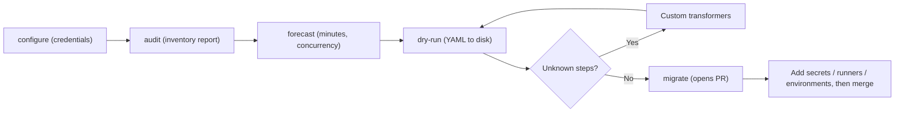

import { TLDR, DocsLinks, LastVerified, FlashCards } from '@components';
import { Aside, Badge, Tabs, TabItem, Steps } from '@astrojs/starlight/components';

<LastVerified date="2026-10" />

<TLDR>
- **GitHub Actions Importer** (formerly code-named "Valet") is a Docker container that you drive with the `gh actions-importer` CLI extension.
- **Sources:** Azure DevOps, Bamboo, Bitbucket Pipelines, CircleCI, GitLab (cloud and self-hosted), Jenkins and Travis CI.
- **Four verbs:** `audit` (inventory) → `forecast` (runner minutes and concurrency) → `dry-run` (writes YAML locally) → `migrate` (opens a PR).
- GitHub's goal is **about 80% conversion per workflow**. Plan for a manual last mile (secrets, unknown plugins, self-hosted runners). **Custom transformers** close the gaps at scale.
</TLDR>

## Common booth questions

<details>
<summary>Does it migrate our secrets and credentials?</summary>

No. Converted workflows **reference** `secrets.*`, but you create the secrets (org, repo or environment level) yourself. This is a good moment to replace long-lived cloud keys with **OIDC** federation.

</details>

<details>
<summary>How much of our Jenkins estate will convert automatically?</summary>

Run `audit` and you get a report that classifies pipelines as **successful**, **partially successful**, **unsupported** or **failed**, and build steps as **known**, **unknown** or **unsupported**. That report is your real answer. The documented goal is ~80% per workflow, and the actual result depends heavily on plugin usage.

</details>

<details>
<summary>Can it tell us how many Actions minutes we'll need?</summary>

Yes. `forecast` uses historical job data to estimate usage and concurrency. For **Jenkins**, you have to install the `paginated-builds` plugin on the Jenkins server first. `forecast github` also works on existing GitHub Actions history.

</details>

<details>
<summary>We have hundreds of custom Jenkins shared-library steps. Now what?</summary>

Write **custom transformers**, a small Ruby DSL that maps an unknown step or plugin to the Actions steps you want, then re-run `dry-run` or `migrate` with `--custom-transformers`. Long term, refactor shared libraries into **reusable workflows** and **composite actions**.

</details>

<details>
<summary>Can teams self-serve their migrations?</summary>

Yes, with the **IssueOps** template ([`actions/importer-issue-ops`](https://github.com/actions/importer-issue-ops)). A developer opens an issue from a template, and an Actions workflow runs the importer and opens the PR. For training, use [`actions/importer-labs`](https://github.com/actions/importer-labs).

</details>

<details>
<summary>Is Actions Importer still maintained?</summary>

Its docs on docs.github.com are current (they moved to `/actions/tutorials/migrate-to-github-actions/automated-migrations`). The extension installs from `github/gh-actions-importer`. Run `gh actions-importer update` regularly. Verify the current status on github.com before making promises.

</details>

<details>
<summary>We want to keep Azure Pipelines for now. Is that OK?</summary>

Yes. Azure Pipelines can build GitHub repos, and the `ado2gh --all` script can rewire pipelines during a repo migration. Migrate the CI later, team by team.

</details>

## Workflow of a CI migration



<Steps>

1. Install it and configure credentials. Docker and the GitHub CLI are required, and the container doesn't need to run on the CI server.

   ```bash
   gh extension install github/gh-actions-importer
   gh actions-importer update
   gh actions-importer configure      # interactive; writes .env.local
   ```

2. Audit the estate:

   ```bash
   gh actions-importer audit jenkins --output-dir audit/
   ```

3. Forecast usage:

   ```bash
   gh actions-importer forecast jenkins --output-dir forecast/
   ```

4. Do a dry run on one pipeline and review the YAML:

   ```bash
   gh actions-importer dry-run jenkins --source-url https://jenkins.example.com/job/app --output-dir out/
   ```

5. Migrate. This opens a PR in the target repo:

   ```bash
   gh actions-importer migrate jenkins --source-url https://jenkins.example.com/job/app \
     --target-url https://github.com/acme/app --output-dir out/
   ```

</Steps>

<Aside type="note">
Flags vary per source. For example, Azure DevOps uses `--pipeline-id` and GitLab uses `--namespace` and `--project`. Run `gh actions-importer <verb> <source> -h` at the booth to show the exact flags.
</Aside>

## Concept mapping (for manual conversion and reviews)

| Concept | Jenkins | Azure Pipelines | GitLab CI | GitHub Actions |
|---|---|---|---|---|
| Pipeline file | `Jenkinsfile` | `azure-pipelines.yml` | `.gitlab-ci.yml` | `.github/workflows/*.yml` |
| Trigger | `triggers {}` / SCM polling | `trigger:` / `pr:` / `schedules:` | `rules:` / `only` / `except` | `on:` (push, pull_request, schedule, workflow_dispatch…) |
| Stage | `stage('Build')` | `stages:` | `stages:` | **job** (ordered with `needs:`) |
| Job | (agent block) | `jobs:` | job | `jobs.<id>` |
| Step | `steps {}` / `sh` | `steps:` / tasks | `script:` | `steps:` with `run:` or `uses:` |
| Agent / runner | `agent { label 'x' }` | `pool:` | runner `tags:` | `runs-on:` (labels, groups, larger runners) |
| Container | `agent { docker }` | `container:` | `image:` | `jobs.<id>.container` / `services:` |
| Parallelism | `parallel {}` / matrix | `strategy: matrix` | `parallel: matrix` | `strategy.matrix` / independent jobs |
| Conditions | `when {}` | `condition:` | `rules: if` | `if:` |
| Post actions | `post { always/failure }` | `condition: always()` | `after_script` / `when: on_failure` | `if: always()` / `failure()` |
| Variables | `environment {}` | `variables:` / variable groups | CI/CD variables | `env:` + `vars.*` (org/repo/env) |
| Secrets | `credentials()` | secret variables / service connections | masked variables | `secrets.*` + **OIDC** for cloud |
| Reuse | Shared libraries | templates | `include:` / `extends:` | reusable workflows, composite actions, YAML anchors |
| Plugins / tasks | Plugins | Marketplace tasks | — | Marketplace **actions** |
| Approvals | `input` step | Environments + checks | `when: manual`, protected envs | **Environments** + required reviewers |
| Artifacts / cache | `archiveArtifacts` / stash | `PublishPipelineArtifact` / Cache | `artifacts:` / `cache:` | `actions/upload-artifact` / `actions/cache` |

### Before and after: a small Jenkinsfile

<Tabs>
<TabItem label="Jenkinsfile">

```groovy
pipeline {
  agent { label 'linux' }
  environment { NODE_ENV = 'test' }
  stages {
    stage('Build') { steps { sh 'npm ci && npm run build' } }
    stage('Test')  { steps { sh 'npm test' } }
    stage('Deploy') {
      when { branch 'main' }
      steps {
        input message: 'Deploy to prod?'
        withCredentials([string(credentialsId: 'DEPLOY_TOKEN', variable: 'TOKEN')]) {
          sh './deploy.sh'
        }
      }
    }
  }
  post { failure { echo 'Build failed' } }
}
```

</TabItem>
<TabItem label="GitHub Actions">

```yaml
name: ci
on:
  push:
    branches: [main]
  pull_request:
permissions:
  contents: read
env:
  NODE_ENV: test
jobs:
  build:
    runs-on: [self-hosted, linux]
    steps:
      - uses: actions/checkout@v5
      - run: npm ci && npm run build
  test:
    needs: build
    runs-on: [self-hosted, linux]
    steps:
      - uses: actions/checkout@v5
      - run: npm ci && npm test
  deploy:
    needs: test
    if: github.ref == 'refs/heads/main'
    runs-on: [self-hosted, linux]
    environment: production   # required reviewers replace `input`
    steps:
      - uses: actions/checkout@v5
      - run: ./deploy.sh
        env:
          TOKEN: ${{ secrets.DEPLOY_TOKEN }}
      - if: failure()
        run: echo "Build failed"
```

</TabItem>
</Tabs>

## Gotchas & talking points

- **Each job runs on a fresh runner.** Jenkins stages often share a workspace, but in Actions you either re-checkout and rebuild, or pass artifacts between jobs.
- **Interactive `input` steps** become **environment protection rules** (required reviewers or wait timers).
- **Credentials:** don't copy static cloud keys. Use **OIDC** with AWS, Azure or GCP plus short-lived tokens.
- **Shared libraries** → reusable workflows (`workflow_call`) in a central repo, governed by required workflows or rulesets.
- **Bitbucket Pipelines and Bamboo** are supported, but the coverage of individual verbs varies by source. Check `gh actions-importer <verb> -h`.
- **Pin third-party actions to a full commit SHA** in converted workflows, and enable the allow-list policy.

<FlashCards
	title="Actions Importer quiz"
	cards={[
		{ q: 'Which command opens a PR with the converted workflow?', a: '`gh actions-importer migrate <source>`' },
		{ q: 'What does `forecast` need on Jenkins?', a: 'The **`paginated-builds`** plugin installed on the Jenkins server.' },
		{ q: 'What is the target conversion rate?', a: '~**80%** per workflow. Always review the output before production.' },
		{ q: 'How do you handle unknown plugins at scale?', a: '**Custom transformers** (a Ruby DSL) passed with `--custom-transformers`.' },
		{ q: 'Jenkins `stage` maps to…?', a: 'Usually a **job**, ordered with `needs:`.' },
	]}
/>

<DocsLinks
	links={[
		{ label: 'Automated migrations with Actions Importer', href: 'https://docs.github.com/en/actions/tutorials/migrate-to-github-actions/automated-migrations' },
		{ label: 'Using GitHub Actions Importer', href: 'https://docs.github.com/en/actions/tutorials/migrate-to-github-actions/automated-migrations/use-github-actions-importer' },
		{ label: 'Migrating from Jenkins', href: 'https://docs.github.com/en/actions/tutorials/migrate-to-github-actions/automated-migrations/jenkins-migration' },
		{ label: 'Migrating from Azure DevOps', href: 'https://docs.github.com/en/actions/tutorials/migrate-to-github-actions/automated-migrations/azure-devops-migration' },
		{ label: 'Migrating from GitLab', href: 'https://docs.github.com/en/actions/tutorials/migrate-to-github-actions/automated-migrations/gitlab-migration' },
		{ label: 'Custom transformers', href: 'https://docs.github.com/en/actions/reference/github-actions-importer/custom-transformers' },
	]}
/>
