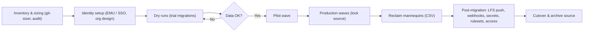

import { TLDR, DocsLinks, LastVerified, DecisionTree } from '@components';
import { Aside, Badge, LinkCard, CardGrid } from '@astrojs/starlight/components';

<LastVerified date="2026-10" />

<TLDR>
- **Repos + PRs + history → GitHub Enterprise Cloud:** use **GitHub Enterprise Importer (GEI)**. It supports GHES 3.4.1+, GitHub.com, GHE.com (cross-enterprise), Azure DevOps Cloud, Bitbucket Server/Data Center 5.14+ and GitLab.
- **CI/CD pipelines → GitHub Actions:** use **GitHub Actions Importer** (it was previously code-named "Valet"). It handles Jenkins, Azure DevOps, GitLab, CircleCI, Travis CI, Bamboo and Bitbucket Pipelines.
- **Into GHES** (GHES→GHES or GitHub.com→GHES): use `ghe-migrator`. **Code only, from anything else:** use GitHub Importer or `git push --mirror`.
- **GHES → GHE.com with minimal downtime:** look at **Enterprise Live Migrations (ELM)**, which works on supported GHES 3.17+ patch releases.
- Treat a migration as a **program**, not a one-off command: inventory → dry runs → pilot → waves → reclaim mannequins → cutover.
</TLDR>

## Common booth questions

We're on Bitbucket Cloud. Can GEI migrate our PRs?

The current docs list only **Bitbucket Server / Data Center 5.14+** as a GEI source. Bitbucket Cloud is **not** listed, so plan to move code and history with GitHub Importer or `git push --mirror`, and the pipelines with Actions Importer (Bitbucket Pipelines). Verify before quoting, because support could change at any time.

We're on Azure DevOps Server (on-prem). Can we go straight to GitHub?

Not with GEI, which supports **ADO Cloud only**. Your options are to migrate ADO Server → ADO Cloud first and then use GEI, or to move code only with `git push --mirror`.

Is there an official GitLab path now?

Yes. GEI supports **GitLab.com and maintained self-hosted GitLab versions** through the `gh gl2gh` CLI extension. It migrates the repo, wiki, issues, MRs→PRs, milestones, releases and more. It does **not** migrate CI/CD pipelines (`.gitlab-ci.yml`); use Actions Importer for those.

Will we lose who authored what?

Git commits keep their original authors. All other activity (PRs, comments, issues) is attributed to placeholder **mannequins**, which you **reclaim** to real org members after the migration (in bulk via CSV). See [GEI repository migrations](/github-cheatsheet/migration/repos-gei/).

How much downtime is there?

GEI migrates a snapshot of each repo, so anything pushed to the source after the export is not carried over. Plan **waves** with a change freeze (make the source read-only) per wave and use dry-run timings to size each wave. For GHES → GHE.com, **Enterprise Live Migrations** is designed to reduce downtime and handle large monorepos better.

Do migrated repos burn GHAS licenses for old committers?

No. For repos migrated with GEI, GHAS license consumption counts only commits pushed **after** the migration.

## Which migration tool?

<DecisionTree
	title="Which migration tool?"
	tree={{
		start: 'what',
		nodes: {
			what: {
				question: 'What are you moving?',
				options: [
					{ label: 'Repositories (code, PRs, issues)', next: 'src' },
					{ label: 'CI/CD pipelines', next: 'ci' },
					{ label: 'Both', next: 'both' },
				],
			},
			src: {
				question: 'Where is the source?',
				options: [
					{ label: 'GitHub Enterprise Server', next: 'ghesdest' },
					{ label: 'GitHub.com / GHE.com', next: 'ghcomdest' },
					{ label: 'Azure DevOps', next: 'ado' },
					{ label: 'Bitbucket Server / Data Center', next: 'bbs' },
					{ label: 'GitLab', next: 'gitlab' },
					{ label: 'Bitbucket Cloud or other Git host', next: 'other' },
					{ label: 'SVN / TFVC / Mercurial', next: 'nongit' },
				],
			},
			ghesdest: {
				question: 'Where is the destination?',
				options: [
					{ label: 'GitHub Enterprise Cloud (GitHub.com)', next: 'gei' },
					{ label: 'GHE.com (data residency)', next: 'elm' },
					{ label: 'Another GHES instance', next: 'ghemig' },
				],
			},
			ghcomdest: {
				question: 'Where is the destination?',
				options: [
					{ label: 'Another org / enterprise on GitHub Enterprise Cloud', next: 'gei' },
					{ label: 'A GHES instance', next: 'ghemig' },
				],
			},
			ado: {
				question: 'Azure DevOps **Cloud** or **Server**?',
				options: [
					{ label: 'Cloud', next: 'ado2gh' },
					{ label: 'Server (on-prem)', next: 'adoserver' },
				],
			},
			gei: {
				answer: 'Use **GEI** with `gh gei` (repo or whole-org migrations from GitHub.com; repo migrations from GHES). Run dry runs first, then reclaim mannequins.',
				links: [{ label: 'About GEI', href: 'https://docs.github.com/en/migrations/using-github-enterprise-importer/understanding-github-enterprise-importer/about-github-enterprise-importer' }],
			},
			elm: {
				answer: 'Consider **Enterprise Live Migrations** (supported GHES 3.17+ patch releases) for low downtime and large monorepos; otherwise use **GEI** (`gh gei`).',
				links: [{ label: 'About Enterprise Live Migrations', href: 'https://docs.github.com/en/migrations/elm/about-live-migrations' }],
			},
			ghemig: {
				answer: 'Use **`ghe-migrator`** (site admin on GHES). Do a trial run on a staging instance first. Do not use it to move an instance between hypervisors; use backup-utils or a replica for that.',
				links: [{ label: 'About ghe-migrator', href: 'https://docs.github.com/en/enterprise-server@latest/migrations/using-ghe-migrator/about-ghe-migrator' }],
			},
			ado2gh: {
				answer: 'Use **GEI** with `gh ado2gh`. Repos, PRs, PR history, work-item links on PRs and branch policies migrate. Azure Boards and Pipelines can stay integrated with GitHub repos.',
				links: [{ label: 'ADO → GitHub', href: 'https://docs.github.com/en/migrations/ado/understand-migrations-from-azure-devops-to-github' }],
			},
			adoserver: {
				answer: 'GEI does **not** support ADO Server. Either migrate to **ADO Cloud first**, then use `gh ado2gh`, or move **code only** with `git push --mirror`.',
			},
			bbs: {
				answer: 'Use **GEI** with `gh bbs2gh` (Bitbucket Server/DC **5.14+**). Code and PRs migrate; branch permissions, repo settings and CI pipelines do not.',
				links: [{ label: 'Bitbucket Server → GHEC', href: 'https://docs.github.com/en/migrations/using-github-enterprise-importer/migrating-from-bitbucket-server-to-github-enterprise-cloud/about-migrations-from-bitbucket-server-to-github-enterprise-cloud' }],
			},
			gitlab: {
				answer: 'Use **GEI** with the `gh gl2gh` extension (GitLab.com or maintained self-hosted versions). Pipelines are not migrated; use Actions Importer for those.',
				links: [{ label: 'GitLab migrations', href: 'https://docs.github.com/en/migrations/using-github-enterprise-importer/migrate-from-gitlab/understand-migrations' }],
			},
			other: {
				answer: '**Code + history only:** use **GitHub Importer** (GitHub.com UI; the source must be reachable from the internet) or `git clone --mirror` + `git push --mirror`. Issues/PRs need custom API scripting. Push Git LFS objects separately.',
				links: [{ label: 'About GitHub Importer', href: 'https://docs.github.com/en/migrations/importing-source-code/using-github-importer/about-github-importer' }],
			},
			nongit: {
				answer: 'Convert to Git first (for example `git svn` or `git-tfs`), then push. GitHub Importer only supports Git sources.',
				links: [{ label: 'Command-line source imports', href: 'https://docs.github.com/en/migrations/importing-source-code/using-the-command-line-to-import-source-code/about-source-code-imports-using-the-command-line' }],
			},
			ci: {
				answer: 'Use **GitHub Actions Importer** (`gh actions-importer audit → forecast → dry-run → migrate`). Expect to finish the last mile by hand. See [Actions Importer](/github-cheatsheet/migration/ci-actions-importer/).',
				links: [{ label: 'Automated migrations', href: 'https://docs.github.com/en/actions/tutorials/migrate-to-github-actions/automated-migrations' }],
			},
			both: {
				answer: 'Run two tracks: **GEI** for repos (wave by wave) and **Actions Importer** for pipelines. Migrate the repo first, then open the Actions Importer PR into the migrated repo.',
			},
		},
	}}
/>

## A migration program, end to end

| Phase | What to do | Gotchas |
|---|---|---|
| Inventory | List repos, size them with `git-sizer`, and find LFS usage, large files and inactive repos. Run `gh actions-importer audit` for pipelines. | Archive dead repos instead of migrating them. |
| Identity | Decide on **EMU vs personal accounts** *before* creating the destination enterprise. See [Administration](/github-cheatsheet/administration/). | Switching to EMU later means migrating again. |
| Dry runs | Run trial migrations into a scratch org, and review the migration logs (they're created as an issue in the repo). | Logs list non-fatal per-item failures. |
| Waves | Group repos by team or dependency. Freeze changes to the source during each wave. | User/team access to repos is **not** migrated (except team access in GitHub.com *org* migrations). |
| Mannequins | Generate the mannequin CSV, map it to org members and reclaim. | Reclaim **before** transferring repos to another org. |
| Post-migration | Push LFS objects, re-enable webhooks, recreate secrets/variables/environments, rulesets and custom properties. | Code search re-indexing takes a while. |

<Aside type="tip" title="Talking point">
Pilot early with one volunteer team per source type. A realistic dry run surfaces most of the surprises early: LFS, oversized files, ref names longer than 255 bytes, and missing identities.
</Aside>

## Pages in this section

<CardGrid>
	<LinkCard title="Repositories with GEI" description="What migrates per source, gh gei / ado2gh / bbs2gh / gl2gh, mannequins, limits, EMU." href="/github-cheatsheet/migration/repos-gei/" />
	<LinkCard title="CI/CD with Actions Importer" description="audit / forecast / dry-run / migrate, concept mapping (Jenkins, ADO, GitLab…)." href="/github-cheatsheet/migration/ci-actions-importer/" />
</CardGrid>

<DocsLinks
	links={[
		{ label: 'Migrations documentation', href: 'https://docs.github.com/en/migrations' },
		{ label: 'About GitHub Enterprise Importer', href: 'https://docs.github.com/en/migrations/using-github-enterprise-importer/understanding-github-enterprise-importer/about-github-enterprise-importer' },
		{ label: 'About Enterprise Live Migrations', href: 'https://docs.github.com/en/migrations/elm/about-live-migrations' },
		{ label: 'About ghe-migrator', href: 'https://docs.github.com/en/enterprise-server@latest/migrations/using-ghe-migrator/about-ghe-migrator' },
		{ label: 'About GitHub Importer', href: 'https://docs.github.com/en/migrations/importing-source-code/using-github-importer/about-github-importer' },
		{ label: 'GitHub Actions Importer', href: 'https://docs.github.com/en/actions/tutorials/migrate-to-github-actions/automated-migrations' },
	]}
/>
