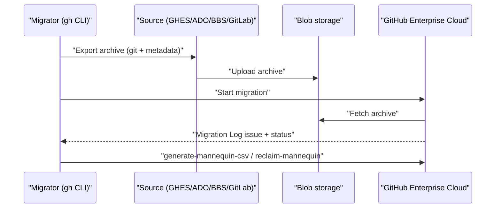

import { TLDR, DocsLinks, LastVerified, CompareTable, FlashCards } from '@components';
import { Aside, Badge, Tabs, TabItem, Steps } from '@astrojs/starlight/components';

<LastVerified date="2026-10" />

<TLDR>
- **GEI** migrates **to GitHub Enterprise Cloud** (GitHub.com or GHE.com). Each source has its own `gh` CLI extension: `gei` (GitHub sources), `ado2gh`, `bbs2gh` and `gl2gh`.
- The core flow is `generate-script` → **trial runs** → production run → read the **"Migration Log" issue** → **reclaim mannequins** → follow-up tasks.
- **Not migrated anywhere:** Git LFS objects (push them afterwards), secrets, user/team repo access and CI from non-GitHub sources.
- **Limits:** 2 GiB per commit/push, a 400 MiB file limit during migration (100 MiB afterwards), 255-byte ref names, and a **40 GiB** repo source limit <Badge text="Preview" variant="caution" />.
- With **GitHub.com as the source** you can migrate **whole organizations** (teams + team access included). Every other source migrates repo by repo.
</TLDR>

## Common booth questions

<details>
<summary>What exactly comes over from Azure DevOps?</summary>

The Git source and history, **pull requests** (with user history, attachments and **work-item links**) and **branch policies**. User-scoped and cross-repo policies are excluded. Work items themselves stay in **Azure Boards**, and pipelines stay in **Azure Pipelines**. Both can keep working against GitHub repos. Running `gh ado2gh generate-script --all` adds steps to rewire pipelines, create teams and configure the Boards integration.

</details>

<details>
<summary>Our repo is 60 GB. Will it migrate?</summary>

The GEI limit is **40 GiB of source** (public preview). This counts Git source only, so check it with `git-sizer` (total blob size). Options:
- Move large binaries to **Git LFS** (LFS objects are pushed separately after the migration).
- Rewrite history to drop large blobs.
- For GHES → GHE.com, evaluate **Enterprise Live Migrations**, which has better support for large monorepos.

GHES sources have version-dependent archive limits: 2 GiB before 3.8, 10 GiB on 3.8–3.11, 20 GiB on 3.12 and 40 GiB (preview) on 3.13+.

</details>

<details>
<summary>What is a mannequin, and do users have to accept something?</summary>

After migration, all activity **except Git commits** is attributed to placeholder accounts called **mannequins**. You reclaim them to existing **org members**, one at a time or in bulk via CSV. By default the member gets an **invitation email** and must accept it. On **EMU** you can add `--skip-invitation` to reclaim immediately. Reclaim **before** transferring a repo to another org, because afterwards you can't.

</details>

<details>
<summary>Do GitHub Actions secrets, environments and runners migrate (GHES → GHEC)?</summary>

No. Workflows (the YAML files) migrate, but **secrets, variables, environments, self-hosted/larger runners, artifacts and run history** do not. Rulesets, custom properties, Projects, Packages, Dependabot/code scanning alerts, discussions and stars don't migrate either. Plan to recreate them, ideally as code (Terraform or scripts).

</details>

<details>
<summary>Our migration failed on commit-author emails. Why?</summary>

**Rulesets in the destination org can fail migrations.** One example is a metadata rule that requires author emails to end with `@yourco.com`, which historic commits will violate. Temporarily exclude the migration target, or add the migrator to the bypass list, and re-enable the rule after cutover.

</details>

<details>
<summary>Who can run migrations? Do they need to be org owners?</summary>

No. GEI has a dedicated **migrator role** that you grant to users or teams in the destination org, so org owners don't have to run every migration. Personal access token (PAT) scopes differ by source; see "Manage access" in the docs for your source.

</details>

<details>
<summary>Do historic committers consume GHAS licenses after migration?</summary>

No. For GEI-migrated repos, GHAS counts only commits pushed **after** the migration.

</details>

## What migrates, per source

<CompareTable
	title="GEI: what migrates (summary — check the docs for your source)"
	columns={[
		{ key: 'ghes', label: 'GHES 3.4.1+' },
		{ key: 'ghcom', label: 'GitHub.com' },
		{ key: 'ado', label: 'Azure DevOps Cloud' },
		{ key: 'bbs', label: 'Bitbucket Server/DC' },
		{ key: 'gitlab', label: 'GitLab' },
	]}
	rows={[
		{ feature: 'Git source + commit history', category: 'Code', values: { ghes: true, ghcom: true, ado: true, bbs: true, gitlab: true } },
		{ feature: 'Git LFS objects', category: 'Code', values: { ghes: 'Push after', ghcom: 'Push after', ado: 'Push after', bbs: 'Push after', gitlab: 'Push after' } },
		{ feature: 'Pull requests (+ reviews, comments)', category: 'Collaboration', values: { ghes: true, ghcom: true, ado: true, bbs: true, gitlab: 'MRs → PRs' } },
		{ feature: 'Issues', category: 'Collaboration', values: { ghes: true, ghcom: true, ado: 'Stay in Azure Boards', bbs: false, gitlab: true } },
		{ feature: 'Milestones', category: 'Collaboration', values: { ghes: true, ghcom: true, ado: false, bbs: false, gitlab: true } },
		{ feature: 'Wiki', category: 'Collaboration', values: { ghes: true, ghcom: 'Yes (no attachments)', ado: false, bbs: false, gitlab: true } },
		{ feature: 'Commit comments', category: 'Collaboration', values: { ghes: true, ghcom: true, ado: false, bbs: false, gitlab: true } },
		{ feature: 'Releases', category: 'Collaboration', values: { ghes: false, ghcom: 'Up to 10 GiB/repo', ado: false, bbs: false, gitlab: 'With assets' } },
		{ feature: 'Branch protections / policies', category: 'Settings', values: { ghes: 'Partial', ghcom: 'Partial', ado: 'Branch policies (not user-scoped / cross-repo)', bbs: false, gitlab: false } },
		{ feature: 'Webhooks', category: 'Settings', values: { ghes: 'Re-enable after', ghcom: 'Active ones; re-enable after', ado: false, bbs: false, gitlab: false } },
		{ feature: 'Rulesets & custom properties', category: 'Settings', values: { ghes: false, ghcom: false, ado: false, bbs: false, gitlab: false } },
		{ feature: 'GitHub Actions workflow files', category: 'CI/CD', values: { ghes: true, ghcom: true, ado: 'N/A', bbs: 'N/A', gitlab: 'N/A' } },
		{ feature: 'CI pipelines / secrets / variables', category: 'CI/CD', values: { ghes: false, ghcom: false, ado: 'Keep Azure Pipelines or use Actions Importer', bbs: false, gitlab: false } },
		{ feature: 'Org-level migration (teams, team access)', category: 'Scope', values: { ghes: false, ghcom: true, ado: false, bbs: false, gitlab: false } },
		{ feature: 'User activity attribution', category: 'Identity', values: { ghes: 'Mannequins', ghcom: 'Mannequins', ado: 'Mannequins', bbs: 'Mannequins', gitlab: 'Mannequins' } },
	]}
/>

<Aside type="caution" title="Also not migrated (GitHub sources)">
Audit logs, code scanning results, Dependabot alerts, secret scanning remediation states, Codespaces/Dependabot/Actions secrets, Packages, Projects, discussions, sub-issues, forks and stars/watchers, user-owned repositories, and GitHub Apps installations. Branch protection rules such as "bypass required PRs", "require approval of most recent push", "lock branch" and "allow force pushes" are also dropped.
</Aside>

## CLI cheat sheet

All extensions need GitHub CLI **2.4.0+**. When the destination is **GHE.com**, add `--target-api-url https://api.SUBDOMAIN.ghe.com` to every command.

<Tabs>
<TabItem label="GitHub (gei)">

```bash
gh extension install github/gh-gei
export GH_PAT=...          # destination token
export GH_SOURCE_PAT=...   # source token

# Whole-org script (GitHub.com source) or per-repo
gh gei generate-script --github-source-org SRC --github-target-org DEST --output migrate.ps1
gh gei migrate-repo --github-source-org SRC --source-repo app --github-target-org DEST --target-repo app
# Optional: --target-repo-visibility internal | --skip-releases | --download-migration-logs

# GHES source: add --ghes-api-url https://ghes.example.com/api/v3 (+ blob storage or GHES 3.16+ local storage)
gh gei abort-migration --migration-id MIGRATION-ID
```

</TabItem>
<TabItem label="Azure DevOps (ado2gh)">

```bash
gh extension install github/gh-ado2gh
export ADO_PAT=... GH_PAT=...

gh ado2gh generate-script --ado-org SRC --github-org DEST --output migrate.ps1 --all
# --all adds: rewire Azure Pipelines, create teams, configure Azure Boards integration
```

</TabItem>
<TabItem label="Bitbucket Server (bbs2gh)">

```bash
gh extension install github/gh-bbs2gh

gh bbs2gh migrate-repo --bbs-server-url https://bbs.example.com \
  --bbs-project PROJ --bbs-repo app \
  --github-org DEST --github-repo app \
  --ssh-user USER --ssh-private-key ~/.ssh/id_rsa \
  --use-github-storage        # or --aws-bucket-name / Azure storage
```

</TabItem>
<TabItem label="GitLab (gl2gh)">

```bash
gh extension install github/gh-gl2gh

gh gl2gh migrate-repo --gitlab-server-url https://gitlab.example.com \
  --gitlab-group GROUP --gitlab-project app \
  --github-org DEST --github-repo app \
  --use-github-storage

gh gl2gh generate-script --gitlab-server-url https://gitlab.example.com \
  --github-org DEST --output migrate.ps1 --use-github-storage
```

</TabItem>
</Tabs>

<Aside type="tip">
Run `gh <ext> --help` and `gh <ext> migrate-repo --help` on site. The flags differ between extensions (for example `--github-target-org` for `gei` vs `--github-org` for the others).
</Aside>

## Dry runs → production → mannequins



<Steps>

1. **Trial run** into a scratch org, as many times as you like. Review the **"Migration Log" issue** in each destination repo (or use `--download-migration-logs`).
2. **Fix blockers**: large files and blobs, refs longer than 255 bytes, conflicting org rulesets, and missing users.
3. **Production run** per wave, with a change freeze on the source.
4. **Reclaim mannequins** in bulk:

   ```bash
   gh gei generate-mannequin-csv --github-target-org DEST --output mannequins.csv
   # edit: map each mannequin to an existing org member
   gh gei reclaim-mannequin --github-target-org DEST --csv mannequins.csv
   # EMU only: --skip-invitation to reclaim without the email invitation
   ```

   (`ado2gh`, `bbs2gh` and `gl2gh` have the equivalent commands with `--github-org`.)
5. **Follow-up tasks**: grant user/team access, push LFS objects, re-enable webhooks, recreate secrets, environments and rulesets, set visibility (everything lands **private** by default), and wait for code search to re-index.

</Steps>

## EMU and GHE.com considerations

- **Decide on EMU first.** For an existing enterprise, switching to EMU means migrating into a *new* enterprise account. GHE.com (data residency) is **always EMU**.
- **Users must already exist** (provisioned via SCIM) and be **org members** before you can reclaim their mannequins.
- **Public repos aren't allowed** for managed users. Use `private` or `internal` for `--target-repo-visibility`.
- Use `--skip-invitation` on `reclaim-mannequin` so the history is attributed immediately.
- If you use **IP allow lists** on the destination, allow the GEI egress ranges (see "Managing access" for your source).

## Gotchas & talking points

- Commits keep **author names/emails from Git**. Linking them to accounts depends on the users' verified emails, not on mannequins.
- CODEOWNERS and `@org/team` references are **not rewritten** in org migrations, so review CODEOWNERS after you move.
- **Mannequin content may not be searchable** by user qualifiers (for example `author:`), which is another reason to reclaim promptly.
- **GHES 3.16+** can stage archives on local instance storage instead of external blob storage.

<FlashCards
	title="GEI quick quiz"
	cards={[
		{ q: 'Max Git source size per repo in GEI?', a: '**40 GiB** (public preview); check with `git-sizer`.' },
		{ q: 'Which ADO edition does GEI support?', a: '**Azure DevOps Cloud** only (not ADO Server).' },
		{ q: 'Which data is attributed to mannequins?', a: 'All user activity **except Git commits**.' },
		{ q: 'Which source supports whole-org migration?', a: '**GitHub.com** (org → another enterprise).' },
		{ q: 'Are LFS objects migrated?', a: 'No. Push them to the destination after the migration.' },
	]}
/>

<DocsLinks
	links={[
		{ label: 'About GitHub Enterprise Importer', href: 'https://docs.github.com/en/migrations/using-github-enterprise-importer/understanding-github-enterprise-importer/about-github-enterprise-importer' },
		{ label: 'Migrations between GitHub products', href: 'https://docs.github.com/en/migrations/using-github-enterprise-importer/migrating-between-github-products/about-migrations-between-github-products' },
		{ label: 'Azure DevOps → GitHub', href: 'https://docs.github.com/en/migrations/ado/understand-migrations-from-azure-devops-to-github' },
		{ label: 'Bitbucket Server → GHEC', href: 'https://docs.github.com/en/migrations/using-github-enterprise-importer/migrating-from-bitbucket-server-to-github-enterprise-cloud/about-migrations-from-bitbucket-server-to-github-enterprise-cloud' },
		{ label: 'GitLab → GitHub', href: 'https://docs.github.com/en/migrations/using-github-enterprise-importer/migrate-from-gitlab/understand-migrations' },
		{ label: 'Reclaiming mannequins', href: 'https://docs.github.com/en/migrations/using-github-enterprise-importer/completing-your-migration-with-github-enterprise-importer/reclaiming-mannequins-for-github-enterprise-importer' },
		{ label: 'Enterprise Live Migrations', href: 'https://docs.github.com/en/migrations/elm/about-live-migrations' },
	]}
/>
