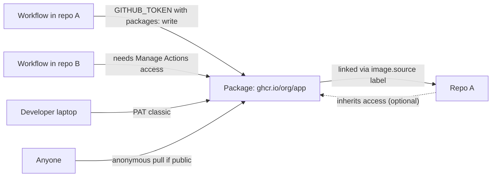

import { TLDR, DocsLinks, LastVerified, CompareTable, FlashCards, DecisionTree } from '@components';
import { Aside, Badge, Tabs, TabItem, LinkCard, CardGrid, Code } from '@astrojs/starlight/components';
import publishGhcr from '@snippets/packages-publish-ghcr.yml?raw';
import publishNpm from '@snippets/packages-publish-npm.yml?raw';

<LastVerified date="2026-10" />

<TLDR>
- GitHub Packages hosts **containers (`ghcr.io`), npm, Maven, Gradle, NuGet and RubyGems** next to your code, with GitHub identities and permissions.
- There are two permission models. **Granular** (Container, npm, NuGet, RubyGems): a package belongs to a user or org and has its own access settings. **Repo-scoped** (Maven, Gradle): a package always inherits the repo's permissions and visibility.
- In Actions, publish with **`GITHUB_TOKEN`** (`permissions: packages: write`). Outside Actions, use a **PAT (classic)**, because fine-grained PATs **do not** work with Packages.
- **Billing:** public packages are free. Private packages use storage (shared with Actions artifacts) plus data transfer. **Container registry storage and bandwidth are currently free.**
- **Visibility:** new packages are **private by default**. Once a package is made public, it **can't be made private again**.
</TLDR>

## Common booth questions

Can I use a fine-grained PAT with GitHub Packages?

**No.** GitHub lists it as a known gap: the npm and Container registry docs say *"GitHub Packages only supports authentication using a personal access token (classic)."*

- **Inside Actions:** use `GITHUB_TOKEN`.
- **Elsewhere:** use a classic PAT with `read:packages` and/or `write:packages`, scoped as narrowly as possible, or use a GitHub App where the registry supports it.

My image pushed fine but it isn't linked to my repo. Why?

Images pushed from the CLI are **not linked** to a repo by default, even if the name matches the repo.

- **Fix:** add `LABEL org.opencontainers.image.source=https://github.com/OWNER/REPO` to the Dockerfile. `docker/metadata-action` adds it for you. You can also connect the package to a repo in the package settings.
- **Link before you publish:** a package only **inherits repo permissions automatically** if it is linked *before* its first publish.

Why can't my workflow in repo B pull a package published by repo A?

For granular-permission registries, open package settings → **Manage Actions access** and **Add repository** B with the Read role.

`GITHUB_TOKEN` only gets access automatically in the repo that published the package (or the linked repo).

For Maven or Gradle (repo-scoped), installing from another **private** repo needs a classic PAT.

Does pulling public packages need authentication?

- **Container registry:** **no**. Public images allow **anonymous pulls**.
- **npm, Maven, Gradle, NuGet, RubyGems:** **yes**, even for public packages, you must authenticate with a PAT or `GITHUB_TOKEN`.

Can I delete a package version? Can I undo it?

**Deleting:**

- **Private packages:** you can delete them.
- **Public packages:** you can delete them **only if no version has more than 5,000 downloads**. Otherwise contact Support.

**Restoring:** you can restore a deleted package or version **within 30 days**, as long as the namespace is still available.

**Automation:** with granular registries, Actions can delete or restore via REST using `GITHUB_TOKEN` (needs **admin** on the package). This is <Badge text="Preview" variant="caution" />.

What does Packages cost, and does CI traffic count?

**Included storage / transfer per month:**

| Plan | Storage | Transfer |
|---|---|---|
| Free | 500 MB | 1 GB |
| Pro / Team | 2 GB | 10 GB |
| Enterprise Cloud | 50 GB | 100 GB |

- **Shared storage:** the storage allowance is **shared with Actions artifacts**.
- **CI downloads:** downloads by Actions using `GITHUB_TOKEN` are **free**, on hosted and self-hosted runners alike. **Self-hosted runners using a PAT** are billed.
- **Container registry:** storage and bandwidth are currently free, and GitHub promises at least one month's notice before that changes.

Packages vs Actions artifacts vs Releases?

They solve different problems:

- **Packages:** versioned, installable dependencies and images.
- **Artifacts:** short-lived build outputs passed between jobs or downloaded for debugging.
- **Releases:** human-facing downloads attached to a Git tag. Combine them with **immutable releases** for tamper-proof assets.

The full comparison is below.

## Registries and permission models

| Registry | Endpoint | Permission model |
|---|---|---|
| Container | `ghcr.io/OWNER/IMAGE` | **Granular** |
| npm | `https://npm.pkg.github.com` (scoped `@OWNER/pkg`) | **Granular** |
| NuGet | `https://nuget.pkg.github.com/OWNER/index.json` | **Granular** |
| RubyGems | `https://rubygems.pkg.github.com/OWNER` | **Granular** |
| Apache Maven | `https://maven.pkg.github.com/OWNER/REPO` | **Repo-scoped** |
| Gradle | `https://maven.pkg.github.com/OWNER/REPO` | **Repo-scoped** |

<CompareTable
	title="Granular vs repository-scoped packages"
	columns={[
		{ key: 'gran', label: 'Granular (Container, npm, NuGet, RubyGems)' },
		{ key: 'repo', label: 'Repo-scoped (Maven, Gradle)' },
	]}
	rows={[
		{ feature: 'Owned by', category: 'Model', values: { gran: 'User or org', repo: 'Repository' } },
		{ feature: 'Can exist without a linked repo', category: 'Model', values: { gran: true, repo: false } },
		{ feature: 'Own access list (users/teams/repos)', category: 'Access', values: { gran: true, repo: false } },
		{ feature: 'Visibility', category: 'Access', values: { gran: 'Set per package (private by default)', repo: 'Same as repo' } },
		{ feature: 'Inherits repo permissions', category: 'Access', values: { gran: 'If linked before first publish (removable)', repo: 'Always' } },
		{ feature: 'Anonymous pull of public packages', category: 'Access', values: { gran: 'Container registry only', repo: false } },
		{ feature: 'Publish with GITHUB_TOKEN', category: 'Actions', values: { gran: true, repo: true } },
		{ feature: 'Cross-repo Actions access', category: 'Actions', values: { gran: '**Manage Actions access**', repo: 'Classic PAT for other private repos' } },
		{ feature: 'Delete/restore via REST from Actions', category: 'Actions', values: { gran: 'Yes (Preview, admin role)', repo: '—' } },
		{ feature: 'GraphQL Packages API', category: 'API', values: { gran: false, repo: true } },
		{ feature: 'Moves with repo transfer', category: 'Lifecycle', values: { gran: 'No (owned by account)', repo: true } },
	]}
/>

## Publishing from Actions

<Tabs>
	<TabItem label="Container (ghcr.io) + provenance">
		<Code code={publishGhcr} lang="yaml" title=".github/workflows/publish-image.yml" />
	</TabItem>
	<TabItem label="npm">
		<Code code={publishNpm} lang="yaml" title=".github/workflows/publish-npm.yml" />
	</TabItem>
</Tabs>

<Aside type="tip">
`actions/attest` with `push-to-registry: true` stores a signed build-provenance attestation next to the
image. Consumers can verify it with `gh attestation verify oci://ghcr.io/OWNER/IMAGE:TAG --owner OWNER`. See
[GitHub Actions](/github-cheatsheet/actions/) for more on supply-chain security.
</Aside>

## Visibility and inheritance

- **Default visibility:** new packages are **private**. Once a package is public, it **can't be made private again**.
- **Linked granular packages** inherit the repo's **access permissions, not its visibility**. To set separate access, remove inherited permissions in package settings.
- **Repo-scoped packages** (Maven, Gradle) always share the repo's permissions **and** visibility.
- **Org owners** can restrict which visibilities members may publish (public, private, internal), and can disable permission inheritance org-wide.
- **Internal packages** are available in enterprise accounts. For private or internal org packages, you can only grant access to org members or teams.

<DecisionTree
	title="Where should this build output go?"
	tree={{
		start: 'q1',
		nodes: {
			q1: {
				question: 'Will other projects **install** it as a dependency or pull it as an image?',
				options: [
					{ label: 'Yes', next: 'pkg' },
					{ label: 'No', next: 'q2' },
				],
			},
			q2: {
				question: 'Is it for **humans to download** for a tagged version (binaries, installers)?',
				options: [
					{ label: 'Yes', next: 'rel' },
					{ label: 'No, it only passes between jobs or is for debugging', next: 'art' },
				],
			},
			pkg: {
				answer: '**GitHub Packages**: versioned and installable with native tooling (`docker pull`, `npm install`, `mvn`).',
				links: [{ label: 'Introduction to GitHub Packages', href: 'https://docs.github.com/en/packages/learn-github-packages/introduction-to-github-packages' }],
			},
			rel: {
				answer: '**Releases**: assets attached to a Git tag. Turn on **immutable releases** so tags and assets can\'t be changed after publishing.',
				links: [{ label: 'About releases', href: 'https://docs.github.com/en/repositories/releasing-projects-on-github/about-releases' }],
			},
			art: {
				answer: '**Actions artifacts** (`actions/upload-artifact`) are short-lived with configurable retention, and their storage is shared with the Packages quota.',
				links: [{ label: 'Store and share data with workflow artifacts', href: 'https://docs.github.com/en/actions/tutorials/store-and-share-data' }],
			},
		},
	}}
/>

| | Packages | Actions artifacts | Releases |
|---|---|---|---|
| Purpose | Installable dependencies and images | Build outputs between jobs, debugging | Human-facing versioned downloads |
| Consumed by | Package managers, `docker` | Workflows, people (zip download) | People, scripts |
| Lifetime | Until deleted | Retention period | Until deleted |
| Versioning | Package version or tag | Per run | Git tag |
| Billing | Packages storage + transfer | Actions storage (shared quota) | No separate metered charge |

## GitHub Enterprise Server notes

- **Enabling it:** an admin enables GitHub Packages and connects **external blob storage**: **AWS S3, Azure Blob Storage or MinIO**.
- **Ecosystems:** each one (Container, Docker, npm, Maven, Gradle, NuGet, RubyGems) can be **enabled, disabled or set to read-only**.
- **Subdomain isolation:** if it is on, the TLS certificate must cover each package host, such as `containers.HOSTNAME`.
- **Capacity:** the Container registry needs **at least 10% more CPU**.
- **Feature parity:** check the GHES version docs for your release, because some newer features are cloud-first.

## Talking points and gotchas

- **npm scope:** the package name must be `@OWNER/name`, and `.npmrc` must map the scope to `npm.pkg.github.com`.
- **Migrating from Docker Hub or Artifactory:** GHCR keeps images next to the code, gives anonymous pulls for public images, has free Container storage today, and integrates with artifact attestations.
- **Not a proxy or cache:** GitHub Packages is a host for **your** packages, not an upstream mirror or virtual repository. Keep Artifactory or Nexus if you need proxying.
- **Supply chain:** combine packages with **artifact attestations** and **Dependabot** for consumers. See [GHAS](/github-cheatsheet/ghas/).

<FlashCards
	title="Packages quick quiz"
	cards={[
		{ q: 'Which registries only support repo-scoped permissions?', a: '**Maven** and **Gradle**' },
		{ q: 'Do fine-grained PATs work with Packages?', a: '**No.** Use `GITHUB_TOKEN` or a classic PAT.' },
		{ q: 'Which registry allows anonymous pulls of public packages?', a: 'The **Container registry** (`ghcr.io`)' },
		{ q: 'Restore window after deletion?', a: '**30 days**' },
		{ q: 'Can you make a public package private again?', a: '**No.**' },
	]}
/>

<CardGrid>
	<LinkCard title="GitHub Actions" description="Workflows, OIDC, attestations." href="/github-cheatsheet/actions/" />
	<LinkCard title="Billing" description="Storage and transfer quotas." href="/github-cheatsheet/billing/" />
</CardGrid>

<DocsLinks
	links={[
		{ label: 'Introduction to GitHub Packages', href: 'https://docs.github.com/en/packages/learn-github-packages/introduction-to-github-packages' },
		{ label: 'About permissions for GitHub Packages', href: 'https://docs.github.com/en/packages/learn-github-packages/about-permissions-for-github-packages' },
		{ label: 'Working with the Container registry', href: 'https://docs.github.com/en/packages/working-with-a-github-packages-registry/working-with-the-container-registry' },
		{ label: 'Publishing and installing a package with Actions', href: 'https://docs.github.com/en/packages/managing-github-packages-using-github-actions-workflows/publishing-and-installing-a-package-with-github-actions' },
		{ label: 'Connecting a repository to a package', href: 'https://docs.github.com/en/packages/learn-github-packages/connecting-a-repository-to-a-package' },
		{ label: "Configuring a package's access control and visibility", href: 'https://docs.github.com/en/packages/learn-github-packages/configuring-a-packages-access-control-and-visibility' },
		{ label: 'Deleting and restoring a package', href: 'https://docs.github.com/en/packages/learn-github-packages/deleting-and-restoring-a-package' },
		{ label: 'GitHub Packages billing', href: 'https://docs.github.com/en/billing/concepts/product-billing/github-packages' },
		{ label: 'GHES: Getting started with GitHub Packages', href: 'https://docs.github.com/en/enterprise-server@latest/admin/configuring-packages/getting-started-with-github-packages-for-your-enterprise' },
	]}
/>
