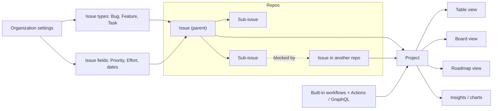

import { TLDR, DocsLinks, LastVerified, CompareTable, FlashCards } from '@components';
import { Aside, Tabs, TabItem, LinkCard, CardGrid, Code } from '@astrojs/starlight/components';
import addToProject from '@snippets/projects-add-to-project.yml?raw';

export const issueForm = `name: Bug report
description: Report a defect
type: Bug                 # sets the org-level issue type
labels: ["triage"]
projects: ["my-org/42"]   # auto-add to an org project
body:
  - type: dropdown
    id: area
    attributes:
      label: Area
      options: [API, Web, Mobile]
    validations:
      required: true
  - type: textarea
    id: repro
    attributes:
      label: Steps to reproduce
      render: shell
    validations:
      required: true`;

export const graphql = `# 1) Find the project and field IDs
gh project view 42 --owner my-org --format json
gh project field-list 42 --owner my-org --format json

# 2) Add an issue and set a single-select field (GraphQL under the hood)
gh project item-add 42 --owner my-org --url https://github.com/my-org/api/issues/123
gh project item-edit --project-id PVT_xxx --id PVTI_xxx \\
  --field-id PVTSSF_xxx --single-select-option-id 98236657`;

<LastVerified date="2026-10" />

<TLDR>
- **Issues** are the unit of work. They have **sub-issues** (up to 100 per parent, nested 8 levels), org-wide **issue types** (up to 25) and **issue fields** (up to 25 typed org-level fields such as Priority and dates), plus **dependencies** (blocked by / blocking).
- **Projects** are a spreadsheet-like planning layer across repos. They offer **table, board and roadmap** views, custom fields, **iterations**, built-in workflows, charts, and a GraphQL API.
- **Search:** issue search supports `AND` / `OR` with parentheses nested up to 5 levels, plus `type:` and `field.` qualifiers.
- **Automation:** use built-in workflows first, then Actions + GraphQL. The `GITHUB_TOKEN` **cannot** access Projects, so use a GitHub App token or a PAT.
- **Limits:** a project holds up to **50,000 items** and **50 fields** in total.
</TLDR>

## Common booth questions

What is the difference between labels, issue types and issue fields?

- **Labels** are per-repo, free-form tags.
- **Issue types** are defined **once per org**, one per issue (default: Task, Bug, Feature; max 25). They are searchable with `type:"Bug"`.
- **Issue fields** are **typed, org-level metadata** stored on the issue itself and visible in every project. Types are single-select, text, number and date, with a max of 25 per org. The defaults are **Priority, Effort, Start date and Target date**, and fields can be pinned per issue type.

Rule of thumb: use types for the kind of work, fields for structured attributes, and labels for everything else.

Issue fields vs project custom fields: which should I use?

- **Use issue fields** for data that must travel with the issue across **every** project, such as Priority or Target date. You define them once and they are consistent org-wide.
- **Use project custom fields** for data that only matters to **one** project, such as a team's "Sprint goal".

A project allows **50 fields total**, counting issue fields, custom fields and system fields together. Only issue fields marked **Public** show in public or internal projects.

How deep can sub-issues go? Do they roll up progress?

- **Limits:** up to **100 sub-issues per parent**, nested **8 levels** deep.
- **Progress:** the parent shows sub-issue completion, and Projects can display parent issue and sub-issue progress fields.
- **CLI:**
  - `gh issue create --parent 123`
  - `gh issue edit 456 --add-sub-issue 789`

Can I auto-add issues from many repos to one project?

Yes, use the **auto-add** built-in workflow with a filter, for example `is:issue label:bug`.

- **Workflows per project:** Free 1, Pro/Team 5, Enterprise Cloud/Server 20.
- **Gotcha:** auto-add only catches items **created or updated after** you enable it. Bulk-add existing items manually or with the API.

Why does my Actions workflow fail to update the project?

The **`GITHUB_TOKEN` is repo-scoped and cannot access Projects.**

- **Org projects:** use a **GitHub App** installation token (recommended).
- **User projects:** use a PAT with `project` scope.

See the Actions example below.

Can we migrate from Jira?

There is **no first-party Jira importer** in GitHub Docs.

The usual approach is to:

1. Map Jira issue types to **issue types**, epics and stories to **sub-issues**, and custom fields to **issue fields** or project fields.
2. Export from Jira (CSV or API).
3. Script the creation with `gh` and GraphQL, and run a pilot project first.

Marketplace and partner tools exist, but evaluate them yourself. During the transition, the Atlassian "GitHub for Jira" app can link commits and PRs to Jira tickets.

Can Projects do roadmaps and burn-up charts?

Yes.

- **Roadmap layout:** items are placed by date or iteration fields. You can zoom by month, quarter or year, and add markers for iterations and milestones.
- **Insights:** the built-in historical burn-up chart, plus custom charts. Charts can group by issue fields.

## How it fits together

## Issues deep dive

### Advanced search examples

| Goal | Query |
|---|---|
| Bugs assigned to me, or features assigned to Hubot | `(type:"Bug" AND assignee:@me) OR (type:"Feature" AND assignee:hubot)` |
| Open high-priority work | `is:open field.priority:high` |
| Due on or after a date | `field."target date":>=2026-11-01` |
| Story points greater than 5 | `field.story-points:>5` |
| Closed as not planned | `is:issue is:closed reason:"not planned"` |
| Not in any project | `is:issue is:open no:project` |

Boolean grouping with parentheses works on the repo issues page and the issues dashboard, nested up to **5 levels**.

### Templates and issue forms

Issue forms (`.github/ISSUE_TEMPLATE/*.yml`) give you structured input with required fields. They can also set the **issue type**, labels, assignees and **projects** automatically. For `projects`, the person opening the issue needs write access to that project. Put `config.yml` in the same folder to disable blank issues or to link to Discussions or support.

<Code code={issueForm} lang="yaml" title=".github/ISSUE_TEMPLATE/bug.yml" />

<Aside type="tip">
Org-wide defaults: templates in the org's `.github` repository apply to every repo that has none of its own.
</Aside>

## Projects deep dive

| Capability | What to tell customers |
|---|---|
| **Views** | **Table**, **board** and **roadmap**. Each view saves its own filter, sort, group-by and slice-by. |
| **Fields** | Text, number, date, single-select and **iteration**, plus issue fields and system fields (assignees, labels, milestone, parent issue, sub-issue progress and so on). Max 50. |
| **Iterations** | Any length in days or weeks, with **breaks**, and individually editable |
| **Built-in workflows** | Closed or merged → Status *Done* (on by default), item added → *Todo*, **auto-archive**, **auto-add** |
| **Charts / Insights** | Burn-up, plus custom bar, column, line and stacked charts grouped by any field |
| **API** | GraphQL `ProjectV2` (add items, update fields), the `gh project` CLI, and webhooks (`projects_v2_item`) |
| **Scale** | Up to **50,000 items**, across active and archived |

### Automating with Actions and the API

<Tabs>
	<TabItem label="Actions: add-to-project">
		<Code code={addToProject} lang="yaml" title=".github/workflows/add-to-project.yml" />
	</TabItem>
	<TabItem label="gh project CLI">
		<Code code={graphql} lang="bash" />
	</TabItem>
</Tabs>

## Planning features compared

<CompareTable
	title="Where does each planning capability live?"
	columns={[
		{ key: 'labels', label: 'Labels' },
		{ key: 'types', label: 'Issue types' },
		{ key: 'ifields', label: 'Issue fields' },
		{ key: 'pfields', label: 'Project fields' },
		{ key: 'milestones', label: 'Milestones' },
	]}
	rows={[
		{ feature: 'Defined at', category: 'Scope', values: { labels: 'Repo', types: 'Org', ifields: 'Org', pfields: 'Project', milestones: 'Repo' } },
		{ feature: 'Values per issue', category: 'Scope', values: { labels: 'Many', types: 'One', ifields: 'One per field', pfields: 'One per field', milestones: 'One' } },
		{ feature: 'Typed values (number/date)', category: 'Data', values: { labels: false, types: false, ifields: true, pfields: true, milestones: 'Due date only' } },
		{ feature: 'Visible in every project', category: 'Data', values: { labels: true, types: true, ifields: true, pfields: false, milestones: true } },
		{ feature: 'Searchable in issue search', category: 'Search', values: { labels: '`label:`', types: '`type:`', ifields: '`field.name:`', pfields: 'Project filters only', milestones: '`milestone:`' } },
		{ feature: 'Limit', category: 'Limits', values: { labels: '—', types: '25 per org', ifields: '25 per org', pfields: '50 fields per project (total)', milestones: '—' } },
	]}
/>

## Talking points and gotchas

- **Projects are not repo-scoped.** One project can span many repos and orgs' issues and PRs, but workflows that feed it live **per repo**.
- **Draft issues** in a project are lightweight placeholders. Convert them to real issues when work starts.
- **Auto-add doesn't backfill.** Plan a one-time bulk add.
- **Public projects** only show issue fields marked **Public**.
- **Copilot tie-in:** assign issues to **Copilot cloud agent**. Well-structured issues with types, fields and sub-issues make better agent tasks. See [Copilot](/github-cheatsheet/copilot/).

<FlashCards
	title="Projects & Issues quick quiz"
	cards={[
		{ q: 'Max sub-issues per parent / nesting depth?', a: '**100** / **8 levels**' },
		{ q: 'Max issue types per org? Max issue fields per org?', a: '**25** each' },
		{ q: 'Max fields per project?', a: '**50**, including issue, custom and system fields' },
		{ q: 'Can `GITHUB_TOKEN` update a project?', a: '**No.** Use a GitHub App token or a PAT.' },
		{ q: 'Auto-add workflows on Enterprise Cloud?', a: '**20** per project' },
	]}
/>

<CardGrid>
	<LinkCard title="Copilot" description="Assign issues to Copilot cloud agent." href="/github-cheatsheet/copilot/" />
	<LinkCard title="GitHub Actions" description="Automate project updates." href="/github-cheatsheet/actions/" />
</CardGrid>

<DocsLinks
	links={[
		{ label: 'About Projects', href: 'https://docs.github.com/en/issues/planning-and-tracking-with-projects/learning-about-projects/about-projects' },
		{ label: 'Adding sub-issues', href: 'https://docs.github.com/en/issues/tracking-your-work-with-issues/using-issues/adding-sub-issues' },
		{ label: 'Managing issue types in an organization', href: 'https://docs.github.com/en/issues/tracking-your-work-with-issues/using-issues/managing-issue-types-in-an-organization' },
		{ label: 'About issue fields', href: 'https://docs.github.com/en/issues/planning-and-tracking-with-projects/understanding-fields/about-issue-fields' },
		{ label: 'Creating issue dependencies', href: 'https://docs.github.com/en/issues/tracking-your-work-with-issues/using-issues/creating-issue-dependencies' },
		{ label: 'Filtering and searching issues and PRs', href: 'https://docs.github.com/en/issues/tracking-your-work-with-issues/using-issues/filtering-and-searching-issues-and-pull-requests' },
		{ label: 'Syntax for issue forms', href: 'https://docs.github.com/en/communities/using-templates-to-encourage-useful-issues-and-pull-requests/syntax-for-issue-forms' },
		{ label: 'Using the built-in automations', href: 'https://docs.github.com/en/issues/planning-and-tracking-with-projects/automating-your-project/using-the-built-in-automations' },
		{ label: 'Automating Projects using Actions', href: 'https://docs.github.com/en/issues/planning-and-tracking-with-projects/automating-your-project/automating-projects-using-actions' },
		{ label: 'Customizing the roadmap layout', href: 'https://docs.github.com/en/issues/planning-and-tracking-with-projects/customizing-views-in-your-project/customizing-the-roadmap-layout' },
	]}
/>
