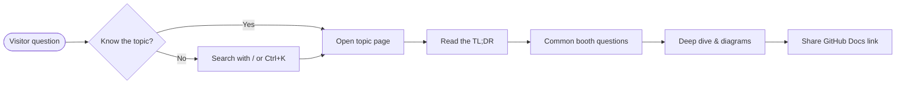

import { Aside, Badge, Tabs, TabItem } from '@astrojs/starlight/components';
import { CompareTable, DecisionTree, DocsLinks, FlashCards, LastVerified, TLDR, YamlBuilder } from '@components';

export const ciBase = `name: CI
on:
  push:
    branches: [main]
  pull_request:
# @top
jobs:
  build:
    runs-on: ubuntu-latest
    # @job
    steps:
      - uses: actions/checkout@v5
      # @steps
`;

export const ciOptions = [
	{
		id: 'permissions',
		label: 'Least-privilege GITHUB_TOKEN',
		section: 'top',
		default: true,
		snippet: `
permissions:
  contents: read`,
		explanation: 'Restricts the token to read-only by default — a GHAS/OpenSSF best practice.',
	},
	{
		id: 'concurrency',
		label: 'Cancel superseded runs',
		section: 'top',
		snippet: `
concurrency:
  group: \${{ github.workflow }}-\${{ github.ref }}
  cancel-in-progress: true`,
	},
	{ id: 'timeout', label: 'Job timeout', section: 'job', snippet: 'timeout-minutes: 15' },
	{
		id: 'node',
		label: 'Set up Node.js with cache',
		description: 'Adds `actions/setup-node`.',
		snippet: `
- uses: actions/setup-node@v4
  with:
    node-version: 22
    cache: npm
- run: npm ci
- run: npm test`,
	},
];

<LastVerified date="2026-10" />

<TLDR>
- Press <kbd>/</kbd> or <kbd>Ctrl</kbd>+<kbd>K</kbd> to **search** everything (English and 日本語).
- Every topic page starts with a **TL;DR**, then **Common booth questions**, then a deep dive.
- Use the language picker (top right) to switch to [日本語](/github-cheatsheet/ja/start-here/how-to-use/).
</TLDR>

## How the site is organized

Priority topics — [GitHub Actions](/github-cheatsheet/actions/), [GitHub Copilot](/github-cheatsheet/copilot/) and
[GitHub Advanced Security](/github-cheatsheet/ghas/) — are expanded in the sidebar. Secondary topics
(Migration, Adoption, Administration, Billing, Codespaces, Projects & Issues, Packages) are collapsed.

Each topic page follows the same layout:

1. **Last verified** badge — when the facts were last checked.
2. **TL;DR** — the 10-second answer.
3. **Common booth questions** — collapsible Q&A you can open while talking.
4. **Deep dive** — diagrams, comparison tables, decision trees, workflow builders.
5. **GitHub Docs** — authoritative links to share with the visitor.

## Common booth questions

Is this site official GitHub documentation?

No. It is a booth aid that summarizes and links to [GitHub Docs](https://docs.github.com). Always share the
GitHub Docs link for anything a customer will act on.

Does search work offline?

Search runs in the browser (Pagefind), but downloads index chunks and result data on demand. An internet
connection is still needed for uncached searches; visiting a page once does not guarantee offline search.

## Component demos

<Aside type="tip">These demos also serve as copy-paste examples for authors. See the README "Authoring guide".</Aside>

### Decision tree

<DecisionTree
	title="Which runner should I use?"
	tree={{
		start: 'q1',
		nodes: {
			q1: {
				question: 'Does the job need access to resources in a **private network**?',
				options: [
					{ label: 'Yes', next: 'q2' },
					{ label: 'No', next: 'q3' },
				],
			},
			q2: {
				question: 'Can you manage your own VMs / Kubernetes?',
				options: [
					{ label: 'Yes', next: 'selfhosted' },
					{ label: 'No', next: 'vnet' },
				],
			},
			q3: {
				question: 'Do you need more CPU/RAM, GPU or static IPs?',
				options: [
					{ label: 'Yes', next: 'larger' },
					{ label: 'No', next: 'standard' },
				],
			},
			selfhosted: {
				answer: 'Use **self-hosted runners** (consider Actions Runner Controller on Kubernetes).',
				links: [{ label: 'About self-hosted runners', href: 'https://docs.github.com/en/actions/hosting-your-own-runners' }],
			},
			vnet: { answer: 'Use **GitHub-hosted larger runners with Azure private networking**.' },
			larger: { answer: 'Use **larger runners** (`runs-on: my-larger-runner`).' },
			standard: { answer: 'Standard GitHub-hosted runners (`ubuntu-latest`) are fine.' },
		},
	}}
/>

### Workflow YAML builder

<YamlBuilder title="Build a CI workflow" filename=".github/workflows/ci.yml" base={ciBase} options={ciOptions} />

### Comparison table

<CompareTable
	title="Where does it run?"
	columns={[
		{ key: 'hosted', label: 'GitHub-hosted' },
		{ key: 'larger', label: 'Larger runners' },
		{ key: 'self', label: 'Self-hosted' },
	]}
	rows={[
		{ feature: 'Managed by GitHub', category: 'Operations', values: { hosted: true, larger: true, self: false } },
		{ feature: 'GPU available', category: 'Hardware', values: { hosted: false, larger: true, self: true } },
		{ feature: 'Static IP', category: 'Network', values: { hosted: false, larger: true, self: 'Your network' } },
	]}
/>

### Flash cards

<FlashCards
	title="Quick quiz"
	cards={[
		{ q: 'Which key opens search?', a: '<kbd>/</kbd> or <kbd>Ctrl</kbd>+<kbd>K</kbd>' },
		{ q: 'Where do authoritative answers live?', a: '[GitHub Docs](https://docs.github.com)' },
		{ q: 'What does `permissions: contents: read` do?', a: 'Limits the `GITHUB_TOKEN` to read-only repository contents.' },
	]}
/>

### Starlight built-ins

<Tabs>
	<TabItem label="Badge">Status badges: <Badge text="GA" variant="success" /> <Badge text="Preview" variant="caution" /></TabItem>
	<TabItem label="Aside">Use `<Aside type="note|tip|caution|danger">` for callouts.</TabItem>
</Tabs>

<DocsLinks
	links={[
		{ label: 'GitHub Docs home', href: 'https://docs.github.com/en' },
		{ label: 'GitHub Actions documentation', href: 'https://docs.github.com/en/actions' },
	]}
/>
