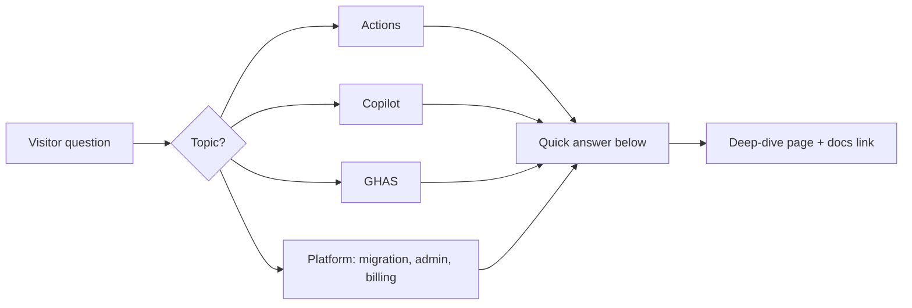

import { Tabs, TabItem, Aside, Badge } from '@astrojs/starlight/components';
import { TLDR, LastVerified } from '@components';

<LastVerified date="2026-10" />

<TLDR>

- Each answer is one or two lines; follow **→** to the deep dive for diagrams, YAML and docs links.
- Press <kbd>/</kbd> or <kbd>Ctrl</kbd>+<kbd>K</kbd> to search the whole site in English or Japanese.
- Answers marked <Badge text="Verify" variant="caution" /> change often, so check docs.github.com before quoting them.

</TLDR>

<Tabs syncKey="qa-topic">
<TabItem label="⚙️ Actions">

Our required check is stuck at "Expected — waiting for status"

The workflow was skipped by a `paths`/`branches` filter, so it never reports a status. Make a single `if: always()` aggregator job the only required check, and don't use path filters on required workflows. → [Advanced workflows](/github-cheatsheet/actions/advanced-workflows/) · [Troubleshooting](/github-cheatsheet/actions/troubleshooting/)

Reusable workflow or composite action?

A **reusable workflow** is a whole pipeline: jobs, runners, environments and secrets, nesting up to 10 levels. A **composite action** is a bundle of steps that runs inside the caller's job. Use reusable workflows for golden-path pipelines and composite actions for shared step logic. → [Advanced workflows](/github-cheatsheet/actions/advanced-workflows/)

How do we deploy to AWS/Azure/GCP without long-lived keys?

Use OIDC: set `permissions: id-token: write` and make the cloud trust policy match the `sub` claim, ideally pinned to repo **and** environment. Repos created after 2026-07-15 use an immutable `sub` format that includes IDs. → [Security hardening](/github-cheatsheet/actions/security/)

Our merge queue waits forever

Required workflows must also trigger on `on: merge_group`. → [Advanced workflows](/github-cheatsheet/actions/advanced-workflows/)

Why didn't my bot's push trigger CI?

Events created with `GITHUB_TOKEN` don't start new workflow runs, except `workflow_dispatch` and `repository_dispatch`. Use a GitHub App token if a chained run is required. → [Troubleshooting](/github-cheatsheet/actions/troubleshooting/)

How do we enforce CI standards across hundreds of repos?

Create an org or enterprise ruleset with **"Require workflows to pass before merging"** and target repos by custom property. Back it with reusable workflows and workflow templates. → [Enterprise patterns](/github-cheatsheet/actions/enterprise-patterns/)

Is pull_request_target safe?

Only if you never check out or run PR code with it. A default policy now blocks it in public repos, enforced from 2026-11-02 <Badge text="Verify" variant="caution" />. Pass untrusted input through `env:`, never through `${{ }}` inside `run:`. → [Security hardening](/github-cheatsheet/actions/security/)

Should we pin actions to SHAs?

Yes. Orgs can enforce full-SHA pinning through the allowed-actions policy, and Dependabot keeps the pins up to date. → [Security hardening](/github-cheatsheet/actions/security/)

Self-hosted runners at scale on Kubernetes?

Use ARC (Actions Runner Controller) with runner scale sets and ephemeral JIT pods. Never attach persistent self-hosted runners to public repos. → [Runners](/github-cheatsheet/actions/runners/)

How big can the cache be?

10 GB per repo is included. The limit can be raised with overage billing, and entries unused for 7 days are evicted. <Badge text="Verify" variant="caution" /> → [Performance & cost](/github-cheatsheet/actions/performance-cost/)

</TabItem>
<TabItem label="🤖 Copilot">

How is Copilot billed now?

Since June 1, 2026 Copilot uses **GitHub AI Credits** ($0.01 each), consumed by model and token usage; premium requests are legacy. Completions and next edit suggestions are unlimited on paid plans. Auto model selection gets a discount. <Badge text="Verify" variant="caution" /> → [Plans & billing](/github-cheatsheet/copilot/plans-billing/)

What happens when we run out of credits?

There's no fallback to a cheaper model. Orgs continue on paid overage by default unless an admin disables that policy. → [Plans & billing](/github-cheatsheet/copilot/plans-billing/)

Should we build custom agents, prompts and skills, or let the agent figure it out?

Start with defaults and add customization only when you see a **repeated** failure.

- **Instructions:** short ones for build/test commands and non-obvious rules.
- **Skills:** for repeatable specialist procedures; they load on demand.
- **Custom agents:** for distinct roles with restricted tools.
- **Hooks / CI:** for anything that must be enforced.

→ [Best practices 2026](/github-cheatsheet/copilot/best-practices/)

Prompt files or skills?

Default to **skills**. They load automatically and work in the cloud agent, CLI and code review. Prompt files only work in IDEs. → [Customization](/github-cheatsheet/copilot/customization/)

Do instructions guarantee rules are followed?

No. Use a `preToolUse` hook, CI or rulesets for hard guarantees. → [Customization](/github-cheatsheet/copilot/customization/)

Can the coding agent merge its own PR?

No. It pushes only to `copilot/*` branches and opens draft PRs. A human must approve, and the person who requested the work can't approve it. CI waits for "Approve and run workflows". → [Coding agent](/github-cheatsheet/copilot/coding-agent/)

Do you train on our code?

Not on Business or Enterprise data. Free, Pro, Pro+ and Max data may be used unless the user opts out. <Badge text="Verify" variant="caution" /> → [Privacy & security](/github-cheatsheet/copilot/privacy-security/)

Does content exclusion work everywhere?

No. It does not apply in IDE agent mode, and CLI support is contradictory in the docs. Don't rely on it as a security boundary. → [Admin & governance](/github-cheatsheet/copilot/admin-governance/)

Copilot Extensions?

Copilot Extensions are retired; MCP servers replace them. → [CLI, Spaces, MCP](/github-cheatsheet/copilot/cli-and-more/)

Copilot on GHES?

Not available on GHES. GHE.com (data residency) is the alternative. → [Copilot overview](/github-cheatsheet/copilot/)

</TabItem>
<TabItem label="🛡️ GHAS">

Is GHAS still one bundle?

No. Since April 2025 it is sold as **Secret Protection** and **Code Security**, available on Team and Enterprise plans and billed per unique active committer over 90 days. → [GHAS overview](/github-cheatsheet/ghas/)

Where should we start?

1. Run the free secret risk assessment.
2. Turn on push protection everywhere.
3. Enable CodeQL default setup.
4. Run security campaigns with Copilot Autofix.

→ [Rollout at scale](/github-cheatsheet/ghas/rollout-at-scale/)

Default or advanced setup?

Start with default setup. With build-mode `none`, C/C++, C#, Java and Rust don't need a build. Move to advanced setup only for custom packs or config, manual builds, or monorepos. → [Code scanning](/github-cheatsheet/ghas/code-scanning/)

Does Copilot Autofix need a Copilot license?

No. Autofix comes with Code Security and is free on public repos. → [Code scanning](/github-cheatsheet/ghas/code-scanning/)

Can developers bypass push protection?

Yes, by default. With **delegated bypass**, a bypass becomes a request that a reviewer approves. → [Secret scanning](/github-cheatsheet/ghas/secret-scanning/)

A secret leaked. What first?

**Rotate or revoke it first.** Rewriting git history comes second. → [Secret scanning](/github-cheatsheet/ghas/secret-scanning/)

Can we block PRs that introduce vulnerabilities?

Yes. Use the ruleset rule **"Require code scanning results"**, and add the dependency review action for vulnerable dependencies. → [Code scanning](/github-cheatsheet/ghas/code-scanning/) · [Supply chain](/github-cheatsheet/ghas/supply-chain/)

Too many Dependabot PRs

Use `groups`, `cooldown` and auto-triage rules. → [Supply chain](/github-cheatsheet/ghas/supply-chain/)

Custom frameworks aren't detected by CodeQL

Model them with the CodeQL model editor and model packs <Badge text="Preview" variant="caution" />, or write custom query packs. → [CodeQL advanced](/github-cheatsheet/ghas/codeql-advanced/)

</TabItem>
<TabItem label="🏢 Platform">

Which migration tool?

- GHES, ADO Cloud, Bitbucket Server/DC and GitLab (via `gl2gh`) → **GitHub Enterprise Importer**.
- Bitbucket Cloud → `git push --mirror` or GitHub Importer.
- CI pipelines → **Actions Importer**.

→ [Migration](/github-cheatsheet/migration/)

What doesn't GEI migrate?

Git LFS objects (push them afterwards) and pipelines. Non-commit activity is attributed to **mannequins**, which you reclaim afterwards. Destination rulesets can make a migration fail. → [GEI](/github-cheatsheet/migration/repos-gei/)

EMU or personal accounts?

Decide **before** creating the enterprise, because switching later means a new enterprise and a migration. GHE.com always uses EMU. → [Administration](/github-cheatsheet/administration/)

How do overlapping rulesets combine?

They aggregate and the most restrictive rule wins. Use **Evaluate** mode to test a ruleset before enforcing it. → [Governance](/github-cheatsheet/administration/governance/)

How long is audit log data kept?

180 days, or 7 days for Git events. Stream it to S3, Azure, Datadog, Splunk or other targets for longer retention. → [Governance](/github-cheatsheet/administration/governance/)

Who consumes a GHE seat / GHAS committer?

- **GHE seat:** org members and outside collaborators on private repos.
- **GHAS committer:** a unique pusher in the last 90 days to a repo with the product enabled.

→ [Billing](/github-cheatsheet/billing/)

Can budgets hard-stop spending?

For metered products, yes. For licenses, budgets only alert. → [Billing](/github-cheatsheet/billing/)

How do we roll out Copilot?

Run a pilot with champions, decide the policies, then roll out in waves while measuring the usage metrics dashboard and PR throughput. → [Copilot rollout](/github-cheatsheet/adoption/copilot-rollout/)

Codespaces / Projects / Packages one-liners

- **Codespaces:** org policies only apply to org-billed codespaces, and an IP allow list blocks them. → [Codespaces](/github-cheatsheet/codespaces/)
- **Projects:** `GITHUB_TOKEN` can't access Projects; use an App token. → [Projects & Issues](/github-cheatsheet/projects-issues/)
- **Packages:** fine-grained PATs don't work with Packages; use `GITHUB_TOKEN`. → [Packages](/github-cheatsheet/packages/)

</TabItem>
</Tabs>

<Aside type="tip">New to the site? See [How to use this site](/github-cheatsheet/start-here/how-to-use/) for a tour of the interactive components.</Aside>
